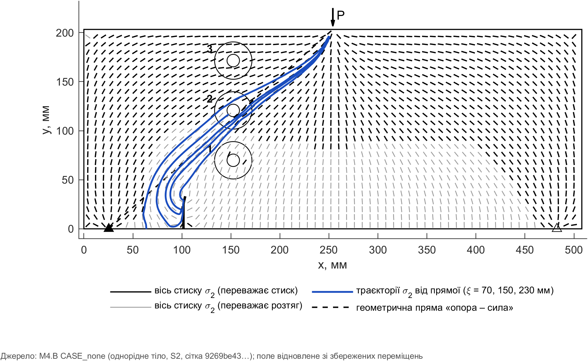
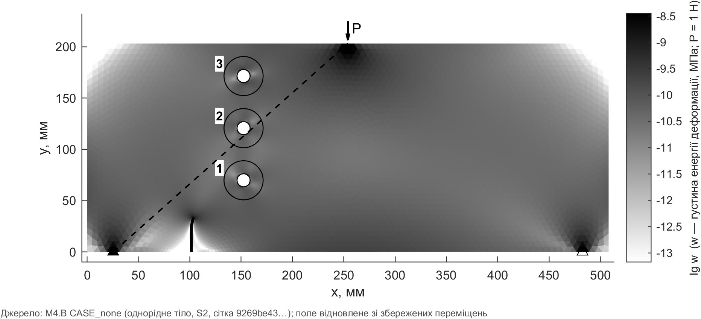
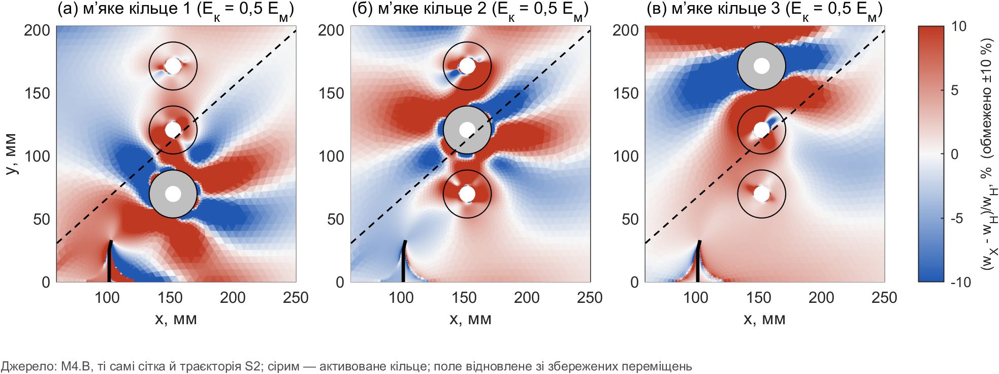
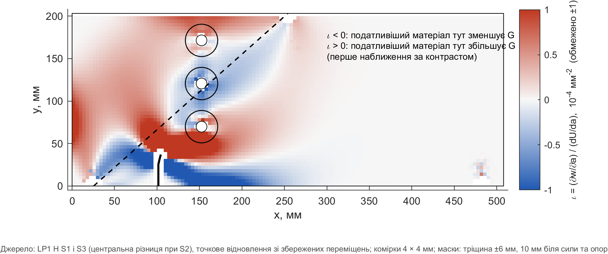
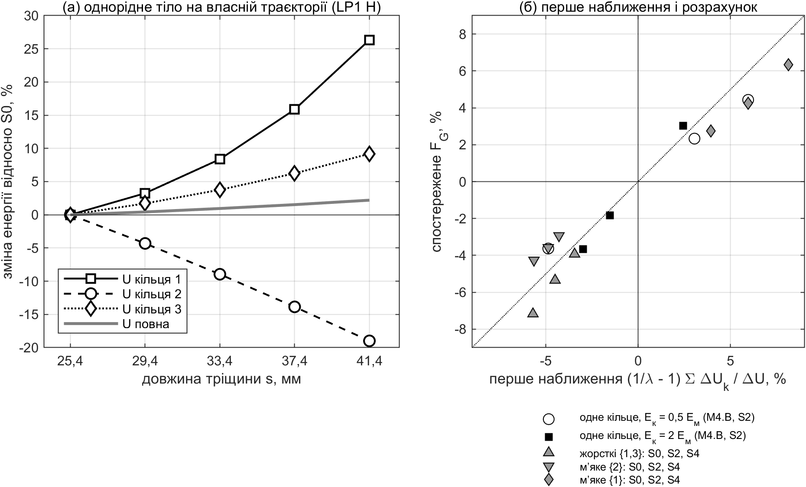

# G2-G1. Чи пояснює геометрія «опора – сила» протилежний вплив кільця 2? Дослідження збережених пружних полів

**Статус:** `G1_PARTIALLY_SUPPORTED`. Пакет зупинено на `REVIEW_STOP_M5_X6_G1_READY`. Жодної нової крайової задачі не розв’язано, нових кроків поширення немає, GO не потрібен і не створювався.

## 0. Головне

1. **Що досліджено.** Чи узгоджується з наявними пружними полями гіпотеза G1: пряма від лівої опори до сили проходить біля отвору 2, а кільця 1 і 3 лежать по різні боки від неї, і це могло б пояснити протилежний знак впливу кільця 2 на G. Використано лише збережені розв’язки M4.B (S2), R1 (інше сімейство сіток, S2) і однорідну траєкторію LP1 H (S0–S4).
2. **Відновлення полів перевірено.** Напруження, деформації й густину енергії w відновлено зі збережених переміщень. Енергії елементів збігаються зі збереженими до 1,9·10⁻¹³. Тотожність Бетті відтворює збережені зміни податливості з похибкою не більше 1,9·10⁻¹⁰.
3. **G1b: кільце 2 справді в особливому стані, але не так, як очікувалося.** Кільце 2 стиснуте в обох напрямках із переважанням стиску (75 % площі), і вісь стиску відхиляється від прямої лише на 5,1°. Кільце 1 переважно розтягнуте (88 %, вісь під 21°). Кільце 3 майже одновісно стиснуте (96 %, вісь під 27°). Кільця 1 і 3 між собою відрізняються ще більше, ніж кожне з них від кільця 2. Отже, сам тип напруженого стану знака впливу не визначає.
4. **G1a: пряма — добре наближення напрямку, але не гребінь напружень.**
   - У смузі ±10 мм навколо прямої медіанне відхилення осі стиску від прямої 11,4°, а 61 % площі лежить у межах 15°. У паралельних смугах на відстані ±30 мм ці значення 16,1°/14,8° і 45–50 %.
   - Траєкторії стиску від сили до отвору 2 проходять не далі 10 мм від прямої. Нижче отвору 2 вони відходять від неї на 26–44 мм і до опори не доходять.
   - Найбільший стиск і найбільша густина енергії лежать **над** прямою, на 38–52 мм ближче до верхньої грані, а не на самій прямій.
5. **G1c: знак визначає перерозподіл енергії під час росту тріщини.** У першому наближенні за контрастом вплив кільця k дорівнює (1/λ − 1)·(∂U_k/∂a)/(dU/da), де U_k — енергія деформації однорідного тіла в області кільця. На однорідній траєкторії від S0 до S4 енергія кільця 2 **падає** на 19,0 %, а кілець 1 і 3 **зростає** на 26,3 % і 9,2 %.
   - Перше наближення правильно дає знак у 21 із 21 порівняння.
   - Відношення «розрахунок / наближення» стабільні: 0,68–0,78 для м’яких кілець і 1,14–1,26 для жорстких.
6. **Карта впливу ∂w/∂a.** Вона показує від’ємну смугу шириною 50–75 мм, що тягнеться вздовж верхньої (ближчої до сили) частини прямої «опора – сила» і повністю охоплює кільце 2. Кільця 1 і 3 лежать поза нею, у додатних областях. Нижня частина прямої, біля вершини тріщини, у цю смугу не входить: там переважає ближнє поле вершини.
7. **Вердикт: `G1_PARTIALLY_SUPPORTED`.**
   - *Встановлено:* розташування кільця 2 вздовж прямої відповідає реальній особливості поля — смузі, яка розвантажується в міру росту тріщини. Перше наближення кількісно пов’язує цей перерозподіл зі знаком і порядком величини впливу на G.
   - *Не встановлено:* що пряма є траєкторією головних напружень чи гребенем стиску. Також не встановлено, що механізм саме «розвантаження діагональної стиснутої смуги»: цей опис узгоджений із даними, але не виділений окремим контрольованим експериментом.

## 1. Питання і гіпотеза

**G1 (гіпотеза, не встановлений механізм).** Пряма від шарніра (25,4; 0) до точки сили (254; 203,2) проходить на відстані 5,8 мм від центру отвору 2. Кільце 1 лежить на 32,2 мм нижче неї, кільце 3 — на 43,8 мм вище. Можливо, кільце 2 стоїть на шляху передачі навантаження, а кільця 1 і 3 — поза ним, і тому впливи на G протилежні:

- м’яке кільце дає +4,43 % (кільце 1), −3,63 % (кільце 2), +2,33 % (кільце 3);
- жорстке кільце дає −3,65 %, +3,04 %, −1,82 % (M4.B, S2).

Перевірялося чотири питання:

- **G1a:** чи збігається пряма з напрямком або областю переважної передачі напружень чи енергії;
- **G1b:** чи відрізняється напружений стан біля кільця 2 від стану біля кілець 1 і 3;
- **G1c:** чи корелюють локальні зміни поля зі знаками впливу кілець;
- **G1d:** чи достатньо цього, щоб пояснити зміни G.

## 2. Наявні поля (WP2.1)

| Джерело | Конфігурації | Збережено | Відновлено тут |
|---|---|---|---|
| M4.B, заморожений S2 (сітка `9269be43…`, 28 625 T3, 3×76 хорд) | однорідне тіло і шість одиночних кілець (E_к/E_м = 0,5 і 2) | переміщення u, енергії елементів і кілець, власник кільця, фаза, КІН, податливість | напруження, деформації, головні напруження та їхні осі, w, перевірка Бетті |
| R1, S2alt (сітка `0627dd3a…`, 35 125 T3, 3×112 хорд) | ті самі сім випадків, інше сімейство сіток | те саме | ті самі величини (стійкість до сітки) |
| LP1 H, однорідна власна траєкторія S0–S4 (відтворена A0 побітово) | однорідне тіло | u, енергії елементів і кілець, власник, G | поля в кожному стані, карта ∂w/∂a при S2 |
| LP1, архітектури S0, S2, S4 | жорсткі {1,3}, м’яке {2}, м’яке {1} | G | — |

Напружень у записах немає, їх **відновлено** з u тією самою кінематикою T6 і матрицею пружності плоского напруженого стану з урахуванням фази елемента, що й у розв’язувачі. Перевірки:

- **Енергії елементів** (правило 3 точок) збігаються зі збереженими з максимальною відносною похибкою 1,6·10⁻¹³ (M4.B), 1,9·10⁻¹³ (R1) і 1,1·10⁻¹³ (LP1 H). Енергії кілець, підсумовані за власником, збігаються до 5,3·10⁻¹¹.
- **Записи.** SHA файлів M4.B і R1 збігаються з закоміченими маніфестами (у клоні виконання лежать лише файли MAT). Маніфести LP1 перевіряються засобом `g2_trajectory_record`.
- **Тотожність Бетті.** ΔC = (t/P²)·∫σ_H : (S_X − S_H) : σ_X dA, де інтеграл береться по активному кільцю, відтворює збережену зміну податливості всіх 12 одиночних випадків з похибкою не більше 1,9·10⁻¹⁰.

Обмеження даних:

- Активація окремих кілець є лише при S2.
- Для архітектур на власних траєкторіях використано тільки G.
- Інтерфейсні напруження, окрім хордових тракцій, не зберігалися.
- Для G1 вони не потрібні.

## 3. Метод

- **Поля елементів.** Значення беруться в центроїді (для T6 це середнє значення лінійного поля), енергія — правилом 3 точок. На рисунках кожен елемент зафарбовано своїм кольором, без інтерполяції. Отвори є порожнинами без елементів.
- **Точкові значення.** У довільній точці значення обчислюється з поля того елемента, який її містить. Між елементами, через порожнини, тріщину чи інтерфейси нічого не інтерполюється.
- **Траєкторії σ₂.** Це лінії, дотичні до осі найбільшого стиску, яка в межах елемента стала. Застосовано схему RK2 з кроком 0,5 мм; лінія зупиняється в порожнині, поза тілом або біля сили чи шарніра. Траєкторії запускали з прямої на відстанях ξ = 70, 150, 230 мм від шарніра в обидва боки.
- **Перше наближення за контрастом.** За сталої сили P доповнювальна енергія стаціонарна. Тому заміна матеріалу кільця k з E_м на λE_м (ν те саме) змінює енергію так: U_X = U_H + (1/λ − 1)·U_k^H + O((1/λ − 1)²). Звідси G_X − G_H ≈ (1/λ − 1)·∂U_k^H/∂a. Для архітектури з кількома кільцями внески підсумовуються.
  - Ця оцінка стає точною при λ → 1. При λ = 0,5 і λ = 2 є поправки другого порядку, і їхній розмір перевіряється прямо (розд. 6.3).
  - Похідні взято скінченними різницями на траєкторії LP1 H: вперед при S0, центральну при S2 і назад при S4.
- **Густина впливу.** ι(x) = (∂w_H/∂a)/(dU/da) — центральна різниця S1–S3 у вузлах сітки з кроком 1 мм, середнє по комірках 4×4 мм.
  - ι < 0 означає, що податливіший матеріал у точці x у першому наближенні зменшує G.
  - Маски: тріщина ±6 мм і по 10 мм навколо сили, шарніра й катка.

## 4. G1a — пряма і передача напружень

**Таблиця 1.** Смуги шириною ±10 мм, паралельні прямій. ξ від 40 до L − 40 мм; області кілець (< 25 мм від центру) і околиця тріщини (< 10 мм) виключені. Однорідне тіло, S2, M4.B; σ₂ у 10⁻⁴ МПа при P = 1 Н.

| Зміщення смуги, мм | Медіана кута осі σ₂ до прямої | Частка ≤ 15° | Частка ≤ 30° | Переважає стиск | Середнє σ₂ |
|---|---|---|---|---|---|
| −60 | 27,9° | 0,03 | 0,67 | 0,39 | −2,60 |
| −30 | 16,1° | 0,45 | 0,71 | 0,62 | −3,41 |
| 0 (пряма) | 11,4° | 0,61 | 0,89 | 0,44 | −3,81 |
| +30 | 14,8° | 0,50 | 0,75 | 0,83 | −4,70 |
| +60 | 15,0° | 0,50 | 0,82 | 1,00 | −4,40 |

- **Напрямок.** Найкраще з осями стиску узгоджується саме смуга прямої (медіана 11,4°, 61 % площі в межах 15°). Перевага над паралельними смугами помірна, а не різка.
- **Величина.** Найбільший стиск лежить вище прямої. У поперечних профілях на ξ = 150, 200 і 230 мм мінімум σ₂ припадає на s = +44, +38 і +52 мм, тобто ближче до верхньої грані. Виняток — ξ = 175 мм, де мінімум σ₂ при s = 0 дає концентрація біля отвору 2.
- **Енергія.** Середня густина енергії в смугах 0 і +30 мм майже однакова (5,63·10⁻¹¹ і 5,69·10⁻¹¹ МПа). Отже, гребеня енергії вздовж прямої немає.
- **Траєкторії σ₂** (рис. G1-1):
  - Від сили до отвору 2 вони йдуть не далі 9,8 мм від прямої; траєкторія з ξ = 70 мм у бік сили впирається в отвір 2.
  - У бік шарніра всі три відходять від прямої на 25,7–44,0 мм. Одна виходить на нижню грань при x = 63,8 мм (за 38 мм від шарніра), дві повертають біля лівого берега тріщини.
  - Жодна з них шарніра не досягає.

**Висновок G1a — частково.** Верхня половина прямої, від отвору 2 до сили, добре наближує напрямок і хід траєкторій стиску. Нижня половина цього не робить. Пряма не є ні гребенем стиску, ні гребенем енергії, тож називати її траєкторією головних напружень не можна.

## 5. G1b — середовище кілець

**Таблиця 2.** Усереднений тензор напружень в області кільця (6,35–19,05 мм), однорідне тіло, S2 (M4.B; σ у 10⁻⁴ МПа при P = 1 Н). Кут — між віссю стиску усередненого тензора і прямою; «стиск/розтяг» — частки площі, де переважає стиск або розтяг.

| Кільце | Відстань до прямої | σ₁ | σ₂ | Кут осі стиску | Стиск / розтяг | Кут за напруженням біля краю отвору (R²) |
|---|---|---|---|---|---|---|
| 1 | −32,2 мм | 4,24 | −1,59 | 21,1° | 0,12 / 0,88 | 21,3° (0,979) |
| 2 | +5,8 мм | 1,92 | −3,81 | 5,1° | 0,75 / 0,25 | 5,1° (0,984) |
| 3 | +43,8 мм | 0,50 | −5,72 | 27,1° | 0,96 / 0,04 | 26,9° (0,980) |

Останній стовпець оцінено незалежно: за розподілом кільцевого напруження на першому шарі елементів біля краю отвору через наближення Кірша. У смугах 19,05–25,4 мм навколо кілець ті самі кути становлять 20,8°, 5,1° і 27,1°.

На сітці R1 енергії кілець відрізняються не більше ніж на 8·10⁻⁵, енергії смуг навколо кілець — не більше ніж на 0,9 %, кути — не більше ніж на 0,4°. Отже, ці величини від сімейства сітки практично не залежать.

**Висновок G1b — так, але цього недостатньо.** Кільце 2 відрізняється тим, що його вісь стиску майже паралельна прямій (5° проти 21° і 27°), а стан стиснутий в обох напрямках. Проте кільця 1 і 3 перебувають у протилежних станах (розтяг і майже одновісний стиск), а впливають на G з одним знаком. Отже, «тип» напруженого стану знак не пояснює.

## 6. G1c — перерозподіл поля і знаки впливу

### 6.1. Що змінює активація одного кільця (S2, рис. G1-3)

М’яке кільце забирає на себе менше напружень. Поза ним густина енергії зменшується вздовж його локальної осі стиску («тінь») і збільшується в поперечному напрямку. Для кільця 2 тінь витягнута вздовж прямої «опора – сила», для кільця 1 вона нахилена приблизно на 21°.

Енергії інших кілець зростають на 2–12 % у разі м’якого кільця і падають на 2–8 % у разі жорсткого. Самі по собі ці карти показують, як розподілені напруження, але знак впливу на G з них не випливає: потрібна похідна за довжиною тріщини.

### 6.2. Що змінює ріст тріщини в однорідному тілі (S0 → S4, рис. G1-5а)

| | S0 | S2 | S4 | Зміна S0→S4 |
|---|---|---|---|---|
| U кільця 1, 10⁻⁸ Н·мм/мм | 4,499 | 4,876 | 5,684 | +26,3 % |
| U кільця 2 | 4,857 | 4,422 | 3,935 | −19,0 % |
| U кільця 3 | 6,412 | 6,653 | 7,001 | +9,2 % |
| U повна, 10⁻⁶ | 8,650 | 8,732 | 8,841 | +2,2 % |

Механічна картина така:

- **Кільце 2.** Середній стиск слабшає з −4,04 до −3,50·10⁻⁴ МПа (−13,5 %), а вісь лишається майже паралельною прямій: 4,7° → 5,5°.
- **Кільце 1.** Розтяг зростає з 3,94 до 4,74·10⁻⁴ МПа.
- **Кільце 3.** Стиск зростає з −5,60 до −5,88·10⁻⁴ МПа.

Отже, ріст тріщини розвантажує стиснуту область біля отвору 2 і довантажує розтягнуту нижню та стиснуту верхню області. Поточна смуга, що проходить уздовж прямої, віддає навантаження згину.

### 6.3. Кількісна перевірка першим наближенням

**Таблиця 3.** Одиночні кільця, S2: перше наближення (1/λ − 1)·(∂U_k/∂a)/(dU/da) за різницею S1–S3 на LP1 H проти розрахунку M4.B.

| Кільце | м’яке: наближення | м’яке: M4.B | відношення | жорстке: наближення | жорстке: M4.B | відношення |
|---|---|---|---|---|---|---|
| 1 | +5,96 % | +4,43 % | 0,743 | −2,98 % | −3,65 % | 1,226 |
| 2 | −4,87 % | −3,63 % | 0,745 | +2,44 % | +3,04 % | 1,246 |
| 3 | +3,05 % | +2,33 % | 0,764 | −1,52 % | −1,82 % | 1,197 |

На сітці R1 відношення ті самі з точністю до 0,001.

**Таблиця 4.** Архітектури: перше наближення (сума за кільцями) проти F_G на власній траєкторії LP1.

| Архітектура | S0 (вперед) | S2 (центр.) | S4 (назад) |
|---|---|---|---|
| жорсткі {1,3} | −3,45 → −3,93 % (1,141) | −4,50 → −5,35 % (1,187) | −5,70 → −7,17 % (1,258) |
| м’яке {2} | −5,65 → −4,26 % (0,754) | −4,87 → −3,58 % (0,734) | −4,29 → −2,93 % (0,683) |
| м’яке {1} | +3,94 → +2,75 % (0,697) | +5,96 → +4,24 % (0,711) | +8,14 → +6,33 % (0,778) |

При S0 геометрія спільна, тож розрахунок дає чистий прямий ефект матеріалу. При S2 і S4 до прямого ефекту додається малий залишок від різниці траєкторій.

- Знак збігається в **21 із 21** порівнянь (12 одиночних кілець на двох сітках і 9 архітектурних).
- Відношення стабільні: 0,68–0,78 (м’які) і 1,14–1,26 (жорсткі). Це очікувана поправка другого порядку: м’яке кільце саме себе частково розвантажує, а жорстке додатково притягує напруження.

### 6.4. Карта впливу (рис. G1-4)

Інтеграл карти по кожному кільцю відтворює значення із записів: 0,0606 проти 0,0596, −0,0487 проти −0,0487 і 0,0296 проти 0,0305.

**Таблиця 5.** Частка додатних значень ι у смугах, паралельних прямій (поза кільцями).

| Зміщення s, мм | −90…−60 | −60…−30 | −30…−10 | −10…10 | 10…30 | 30…60 | 60…90 |
|---|---|---|---|---|---|---|---|
| ξ 120–266 мм (бік сили) | 0,96 | 0,76 | 0,04 | 0,07 | 0,43 | 0,95 | 1,00 |
| ξ 40–120 мм (бік шарніра) | 0,11 | 0,44 | 0,51 | 0,58 | 0,68 | 1,00 | 1,00 |

- **Бік сили.** Тут ι від’ємна у смузі, що охоплює пряму.
  - Поперечні ділянки, де ι < 0, тягнуться від −24 до +30 мм на ξ = 150 мм і від −40 до +34 мм на ξ = 200 мм.
  - Ділянка тягнеться від −44 до +20 мм на ξ = 230 мм.
  - На ξ = 175 мм вона йде від −28 до 0 мм, далі перервана отвором 2, а за ним знову від’ємна від 12 до 32 мм.
- **Колона кілець** (x = 152,4 мм): ι < 0 при y від 82 до 158 мм. Це вся область кільця 2 (101,6–139,7 мм), тоді як кільця 1 (50,8–88,9 мм) і 3 (152,4–190,5 мм) зачеплені лише краєм.
- **Бік шарніра.** Тут поблизу прямої переважає додатна передня пелюстка ближнього поля вершини тріщини.

**Висновок G1c — так, кількісно.** Протилежний знак кільця 2 відповідає тому, що його область лежить у смузі, яка в міру росту тріщини розвантажується. Ця смуга тягнеться вздовж верхньої частини прямої «опора – сила». Кільця 1 і 3 лежать в областях, які ріст тріщини довантажує, і перше наближення переводить це у знак і порядок величини F_G.

## 7. G1d — що пояснено і що ні

**Пояснено:**

- Знак впливу кожного кільця на G при S0, S2 і S4.
- Порядок величини цього впливу (з множником 0,68–1,26, однаковим для кожного типу контрасту).
- Звідки береться знак: з того, як змінюється енергія однорідного тіла в області кільця під час росту тріщини.

Це наслідок стаціонарності доповнювальної енергії та тотожності Бетті, тобто енергетичний зв’язок, а не статистична кореляція трьох точок.

**Не пояснено або не встановлено:**

1. **Роль прямої.** Пряма лише описує, де лежить смуга розвантаження, а не є причиною окремо. Смуга йде вздовж прямої тільки на боці сили, а її центр зміщено від прямої на величину до ≈ 12 мм.
2. **Механізм «діагональної стиснутої смуги».** Опис «тріщина розвантажує діагональну стиснуту смугу і перекладає навантаження на згин» узгоджений із даними (табл. 2, розд. 6.2). Проте контрольованого експерименту, який виділив би саме цей механізм, немає: інше положення сили, інша опора, кільце поза прямою на тій самій висоті.
3. **Точна величина.** Перше наближення не дає точної величини F_G. Поправки другого порядку становлять 14–32 %.
4. **Межі застосовності.** Висновки отримано для однієї схеми навантаження, плоского напруженого стану, ідеального зчеплення й тріщини, що лишається в матриці, до S4.

## 8. Вердикт

**`G1_PARTIALLY_SUPPORTED`.**

Наявні поля підтверджують:

- що кільце 2 лежить в особливій області: вісь стиску майже паралельна прямій, і ця область розвантажується в міру росту тріщини;
- що саме цей перерозподіл у першому наближенні кількісно визначає протилежний знак його впливу на G.

Наявні поля не підтверджують:

- що пряма «опора – сила» є траєкторією головних напружень, гребенем стиску чи гребенем енергії;
- що «розвантаження діагональної стиснутої смуги» є доведеним механізмом, а не лише узгодженим описом;
- що візуальна концентрація енергії сама собою означає механізм екранування.

Причинний зв’язок «перерозподіл → зміна G» встановлено на рівні енергетичного першого наближення. Зв’язок «геометрія прямої → перерозподіл» лишається описовим.

## 9. Рисунки

**Рис. G1-1.** Осі найбільшого стиску σ₂ в однорідному тілі при S2 і траєкторії σ₂, запущені від геометричної прямої «опора – сила». Відрізки чорні там, де переважає стиск, і сірі там, де переважає розтяг. Джерело: M4.B CASE_none; поле відновлено зі збережених переміщень, кожен елемент має своє значення.

**Рис. G1-2.** Густина енергії деформації w в однорідному тілі при S2 (lg w, P = 1 Н; кожен елемент зафарбовано своїм кольором, отвори — порожнини). Джерело: M4.B CASE_none; поле відновлено зі збережених переміщень.

**Рис. G1-3.** Відносна зміна w поза кільцем після активації одного м’якого кільця (E_к = 0,5·E_м) на тій самій сітці й траєкторії S2: (а) кільце 1, (б) кільце 2, (в) кільце 3. Шкалу обмежено ±10 %, активоване кільце показано сірим. Джерело: M4.B; поле відновлено зі збережених переміщень.

**Рис. G1-4.** Густина впливу першого наближення ι = (∂w/∂a)/(dU/da) при S2. Синій колір (ι < 0) — податливіший матеріал тут зменшує G, червоний — збільшує. Джерело: LP1 H S1 і S3, точкове відновлення зі збережених переміщень, комірки 4×4 мм. Шкалу обмежено ±1·10⁻⁴ мм⁻²; поблизу тріщини значення більші. Маски: тріщина ±6 мм, по 10 мм навколо сили та опор.

**Рис. G1-5.** (а) Зміна енергії деформації в областях кілець і повної енергії однорідного тіла вздовж власної траєкторії S0–S4 (LP1 H). (б) Перше наближення проти розрахунку: одиночні кільця M4.B при S2 та архітектури при S0, S2 і S4 (при S2 і S4 — на власній траєкторії, тобто з малим залишком від траєкторії).

## 10. Обмеження і відкриті питання

- **Активація окремих кілець є лише при S2.** Перше наближення при S0 і S4 перевірено на архітектурах; одиночних кілець для цих станів немає.
- **Скінченні різниці взято на різних сітках станів.** Карта ∂w/∂a містить шум дискретизації: інтеграли по кільцях відрізняються від записів до 3 %. Знак у кільцях від цього не залежить.
- **Положення сили й опор у даних не змінюються**, тому пряму можна перевірити лише як опис. Контрольованою перевіркою була б інша схема навантаження або кільце, зміщене вздовж тієї самої висоти; для цього знадобилися б нові розрахунки, які тут не пропонуються і не дозволені.
- **Інтерфейси.** Не розглядалися відшарування, кінк на інтерфейсі, міцність кілець і зупинка тріщини. Висновки стосуються лише пружної рушійної сили для тріщини в матриці.

## Джерела та відтворення

- Код: `scripts/g2/m5/g1/g1_field_analysis.m` (лише читання збережених записів; жодної крайової задачі) і `scripts/g2/m5/g1/g1_figures.m`.
- Докази: `docs/research/G2_G1_evidence/` — `G1_FIELD_EVIDENCE.json`, рисунки PNG і PDF, `run_g1.m/.log`, `run_fig.m/.log`, `SANITIZATION.json`.
- Відтворення: `g1_field_analysis('<repo виконання>','<нова тека>')` і `g1_figures('<та тека>','<тека рисунків>')`. Час ≈ 4 с, вільна RAM ≥ 5 ГіБ.
- Звірка чисел цього документа з доказами: `python -I scripts/g2/m5/g1/g1_report_numbers_check.py <worktree>`.
