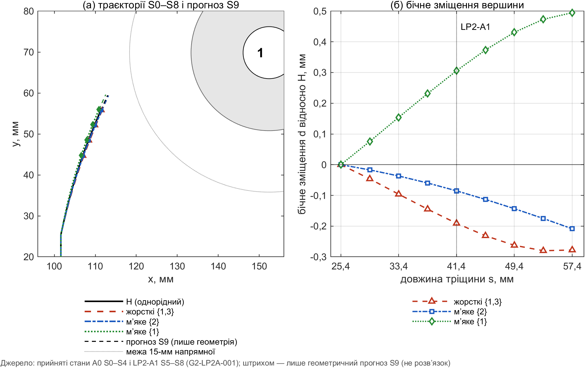
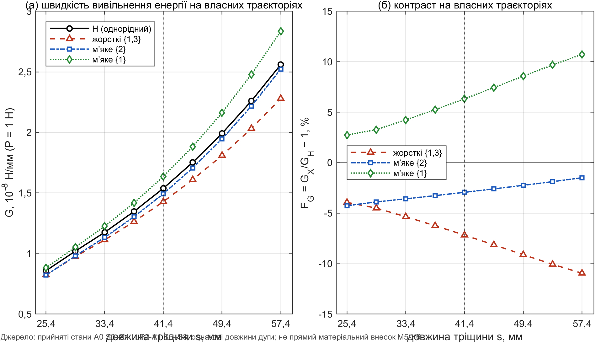
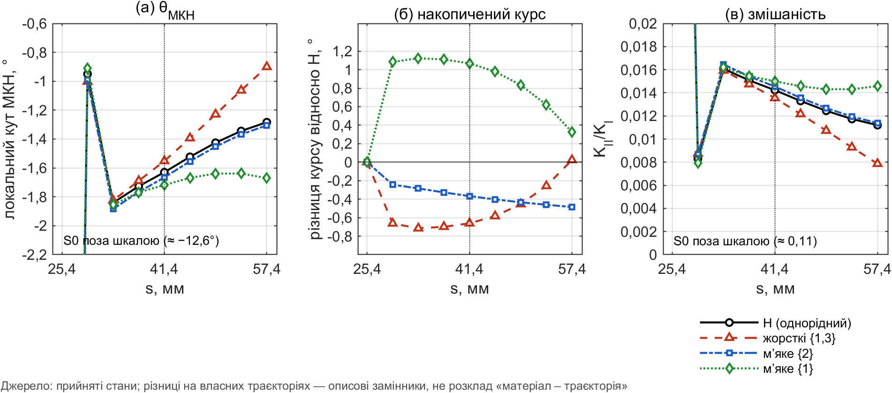
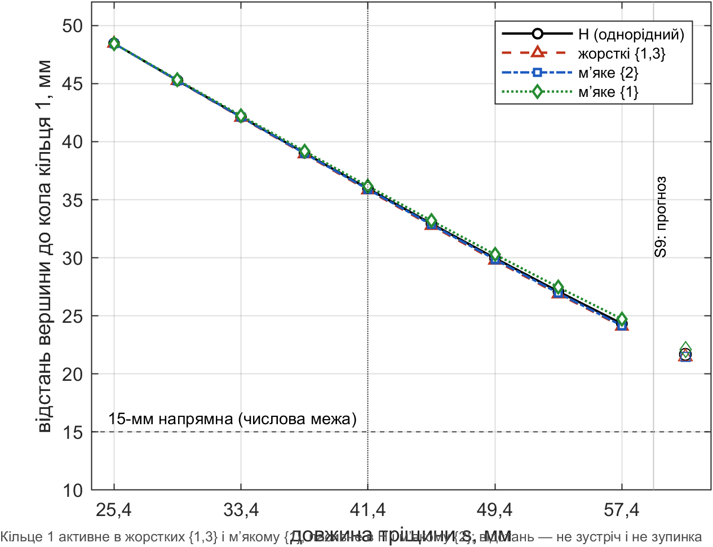

# G2-LP2-A1. Продовження траєкторій тріщини в матриці S5–S8: результати кампанії

**Статус:** `REVIEW_STOP_LP2A1_DEMONSTRATION`. Кампанію `G2-LP2A-001` (прогін `run_lp2a_s5_s8_v1`) виконано повністю, без жодного HOLD.

| | |
|---|---|
| Допущено спроб | 16 |
| Фізичних розв’язків | 16 |
| Прийнятих станів | 16 |
| Невдалих спроб | 0 |

Журнал закрито, перевірку VERIFY_ONLY пройдено, архів перевірено на двох фізично окремих носіях. GO відкликано окремим комітом, і виклик після відкликання відхиляється.

**Підстава:** рішення дослідника `GO_LP2A_PHYSICAL` ([PR #70, коментар 7159870558](https://github.com/mfs9697/NewMetacomp/pull/70#issuecomment-7159870558)) на схваленій голові `3b7bdb9`, кваліфікація v2 (107/107). Коміти: GO `1f200fa`, докази `72cb18e`, відкликання `ee4a28a`.

## 0. Головне

1. **Усі чотири траєкторії продовжено до S8** (довжина дуги 57,4 мм) із незміненою схемою LP1: крок МКН 4 мм, захищена вершина p010, 15-мм напрямна, незмінений генератор сітки. Сітки S5–S8 (29 217–29 879 T3) пройшли аудит 34/34. Кожен випадок завершився `CAMPAIGN_LIMIT_REACHED`, а геометричний прогноз S9 для всіх чотирьох — `MATRIX_ADVANCE`.
2. **H1 підтверджено.** Екранування жорстких {1,3} посилюється монотонно: F_G = −7,17 % у S4 і −10,95 % у S8.
3. **H2 підтверджено.** Екранування м’якого {2} слабшає монотонно, але лишається від’ємним: −2,93 % → −1,49 %. Зміни знака немає. Класифікація м’якого {2} лишається НЕРОЗРІЗНЕНОЮ.
4. **Підсилення м’якого {1} зростає:** +6,33 % → +10,73 %.
5. **Відхилення (лише опис, не розклад «матеріал – траєкторія»).**
   - Різниця курсів відносно H зменшується: для жорстких {1,3} від −0,66° до +0,02°, для м’якого {1} від +1,07° до +0,33°.
   - Різниці локальних кутів МКН мають протилежний знак: +0,38° і −0,39° у S8.
   - Бічне зміщення жорстких {1,3} насичується (−0,28 мм у S7 і S8), у м’якого {1} уповільнюється (+0,49 мм).
   - Для м’якого {2} курс і зміщення й далі поступово розходяться (−0,48°, −0,21 мм).
6. **Наближення до кілець — не зустріч.** У S8 вершини лежать за 24,1–24,7 мм від кола кільця 1 і до межі 15-мм напрямної ще не дійшли. H4 — `NOT_TESTABLE_WITHIN_LP2_A1`.
7. **Межі тлумачення.** Це умовні продовження ЛМР/МКН за P = 1 Н. Фізичного поширення, зупинки чи взаємодії з інтерфейсом вони не встановлюють.

## 1. Виконання і перевірки

**Активація** (GO ще не існував):

- **Перша спроба** зупинилася на `HOLD_LP2A_BACKUP_DEVICE`: не було знімного носія. Нічого не записано.
- **Повторна активація після його підключення.** Пройдено:
  - незалежну перевірку закріплених значень (політика `093a546b…`, спільний відбиток `7e568370…`, LP2 `357dfdcd…`, маніфест батьківських станів `0dcc572f…`, контракт v2 `34fedbda…`) і токена;
  - закріплення STATE, MESH і SOLUTION чотирьох батьківських станів A0 S4;
  - чотири сухі виклики, що відтворюють прогнози S5;
  - пробу `Run=true` з правильним токеном: `G2LP2:HOLD_UNAUTHORIZED_STATE`, жодного запису.
- **Ресурси:** R2023a з PDE Toolbox, один процес MATLAB, 8,53 ГіБ усередині MATLAB, знімний USB-носій D:.

**Кампанія.** Її запускала зовнішня обгортка з правилом глобальної зупинки: наступний випадок починався лише після стану `TERMINAL_*`, перевірки ланцюга, TERMINAL і журналу та за відсутності HOLD у журналі.

- Чотири виклики (H, жорсткі {1,3}, м’яке {2}, м’яке {1}) тривали 32,7–36,3 с кожен.
- Кожен розв’язок — 1,9–2,1 с.
- У журналі: RECEIPT, 16 ADMIT і CLOSED; HOLD — 0.

**Перевірка після закриття:**

- **VERIFY_ONLY.** Чотири виклики дали `VERIFIED_CAMPAIGN_LIMIT_REACHED`; розв’язків 0; файли прогону й журналу побітово не змінилися.
- **Повний верифікатор** (`g2_lp2_verify`): 0 проблем. Для кожного стану перевірено ідентичність, токен, хеші MESH/PHASE/SOLUTION і зв’язки між ними, рівність знакових K, рекурсію від батьківського стану; також TERMINAL-записи, журнал і прив’язку CLOSED.
- **Числові перевірки 16/16:**
  - усі 16 критеріїв КІН у кожному стані;
  - перераховані θ_МКН (≤ 10⁻¹²°), G (відносно ≤ 10⁻¹²) і J;
  - мітки активації й кількості фаз відповідають масці;
  - COD–EDI ≤ 0,88 % (поріг 3 %), |J/G − 1| ≤ 3,1·10⁻⁵.
- **Захищені дерева.** Усі 541 файл до й після кампанії однакові (SHA дерева `20f2d54f…`).
- **Архів.** `NewMetacomp_G2_LP2A_Records_20261125.zip`, SHA-256 `82740133111dab52723f24cfb49a84b25cd115bae411be0dd347c9fd313397ee`, 44 116 318 байтів, 172 члени (158 файлів прогону й журналу, журнали подій і докази). Його перевірено в локальній резервній теці на C: і на знімному USB-носії D:.
- **Відкликання.** GO видалено (`ee4a28a`). Виклики з правильним токеном для H і м’якого {1} дали `G2LP2:HOLD_UNAUTHORIZED_STATE`; 158 файлів кампанії, перелік `outputs` і стан git не змінилися.

## 2. Прийняті стани S5–S8

**Таблиця 1.** Прийняті стани: P = 1 Н, K у МПа·√мм, G у Н/мм; курс відраховується від осі x.

%| Випадок | Стан | s, мм | вершина, мм | курс, ° | K_I | K_II | K_II/K_I | G | θ_МКН, ° |
|---|---|---|---|---|---|---|---|---|---|
| H | S5 | 45,4 | (106,9327; 44,6599) | 71,257 | 7,567420·10⁻³ | +1,006185·10⁻⁴ | 0,01330 | 1,75257·10⁻⁸ | −1,5230 |
| H | S6 | 49,4 | (108,3182; 48,4123) | 69,734 | 8,067372·10⁻³ | +1,003865·10⁻⁴ | 0,01244 | 1,99175·10⁻⁸ | −1,4254 |
| H | S7 | 53,4 | (109,7966; 52,1291) | 68,309 | 8,593343·10⁻³ | +1,008455·10⁻⁴ | 0,01174 | 2,25989·10⁻⁸ | −1,3443 |
| H | S8 | 57,4 | (111,3618; 55,8101) | 66,965 | 9,146881·10⁻³ | +1,024807·10⁻⁴ | 0,01120 | 2,56037·10⁻⁸ | −1,2835 |
| жорсткі {1,3} | S5 | 45,4 | (107,1557; 44,5972) | 70,674 | 7,253153·10⁻³ | +8,823795·10⁻⁵ | 0,01217 | 1,60998·10⁻⁸ | −1,3936 |
| жорсткі {1,3} | S6 | 49,4 | (108,5709; 48,3385) | 69,281 | 7,691232·10⁻³ | +8,251016·10⁻⁵ | 0,01073 | 1,81027·10⁻⁸ | −1,2290 |
| жорсткі {1,3} | S7 | 53,4 | (110,0660; 52,0486) | 68,052 | 8,149566·10⁻³ | +7,564585·10⁻⁵ | 0,00928 | 2,03240·10⁻⁸ | −1,0634 |
| жорсткі {1,3} | S8 | 57,4 | (111,6297; 55,7303) | 66,988 | 8,631902·10⁻³ | +6,785083·10⁻⁵ | 0,00786 | 2,28004·10⁻⁸ | −0,9006 |
| м’яке {2} | S5 | 45,4 | (107,0416; 44,6286) | 70,855 | 7,468624·10⁻³ | +1,013394·10⁻⁴ | 0,01357 | 1,70712·10⁻⁸ | −1,5542 |
| м’яке {2} | S6 | 49,4 | (108,4554; 48,3704) | 69,301 | 7,976390·10⁻³ | +1,011381·10⁻⁴ | 0,01268 | 1,94709·10⁻⁸ | −1,4524 |
| м’яке {2} | S7 | 53,4 | (109,9637; 52,0752) | 67,848 | 8,512358·10⁻³ | +1,016579·10⁻⁴ | 0,01194 | 2,21750·10⁻⁸ | −1,3680 |
| м’яке {2} | S8 | 57,4 | (111,5599; 55,7429) | 66,480 | 9,078537·10⁻³ | +1,034358·10⁻⁴ | 0,01139 | 2,52227·10⁻⁸ | −1,3052 |
| м’яке {1} | S5 | 45,4 | (106,5709; 44,7559) | 72,237 | 7,843771·10⁻³ | +1,142463·10⁻⁴ | 0,01457 | 1,88298·10⁻⁸ | −1,6682 |
| м’яке {1} | S6 | 49,4 | (107,9016; 48,5280) | 70,569 | 8,405843·10⁻³ | +1,202743·10⁻⁴ | 0,01431 | 2,16249·10⁻⁸ | −1,6388 |
| м’яке {1} | S7 | 53,4 | (109,3397; 52,2606) | 68,930 | 8,999679·10⁻³ | +1,287434·10⁻⁴ | 0,01431 | 2,47882·10⁻⁸ | −1,6385 |
| м’яке {1} | S8 | 57,4 | (110,8838; 55,9505) | 67,291 | 9,624798·10⁻³ | +1,403784·10⁻⁴ | 0,01459 | 2,83516·10⁻⁸ | −1,6705 |%

## 3. Енергетичний контраст на власних траєкторіях

**Таблиця 2.** G_H і F_G(s) = G_X(s)/G_H(s) − 1 на однакових довжинах дуги. Стани S0–S4 — A0/LP1, S5–S8 — LP2-A1. Це контрасти на власних траєкторіях, а **не** прямий матеріальний внесок M5-X6.

%| s, мм | G_H, 10⁻⁸ Н/мм | F_G жорсткі {1,3} | F_G м’яке {2} | F_G м’яке {1} |
|---|---|---|---|---|
| 25,4 | 0,8585 | −3,931 % | −4,259 % | +2,746 % |
| 29,4 | 1,0201 | −4,497 % | −3,881 % | +3,274 % |
| 33,4 | 1,1756 | −5,348 % | −3,577 % | +4,239 % |
| 37,4 | 1,3477 | −6,241 % | −3,260 % | +5,258 % |
| 41,4 | 1,5390 | −7,173 % | −2,932 % | +6,329 % |
| 45,4 | 1,7526 | −8,136 % | −2,593 % | +7,441 % |
| 49,4 | 1,9917 | −9,111 % | −2,242 % | +8,573 % |
| 53,4 | 2,2599 | −10,066 % | −1,875 % | +9,688 % |
| 57,4 | 2,5604 | −10,949 % | −1,488 % | +10,732 % |%

- **H1 (жорсткі {1,3}): `SUPPORTED`.** F_G < 0 у кожній точці S4–S8 і строго спадає. На S4–S8 кожен 4-мм крок додає 0,88–0,98 відсоткового пункту.
- **H2 (м’яке {2}): `SUPPORTED`.** F_G < 0 у кожній точці S4–S8 і строго зростає до нуля, приблизно на 0,34–0,39 відсоткового пункту за крок, без зміни знака. Простою екстраполяцією знак змінився б біля s ≈ 73 мм. Це лише геометрична оцінка, а не прогноз, і поза LP2-A1 вона не перевірена.
- **м’яке {1}:** підсилення зростає на 1,05–1,13 відсоткового пункту за крок.

## 4. Відхилення траєкторій

**Таблиця 3.** Бічне зміщення d = (x_X − x_H)·n_H, різниця курсів і різниця локальних кутів МКН відносно H.

%| Архітектура | величина | S4 | S5 | S6 | S7 | S8 |
|---|---|---|---|---|---|---|
| жорсткі {1,3} | d, мм | −0,1909 | −0,2313 | −0,2626 | −0,2801 | −0,2778 |
| жорсткі {1,3} | Δкурс, ° | −0,661 | −0,583 | −0,454 | −0,257 | +0,023 |
| жорсткі {1,3} | Δθ_МКН, ° | +0,0778 | +0,1294 | +0,1964 | +0,2809 | +0,3829 |
| м’яке {2} | d, мм | −0,0852 | −0,1131 | −0,1432 | −0,1752 | −0,2087 |
| м’яке {2} | Δкурс, ° | −0,367 | −0,403 | −0,434 | −0,461 | −0,484 |
| м’яке {2} | Δθ_МКН, ° | −0,0356 | −0,0312 | −0,0270 | −0,0237 | −0,0217 |
| м’яке {1} | d, мм | +0,3057 | +0,3735 | +0,4309 | +0,4732 | +0,4948 |
| м’яке {1} | Δкурс, ° | +1,068 | +0,979 | +0,834 | +0,621 | +0,327 |
| м’яке {1} | Δθ_МКН, ° | −0,0888 | −0,1452 | −0,2134 | −0,2942 | −0,3870 |%

- **Лише опис.** Різниці локальних кутів МКН на власних траєкторіях описують кроки напрямку. Розкладом на матеріал, траєкторію та взаємодію вони не є (такий розклад при S4 зробила M5-X6).
- **Що спостерігається:**
  - Для жорстких {1,3} і м’якого {1} знак Δθ_МКН протилежний знаку різниці курсів, тож ця різниця зменшується: курс жорстких {1,3} у S8 практично збігся з курсом H (+0,02°), а бічне зміщення насичується.
  - Для м’якого {2} Δθ_МКН має той самий знак, що й різниця курсів (обидві від’ємні), тож курс і зміщення поступово розходяться.
- **Чого це не доводить:** збіжності траєкторій, механізму компенсації чи її продовження за S8.
- **Змішаність мала:** K_II/K_I = 0,008–0,015 на S5–S8, найменша в жорстких {1,3} (0,0079 у S8).

## 5. Відстані й завершальні класифікації

**Таблиця 4.** Завершальні записи.

%| Випадок | класифікація | останній стан | маска | до кілець 1 / 2 / 3 у S8, мм | найближче кільце | обмеження прогнозу S9 | обірвано межею S8 |
|---|---|---|---|---|---|---|---|
| H | CAMPAIGN_LIMIT_REACHED | S8 | 000 | 24,32 / 57,69 / 103,66 | 1 (пасивне) | немає (MATRIX_ADVANCE) | так |
| жорсткі {1,3} | CAMPAIGN_LIMIT_REACHED | S8 | 101 | 24,10 / 57,61 / 103,64 | 1 (активне) | немає (MATRIX_ADVANCE) | так |
| м’яке {2} | CAMPAIGN_LIMIT_REACHED | S8 | 010 | 24,16 / 57,64 / 103,65 | 1 (пасивне) | немає (MATRIX_ADVANCE) | так |
| м’яке {1} | CAMPAIGN_LIMIT_REACHED | S8 | 100 | 24,73 / 57,82 / 103,68 | 1 (активне) | немає (MATRIX_ADVANCE) | так |%

- **До кілець.** Вершини в S8 лежать за 24,1–24,7 мм від кола кільця 1, за 57,6–57,8 мм від кільця 2 і за 103,6–103,7 мм від кільця 3. Від кіл отворів — на 12,7 мм більше.
- **До країв плити:** ≈ 55,7–56,0 мм до нижнього, 147,2–147,5 мм до верхнього.
- **Межа кампанії.** Усі чотири траєкторії обірвала стеля S8, а не наближення. Кандидати S9, обчислені лише геометрично, не порушують жодного обмеження.
- **Активні й пасивні кільця.** Кільце 1 активне в жорстких {1,3} і м’якому {1} та пасивне в H і м’якому {2}. Відстань до нього — не зустріч і не зупинка.
- **H4 — `NOT_TESTABLE_WITHIN_LP2_A1`.**

## 6. Рисунки

**Рис. LP2A-1.** (а) Прийняті траєкторії S0–S8: маркери позначають S5–S8, штрих — геометричний прогноз S9 (не розв’язок); показано межу 15-мм напрямної біля кільця 1. (б) Бічне зміщення вершини відносно H.

**Рис. LP2A-2.** (а) G на власних траєкторіях; (б) F_G(s). Вертикальна лінія s = 41,4 мм — початок LP2-A1.

**Рис. LP2A-3.** (а) Локальний кут МКН; (б) різниця курсу відносно H; (в) K_II/K_I. S0 поза шкалою.

**Рис. LP2A-4.** Відстань вершини до кола кільця 1. Пунктир — числова межа 15-мм напрямної; окремі маркери — геометричний прогноз S9.

## 7. Обмеження

- **Похибка дискретизації.** Усі нові стани розраховано на одному рівні сітки. Похибку дискретизації для S5–S8 не сертифіковано; як інформацію наводимо масштаб уточнення A1 при S4 (|ΔF_G| ≤ 5·10⁻⁶).
- **S8 — межа кампанії, а не результат.** Наступні стани потребують LP2-A2 (парування вузлів берегів); підхід ближче за ≈ 19 мм до кільця — LP2-B.
- **Умовність траєкторій.** Це ЛМР/МКН за одиничного навантаження, без G_c, в’язкості руйнування чи R-кривої.
- **Поза моделлю:** зупинка, проникнення в інтерфейс і відшарування.

## Джерела та відтворення

- **Докази:** `docs/research/G2_LP2_evidence/campaign_20261125/`:
  - активація — `LP2_ACTIVATION_HASHCHECK*.json`, `LP2_ACTIVATION_CHECKS_*.json`, журнали;
  - кампанія — `lp2a_campaign.m/.log`, `LP2A_CALLS.json`;
  - перевірка й аналіз — `lp2a_verify_analyze.m/.log`, `LP2A_VERIFY_ONLY.json`, `LP2A_ANALYSIS.json`;
  - захищені дерева, маніфест прогону й журналу, запис архіву, проба після відкликання, рисунки.
- **Генерація й звірка таблиць 1–4:** `python -I scripts/g2/lp2/lp2a_report_tables.py <repo>`.
- **Рисунки:** `scripts/g2/lp2/g2_lp2a_figures.m`.
