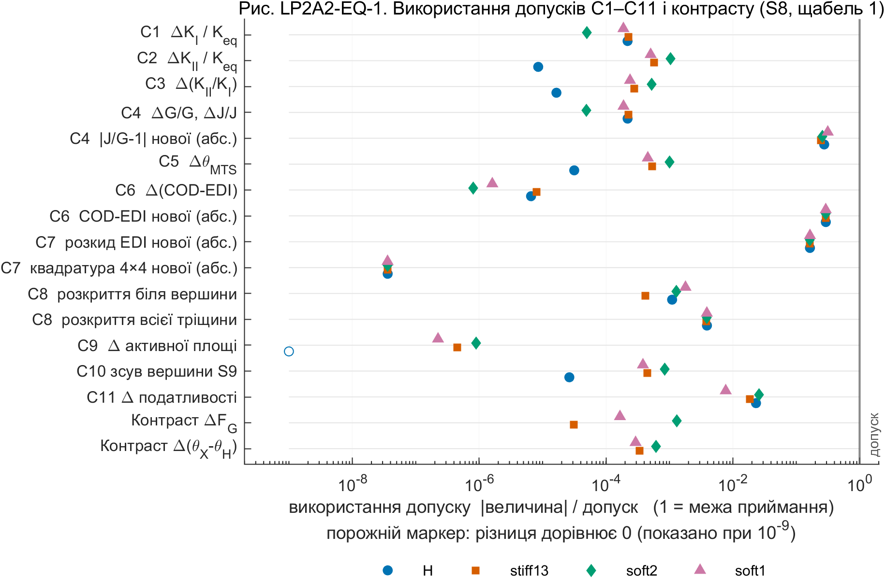
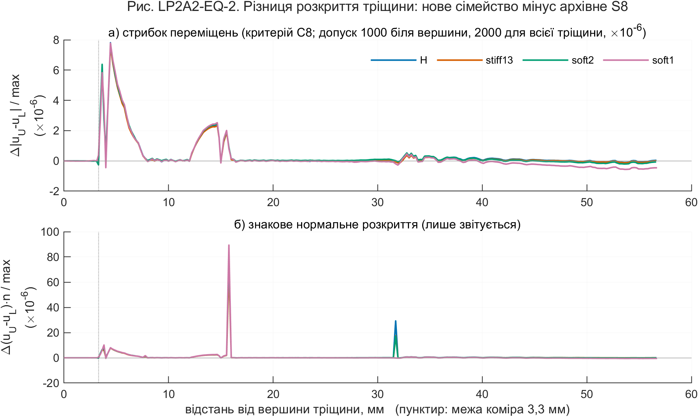

# G2-LP2-A2. Демонстрація еквівалентності КІН, активація A2 (кампанія G2-LP2A2-EQ-001)

Чорновий PR #71. Авторизація дослідника: https://github.com/mfs9697/NewMetacomp/pull/71#issuecomment-7171931196. Рецензія готовності: https://github.com/mfs9697/NewMetacomp/pull/71#pullrequestreview-6063423416. Схвалена голова: `a4561f88dfeda31752ae6c268d2d4d74e16b60a7`. Рецензія демонстрації A2 (голова `2a25973a8b7fc4e6c10c19a01b4243e5ffddafc8`): https://github.com/mfs9697/NewMetacomp/pull/71#pullrequestreview-6063867614. Закриття відтворення лише на читання: розділ 10 (стоп `REVIEW_STOP_LP2A2_EQ_CLOSED`).

## 0. Головне

- **Результат обгортки: `EQUIVALENT`.** Чотири розв’язки на фіксованих архівних геометріях S8 (EQ-H, EQ-stiff13, EQ-soft2, EQ-soft1). Сітка — нове сімейство з парними вузлами берегів, щабель 1 (0,45 мм).
- **Лічильники.**
  - Виклики точки входу `g2_lp2a2_eq_external_run`: 1.
  - Виклики обгортки `g2_lp2a2_eq_campaign`: 1.
  - Допуски драйвера до розв’язку: 4.
  - Завершені фізичні розв’язки: 4.
  - Пройдені порівняння: 4 з 4.
  - Повторів, запасних кроків сітки, змін джерел і допусків не було.
- **Критерії.** Усі критерії C1–C11 пройдено в усіх чотирьох розв’язках. Архітектурний контраст пройдено. Найбільша використана частка допуску серед різницевих критеріїв — 2,6 % (C11, податливість, soft2). Решта — від 10⁻⁷ до 4·10⁻³ допуску.
- **Незалежний аудит Python: `EQUIVALENT_CONFIRMED`.**
  - Перевірено повноту записів, зв’язки SHA-256, тотожність, геометрію і щабель.
  - Критерії перераховано з блоків K.
  - Контраст перераховано і він збігається з обгорткою.
- **Повторне відтворення.** Формальний результат `g2_lp2a2_eq_verify` — `VERIFY_HOLD`. Причина — дефект інструмента відтворення, а не розбіжність (розділ 6). Відтворення перерахувало pass = true для всіх чотирьох розв’язків; усі 11 критеріїв і всі метрики збігаються зі збереженими точно (різниця 0). Записи не змінено. Повідомляємо про це явно; рішення — за рецензією.
  - Рецензія (https://github.com/mfs9697/NewMetacomp/pull/71#pullrequestreview-6063867614) прийняла числову еквівалентність і кваліфікувала це як дефект представлення, а не числовий HOLD. Закрито окремим верифікатором лише на читання: розділ 10 (`VERIFIED_V2`; історичний `VERIFY_HOLD` збережено).
- **Закриття.**
  - GO відкликано окремим комітом.
  - Після відкликання правильний токен відхиляється для всіх чотирьох ID і для обгортки.
  - Архів зберігається на двох фізичних пристроях.
  - 699 захищених записів не змінено.
- **Обсяг.** Продовження S9–S11 лишається HOLD. Розрахунків S9, нових прийнятих станів, розрахунків на запасних кроках і LP2-B немає.

## 1. Хронологія (2026-11-25)

| Крок | Результат |
|---|---|
| Попередня перевірка (Python), голова `a4561f8` | Перевірку хешів пройдено 13/13. Токен збігається з авторизацією байт у байт. Докази v3 `75057751…`. 20 архівних посилань S8 і 699 захищених файлів — без змін. GO і вихідної папки немає, дерево чисте |
| Перевірка перед стартом (`lp2a2_eq_prestart_check.ps1`, 8,2 ГіБ, без зміни порогу) | Спершу відмова: 8,059 ГіБ. Після очікування — пройдено: 8,201 ГіБ, 0 процесів MATLAB, D: знімний |
| Перевірки MATLAB без GO | R2023a, PDE 3.10, один процес. Після контексту 7,630 ГіБ, шлюз 7 ГіБ пройдено. Виклик драйвера з правильним токеном → `G2LP2A2:HOLD_UNAUTHORIZED`, нічого не записано |
| Активація `820efd4` | Лише `G2_LP2A2_EQ_GO.json`, безпосередньо на `a4561f8`. Батька перевірено трьома способами: `git rev-parse HEAD~1`, `git cat-file -p` і `cmd.exe` → `HEAD~1`. Змінено лише файл GO |
| Перевірка перед стартом, кампанія | 8,389 ГіБ, пройдено з першої спроби. Точка входу викликана один раз. Внутрішні перевірки пройдено. Обгортка: 4 розв’язки за 60 с, `EQUIVALENT` |
| Відкликання `886c230` | Видалено лише файл GO. Дерево `536e01f1…` ідентичне схваленій голові |
| Після відкликання | 4/4 відмови `HOLD_UNAUTHORIZED`. Обгортка: `HOLD_UNAUTHORIZED`, 0 розв’язків. 24 файли кампанії не змінено |
| Відтворення, діагностика, аудит, архів | Розділи 6–7 |
| Закриття відтворення лише на читання (після рецензії) | Розділ 10 |

## 2. Що порівнювали

- **Однакове в обох сімействах:**
  - кожен розв’язок використовує побітово ту саму ламану S8 і той самий матеріал, що й прийнятий стан LP2-A1;
  - ядро біля вершини (3,0 мм) і комір (3,3 мм);
  - 64 сектори, q-домени, COD/EDI, відображення фаз;
  - напрямне коло 15 мм і крок 4 мм.
- **Різне:**
  - дискретизація берегів поза коміром: спільні параметричні вузли, по 301 вузлу на кожному березі замість 289;
  - перегенерована зовнішня сітка PDE (таблиця E).

### Таблиця A. Критерії C1–C11 (нове мінус архівне; значення з COMPARISON.json)

Одиниці (для одиничного навантаження 1 Н): K — МПа·√мм; G і J — Н/мм; податливість — мм/Н; відстані і розкриття — мм; кути — градуси; відносні величини безрозмірні.

| Критерій | Величина | Допуск | H | stiff13 | soft2 | soft1 | Результат |
|---|---|---|---|---|---|---|---|
| C1 | ΔK_I / K_eq | ≤ 0.0005 | -1.094547288053621e-07 | -1.1269752525127335e-07 | 2.5065222858984716e-08 | -9.409739152947701e-08 | так ×4 |
| C2 | ΔK_II / K_eq | ≤ 5e-05 | 4.2682042588397014e-10 | -2.8809436707109116e-08 | -5.2179716043300903e-08 | -2.5308542633267502e-08 | так ×4 |
| C3 | Δ(K_II/K_I) | ≤ 0.0001 | 1.65324384043819e-09 | -2.792444677053585e-08 | -5.246869909381058e-08 | -2.3938673486198492e-08 | так ×4 |
| C4 | ΔG/G | ≤ 0.001 | -2.1888614387677308e-07 | -2.2584097192357433e-07 | 4.893825944485286e-08 | -1.8891293518397134e-07 | так ×4 |
| C4 | ΔJ/J | ≤ 0.001 | -2.1906789693382223e-07 | -2.2599564042380393e-07 | 4.8842388800096614e-08 | -1.8902367382445107e-07 | так ×4 |
| C4 | J/G − 1 нової (абс.) | ≤ 0.0001 | 2.759494277682073e-05 | 2.444865057871226e-05 | 2.58883995603032e-05 | 3.138904569643941e-05 | так ×4 |
| C5 | Δθ_MTS, ° | ≤ 0.006 | -1.892814751602856e-07 | 3.1985225295017017e-06 | 6.007011842168453e-06 | 2.739091470971289e-06 | так ×4 |
| C6 | (COD−EDI) нової (абс.) | ≤ 0.03 | 0.00877728925542369 | 0.008795789766646283 | 0.008777689734739405 | 0.008757008449674144 | так ×4 |
| C6 | (COD−EDI) архівної | — | 0.008777282676625343 | 0.008795781772026445 | 0.008777690546137253 | 0.008757006838059916 | — |
| C6 | Δ(COD−EDI) | ≤ 0.001 | 6.57879834636832e-09 | 7.994619837664585e-09 | -8.113978482160444e-10 | 1.6116142274869016e-09 | так ×4 |
| C7 | розкид EDI нової | ≤ max(1e-05, 5×арх.) | 1.6444326005023987e-06 | 1.6444800638552266e-06 | 1.6443939828818776e-06 | 1.644377072925038e-06 | так ×4 |
| C7 | розкид EDI архівної | — | 1.644431905089075e-06 | 1.6444810941706391e-06 | 1.6443932471947846e-06 | 1.6443781553239447e-06 | — |
| C7 | квадратура 4×4 нової | ≤ max(1e-05, 5×арх.) | 3.6088498662636063e-13 | 3.6253246235481797e-13 | 3.628366426952124e-13 | 3.595302207711756e-13 | так ×4 |
| C7 | квадратура 4×4 архівної | — | 3.6088494712999695e-13 | 3.59317056260778e-13 | 3.601617104876592e-13 | 3.600708337086798e-13 | — |
| C8 | розкриття біля вершини | ≤ 0.001 | 1.1030100299924343e-06 | 4.1517349598108163e-07 | 1.286995381971708e-06 | 1.7916981719932435e-06 | так ×4 |
| C8 | розкриття всієї тріщини | ≤ 0.002 | 7.814311300269369e-06 | 7.572843671293921e-06 | 7.755824067107219e-06 | 7.781498929856636e-06 | так ×4 |
| C9 | Δ активної площі (відн.) | ≤ 1e-09 | 0 | 4.492873732344397e-16 | 8.985747464688796e-16 | -2.246436866172198e-16 | так ×4 |
| C10 | зсув вершини S9, мм | ≤ 0.0005 | 1.3214337870550862e-08 | 2.2329900179635224e-07 | 4.193685357419024e-07 | 1.9122465622767083e-07 | так ×4 |
| C11 | Δ податливості (відн.) | ≤ 0.001 | 2.3189293258951693e-05 | 1.8529748704088078e-05 | 2.569377095307246e-05 | 7.724274841081069e-06 | так ×4 |
| C9 | шлюзи розв’язувача нової / архівної; хорди на коло | усі пройдено; 76/76/76 | True / True | True / True | True / True | True / True | так ×4 |

Звітується, не є критерієм (знакове нормальне розкриття (u_U − u_L)·n):

| Величина | H | stiff13 | soft2 | soft1 |
|---|---|---|---|---|
| біля вершини (відн.) | 1.1052160026889195e-06 | 4.134048298592376e-07 | 1.290957464312985e-06 | 1.78308444473979e-06 |
| уся тріщина (відн.) | 8.007995523090488e-05 | 7.139292683912488e-05 | 8.391320456345542e-05 | 8.94285500355489e-05 |
| мін. розкриття нової, мм | 0 | 0 | 0 | 0 |
| мін. розкриття архівної, мм | 0 | 0 | 0 | 0 |

### Таблиця B. Знакові значення: архівне S8 (LP2-A1) і нове сімейство (LP2-A2, щабель 1)

K — МПа·√мм; G і J — Н/мм (для одиничного навантаження 1 Н); θ_MTS — градуси. G = (K_I² + K_II²)/E, E = tolerances.E_MPa = 3268,115 МПа політики, як у g2_lp2a2_eq_compare; J — значення розв’язувача g2_m4b_sif_partial.

| Розв’язок | Величина | Архівне | Нове | Нове − архівне |
|---|---|---|---|---|
| H | K_I | 0.009146880817574437 | 0.009146879816342242 | -1.0012321943753122e-09 |
| H | K_II | 0.0001024807083454975 | 0.00010248071224981809 | 3.904320592415349e-12 |
| H | G | 2.560372905680926e-08 | 2.5603723452507738e-08 | -5.60430152295013e-15 |
| H | J | 2.560443559490114e-08 | 2.5604429985791284e-08 | -5.609109857676451e-15 |
| H | θ_MTS | -1.2834961606663147 | -1.2834963499477898 | -1.892814751602856e-07 |
| stiff13 | K_I | 0.008631902392310013 | 0.008631901419485923 | -9.728240903811303e-10 |
| stiff13 | K_II | 6.785082603107482e-05 | 6.78505773431467e-05 | -2.4868792811996113e-10 |
| stiff13 | G | 2.280040409990482e-08 | 2.2800398950639397e-08 | -5.1492654214171525e-15 |
| stiff13 | J | 2.2800961542544304e-08 | 2.2800956389626397e-08 | -5.152917906895052e-15 |
| stiff13 | θ_MTS | -0.9006139025846337 | -0.9006107040621041 | 3.198522529612724e-06 |
| soft2 | K_I | 0.00907853733589068 | 0.00907853756346101 | 2.275703306353627e-10 |
| soft2 | K_II | 0.00010343580249332967 | 0.00010343532874708376 | -4.737462459136624e-10 |
| soft2 | G | 2.5222655605570327e-08 | 2.522265683992319e-08 | 1.234352864161412e-15 |
| soft2 | J | 2.5223308582174793e-08 | 2.5223309814141437e-08 | 1.231966643308821e-15 |
| soft2 | θ_MTS | -1.305197228711621 | -1.305191221699779 | 6.007011841946408e-06 |
| soft1 | K_I | 0.009624797652410205 | 0.009624796746645528 | -9.057646768034777e-10 |
| soft1 | K_II | 0.0001403783596898005 | 0.00014037811607429143 | -2.436155090591169e-10 |
| soft1 | G | 2.83516448881726e-08 | 2.8351639532180145e-08 | -5.3559924545776045e-15 |
| soft1 | J | 2.8352534822389284e-08 | 2.835252946308899e-08 | -5.359300293598922e-15 |
| soft1 | θ_MTS | -1.6704972516386702 | -1.6704945125471993 | 2.739091470971289e-06 |

### Таблиця C. Геометричний предиктор S9 (лише геометрія, без розв’язку)

| Розв’язок | Вершина S9 архівна, мм | Вершина S9 нова, мм | Зсув, мм | Допуск |
|---|---|---|---|---|
| H | (113.0090467767817, 59.45519081915546) | (113.00904678882351, 59.45519081371363) | 1.3214337870550862e-08 | ≤ 0.0005 |
| stiff13 | (113.2510381957138, 59.386960904158364) | (113.25103799158141, 59.386960994670304) | 2.2329900179635224e-07 | ≤ 0.0005 |
| soft2 | (113.23932135822288, 59.373237169992024) | (113.2393209776061, 59.37323734606256) | 4.193685357419024e-07 | ≤ 0.0005 |
| soft1 | (112.53494070252768, 59.5938528405785) | (112.5349405283538, 59.59385291951094) | 1.9122465622767083e-07 | ≤ 0.0005 |

### Таблиця D. Архітектурний контраст (відносно H)

| Випадок | F_G архівний | F_G новий | ΔF_G (допуск ≤ 0.0002) | θ_X−θ_H архівний, ° | θ_X−θ_H новий, ° | Δ, ° (допуск ≤ 0.01) |
|---|---|---|---|---|---|---|
| stiff13 | -0.10948893228343648 | -0.10948893847678898 | -6.193352497518845e-09 | 0.38288225808168097 | 0.38288564588568574 | 3.3878040047730096e-06 |
| soft2 | -0.014883513662928283 | -0.014883249824635292 | 2.6383829299092554e-07 | -0.02170106804530625 | -0.021694871751989142 | 6.196293317106694e-06 |
| soft1 | 0.10732482855393033 | 0.1073248617440159 | 3.319008556879055e-08 | -0.3870010909723556 | -0.38699816259940945 | 2.9283729461315744e-06 |

Знаки F_G: однакові; порядок: однаковий; контраст пройдено.

### Таблиця E. Сітки

| Розв’язок | T3 нова / архівна | вузли T6 нова / архівна | вузли берегів (пари) нова / архівна |
|---|---|---|---|
| H | 29973 / 29873 | 60973 / 60761 | 301 / 289 |
| stiff13 | 29981 / 29871 | 60989 / 60757 | 301 / 289 |
| soft2 | 30001 / 29879 | 61029 / 60773 | 301 / 289 |
| soft1 | 30021 / 29875 | 61069 / 60765 | 301 / 289 |

## 3. Чутливість величин механіки руйнування до зміни зовнішньої сітки

Нижче величини впорядковано за відносною зміною, від найбільшої до найменшої. Діапазон — по чотирьох розв’язках.

| Величина | Відносна зміна | Частка допуску |
|---|---|---|
| Податливість (C11) | 7,7·10⁻⁶ … 2,57·10⁻⁵ | 0,8–2,6 % |
| Стрибок переміщень уздовж усієї тріщини (C8) | 7,57 … 7,81·10⁻⁶ від максимального розкриття | ≈ 0,39 % |
| Знакове нормальне розкриття вздовж усієї тріщини (лише звітується) | 7,1 … 8,9·10⁻⁵ | — |
| K_I, G, J | ΔK_I/K_eq: 2,5·10⁻⁸ … 1,13·10⁻⁷ ΔG/G, ΔJ/J: 4,9·10⁻⁸ … 2,26·10⁻⁷ | ≤ 2,3·10⁻⁴ |
| Змішаність (K_II, K_II/K_I, θ_MTS) | ΔK_II/K_eq: 4·10⁻¹⁰ … 5,2·10⁻⁸ Δθ_MTS: 1,9·10⁻⁷ … 6,0·10⁻⁶° | ≈ 1,0·10⁻³ |
| Предиктор S9 | зсув вершини 1,3·10⁻⁸ … 4,2·10⁻⁷ мм | ≤ 8,4·10⁻⁴ |
| Розкриття біля вершини (C8) | 4,2·10⁻⁷ … 1,8·10⁻⁶ | ≤ 1,8·10⁻³ |
| Внутрішні показники методу: COD−EDI, розкид EDI, квадратура | ΔCOD−EDI ≤ 8·10⁻⁹ розкид EDI 1,644·10⁻⁶ у обох сімействах | — |
| Активна площа кілець | 0 … 9·10⁻¹⁶ відн. (ті самі CAD-кола і хорди, 76/76/76) | — |

**Податливість — найчутливіша величина.** Це глобальна жорсткість зразка. Вона безпосередньо залежить від зовнішньої сітки, яку перегенеровано.

**Стрибок переміщень уздовж тріщини** змінюється сильніше, ніж K. Критерій C8 порівнює модуль векторного стрибка переміщень |u_U − u_L|, а не знакове нормальне розкриття. Різниця зосереджена в двох місцях, де збережене ядро стикується з новими парними вузлами і новою зовнішньою сіткою (рис. LP2A2-EQ-2а):
- одразу за коміром, на відстані 3,3–8 мм від вершини;
- біля напрямного кола, 12–16 мм.

**Знакове нормальне розкриття** (u_U − u_L)·n має окремі піки до 8,9·10⁻⁵ на відстані ≈ 16 і ≈ 32 мм від вершини (рис. LP2A2-EQ-2б). Ці відстані збігаються з вершинами ламаної. Піки можуть відображати конвенцію нормалі сегмента, на яку проєктується стрибок; це не доведено, і їх не слід тлумачити як доведений фізичний локальний ефект. Величина лише діагностична і не є критерієм.

**K_I, G, J і змішаність** змінюються лише на 10⁻⁷–10⁻⁸. Це спостереження узгоджується зі збереженим ядром (геометрія і сітка ядра та коміра ті самі) і малим збуренням глобального розв’язку. Воно не доводить причинного зв’язку: локальне добування КІН не відокремлює ядро від дискретизації далекого поля, а глобальний розв’язок зсувів усередині ядра може змінитися. Тотожність ядра не гарантує такої самої малості зміни при іншій зміні сітки. У частках допуску зміни K_II і θ_MTS (до 6·10⁻⁶°; ≈ 0,10 %) більші, ніж K_I (≈ 0,02 %); причину ця кампанія не встановлювала.

**Абсолютні показники нового розв’язку** такі самі, як в архівного (різниця ≤ 10⁻⁸): |J/G−1| = 2,4–3,1·10⁻⁵ (24–31 % допуску 10⁻⁴) і COD−EDI 0,876–0,880 % (29 % шлюзу 3 %). Найбільші частки власних шлюзів: |J/G−1| — 31,389 %, COD−EDI — 29,319 %, розкид EDI — 16,445 %. Це властивості методу, а не наслідок зміни сітки; їх слід відрізняти від різниць між сімействами сіток.

Зсув вершини предиктора S9 (найбільше 4,194·10⁻⁷ мм) — лише числове порівняння двох геометричних прогнозів; ним не стверджується фізична точність на субнанометровому рівні.

**Контраст архітектур** збережено: найбільше |ΔF_G| = 2,6384·10⁻⁷ (≈ 2,64·10⁻⁷; це спостережений максимум, а не верхня межа) при допуску 2·10⁻⁴; найбільша зміна кутового контрасту Δ(θ_X−θ_H) = 6,1963·10⁻⁶° при допуску 0,01°. Знаки і порядок не змінилися. Це підтримує стійкість прийнятих контрастів архітектури S8 до цієї конкретної зміни зовнішньої сітки; це не сертифікована межа похибки, не збіжність за сіткою і не універсальний наслідок тотожного ядра.

## 4. Тлумачення

EQUIVALENT за політикою означає таке: сімейство сіток LP2-A2 на щаблі 1 відтворює прийняті результати S8 на чотирьох геометріях у межах попередньо зареєстрованих числових допусків. Це **числова еквівалентність на чотирьох геометріях**. Це не сертифікована межа похибки дискретизації жодного із сімейств і не твердження про збіжність.

Щаблі 2–4 (0,40, 0,50 і 0,35 мм) цією кампанією не охоплено.

Науковий статус soft2 не змінено: результат A1 для soft2 лишається невизначеним (INCONCLUSIVE за консервативним правилом, відношення 0,863); еквівалентність сіток цієї невизначеності не усуває. Усі обмеження A1 і M5 зберігаються без змін, зокрема: уточнення поблизу вершини виконано лише на фіксованих шляхах, а розкладення M5-X6 — на одному рівні сітки.

## 5. Записи

У `outputs/g2_lp2a2_eq_v1/<ID>/` кожного розв’язку є шість файлів, разом 24:
- `MESH.mat`;
- `PHASE.mat` (з маніфестом);
- `SOLUTION.mat` (з маніфестом);
- `COMPARISON.json`.

Як записи пов’язані між собою:
- `SOLUTION` посилається на SHA файлів `MESH` і `PHASE`;
- `COMPARISON` посилається на SHA файлів `SOLUTION`, `MESH` і архівного `SOLUTION`.

Решта:
- `SOLUTION` зберігає токен, схвалену голову `a4561f8`, голову активації `820efd4` і запис шлюзу пам’яті (7 ГіБ);
- ламана кожної нової сітки побітово дорівнює архівній, а дотична на вершині — архівній;
- щабель 1 підтверджено.

## 6. Повторне відтворення: `VERIFY_HOLD` через дефект інструмента

`g2_lp2a2_eq_verify` для кожного розв’язку:
- підтвердив зв’язки хешів;
- перерахував порівняння з архівом і отримав pass = true, як і збережене;
- підтвердив, що записи не змінено.

Однак на останньому кроці він порівнює списки невиконаних критеріїв за допомогою `isequal`:
- перерахований список — порожня комірка `cell(1,0)`;
- збережений список після `jsondecode` порожнього масиву JSON — порожній `double(1,0)`.

`isequal` враховує клас, тому повертає false, і відтворення повідомляє `VERIFY_HOLD`.

Діагностику виконано лише на читання (`verify/LP2A2_EQ_A2_REPLAY_DIAGNOSTIC.json`). Вона підтверджує:
- `isequal(cell(1,0), zeros(1,0))` = 0;
- обидва списки порожні;
- усі 11 критеріїв однакові;
- найбільша абсолютна різниця по всіх метриках — 0;
- записи не змінено.

Тест E11 перевіряв лише випадок без записів. Тому дефект не виявлено до появи справжніх записів.

Виправлення потребувало б зміни закріпленого джерела і нового закріплення. Під час виконання це заборонено, тому дефект лише задокументовано. Рецензія (https://github.com/mfs9697/NewMetacomp/pull/71#pullrequestreview-6063867614) прийняла цю оцінку: це дефект представлення порожнього списку, а не числовий HOLD. Закрито окремим верифікатором лише на читання, без зміни закріплених джерел (розділ 10).

## 7. Незалежний аудит

`scripts/g2/lp2a2/lp2a2_eq_audit.py`, результат `verify/LP2A2_EQ_A2_INDEPENDENT_AUDIT.json`: **EQUIVALENT_CONFIRMED**.

Підсумок: 4 спроби, 4 повні набори записів, 4 пройдені порівняння, проблем немає.

Що перевірено:
- зв’язки SHA і маніфести;
- архівні STATE/MESH/PHASE/SOLUTION/TERMINAL;
- токен і голови;
- ID і випадок, маска і співвідношення;
- ламана, дотична і щабель;
- лічильники власників фаз;
- шлюз пам’яті і шлюзи розв’язувача;
- критерії C1–C7, C10 і C11 перераховано з блоків K і координат;
- контраст перераховано, і він збігається з обгорткою.

Перший запуск аудиту (`…_run1_manifest_case.json`) повідомив NOT_CONFIRMED. Маніфести записів зберігають SHA великими літерами, а ще не випробуваний скрипт аудиту порівнював їх з урахуванням регістру. Порівняння виправлено на нечутливе до регістру; запуск 1 збережено.

## 8. Архів і захищені записи

**Архів** `NewMetacomp_G2_LP2A2_EQ_A2_Records_20261125.zip`:
- SHA-256 `96ed7a364d8742542244ab4003c754c139f437c5e1c41d80a25dbf0dad9675ea`;
- 62 члени, з них 24 файли записів кампанії;
- 11,5 МБ.

Копії:
- внутрішній SSD (C:, локальна тека резервних копій);
- знімний USB D: (NTFS, серійний номер тому 8E4B6EC7).

Обидві копії перевірено поелементно і повторно незалежним хешуванням.

**Попередній архів** A1 `NewMetacomp_G2_LP2A2_EQ_HoldEvidence_20261125.zip` (`4f60ddfd…`) на обох пристроях не змінено.

**Захищені записи.** Їх перевірено до активації і після відкликання: 699 = 541 (`20f2d54f…`) + 158 записів LP2-A1, без змін.

**Логи.** Логи перевірок активації і кампанії записані засобом запуску в UTF-16LE. Для репозиторію їх перетворено на UTF-8 перед санітизацією; оригінали — в архіві.

## 9. Обмеження

- Числова еквівалентність показана на чотирьох геометріях S8 і лише на щаблі 1.
- Історичне `g2_lp2a2_eq_verify` і далі повертає `VERIFY_HOLD` (дефект порівняння порожніх списків, розділ 6); його не змінено, кампанію не перезакріплено. Закриття — окремий верифікатор (розділ 10).
- Науковий статус soft2 і обмеження A1/M5 зберігаються (розділ 4).
- Перевірка геометрії фаз і хорд спирається на записані аудити MATLAB, а не на заново побудовані сітки.
- Продовження S9–S11 лишається HOLD до рецензії закриття відтворення і до окремої підготовленої проспективної політики та авторизації.

## 10. Закриття відтворення лише на читання (`REVIEW_STOP_LP2A2_EQ_CLOSED`)

Рецензія (https://github.com/mfs9697/NewMetacomp/pull/71#pullrequestreview-6063867614) прийняла числову еквівалентність (`SCIENTIFIC_ACCEPT_LP2A2_EQ_DEMONSTRATION`, голова `2a25973`) і залишила відкритим формальне закриття інструмента відтворення. Нижче — це закриття: **0 фізичних розв’язків, без GO, без зміни закріплених джерел, політики, токена, записів кампанії та архівів.**

### 10.1 Що зроблено

- **Окремий верифікатор** `scripts/g2/lp2a2/closure/` — поза `matlab/g2`, тому поза всіма історичними дайджестами. Власні закріплення: `closure/CLOSURE_SOURCE_PINS.json` (дайджест `76614f26…`). Історичні закріплення не змінювались і ретроспективно не перезакріплювались.
- Він викликає **оригінальний** закріплений контекст `g2_lp2a2_eq_context` (перевірка дайджестів усіх джерел і токена) та **оригінальний** компаратор `g2_lp2a2_eq_compare`. Перерахунок повторює історичний рядок за рядком. Змінено лише порівняння списків невиконаних критеріїв.
- **Нормалізація списку** має три рівні:
  1. текст JSON: рівно один член `failed`; значення — плоский масив, порожній або список рядків (відхиляє `null`, вкладені масиви, числа, об’єкти: `null` і `[]` після `jsondecode` однакові, тому розрізнити їх можна лише в тексті);
  2. декодоване значення: порожня комірка або порожній `double` — порожній список; усе інше строго (неточні типи, нетекстові елементи, дублікати, імена, що не є критеріями, відхиляються і ніколи не перетворюються на порожній список);
  3. рівність відсортованих списків із перерахованим; розбіжності зберігаються, а не маскуються.
- Перевіряються **всі 11 критеріїв** (набір і значення), **усі 25 метрик** (набір, скінченність, значення в межах 10⁻¹² змішаної абсолютно-відносної похибки подання тексту — це не науковий допуск; спостережена різниця 0) і внутрішня узгодженість (список `failed` — це хибні критерії; `pass` — усі критерії).
- Перевіряються **рівно чотири повні набори** (24 файли, нічого зайвого), зв’язки хешів MESH/PHASE/SOLUTION/COMPARISON, маніфести, токен, закріплений архівний SOLUTION, а також збіг хешів усіх 24 файлів із двома зафіксованими еталонами: аудитним дампом і записом архіву.

### 10.2 Тести (реальний круговий прохід JSON; без розрахунків)

| Частина | Зміст | Результат |
|---|---|---|
| A | 32 випадки списку `failed`: порожні (комірки 1×0, 0×0, 0×1 — усі записуються як `[]` і читаються як `double` 0×0), одноелементний (читається як комірка 1×1), багатоелементні (N×1, інший порядок, усі 11), розбіжні (5), неправильні (17: числа, логічне, змішані елементи, вкладені, об’єкт, рядок замість масиву, порожнє ім’я, невідоме ім’я, дублікат, `null`, відсутнє поле, два члени, неправильний перерахований список) | 32/32 |
| B | 23 випадки на копії записів: 2 незмінені копії (з еталонами і без) приймаються; 21 змінена копія відхиляється з очікуваною причиною (список `failed`, критерій, `pass`, метрика, набір метрик, зайвий/відсутній файл, відсутня тека, розірваний хеш-зв’язок, хеш маніфесту, змінений `PHASE.mat`, хеш еталона) | 23/23 |

Історичний вираз `isequal(sort(перерахований(:)).', sort(збережений(:)).')` дає `false` для всіх порожніх списків (комірка проти `double`) і `true` для одно- і багатоелементних; виправлений порівнювач дає `true` для порожніх. Дефект обмежений порожнім списком.

### 10.3 Результат на чотирьох наявних наборах записів

| Розв’язок | Хеш-зв’язки і маніфести | Критерії однакові | Метрики збігаються | Максимальна різниця метрик | Список `failed` | Результат |
|---|---|---|---|---|---|---|
| EQ-H | так | 11/11 | 25/25 (побітово 25) | 0 | порожній = порожній | пройдено |
| EQ-stiff13 | так | 11/11 | 25/25 (побітово 25) | 0 | порожній = порожній | пройдено |
| EQ-soft2 | так | 11/11 | 25/25 (побітово 25) | 0 | порожній = порожній | пройдено |
| EQ-soft1 | так | 11/11 | 25/25 (побітово 25) | 0 | порожній = порожній | пройдено |

Підсумок: **`VERIFIED_V2`**, 4/4, проблем немає, `physicalSolves` = 0. У тому ж запуску історичне `g2_lp2a2_eq_verify` на тих самих записах знову повернуло `VERIFY_HOLD` (збережено як історичний результат). Закріплення (токен, політика, дайджести `matlab/g2`, `lp2`, `lp2a2`, архівні S8) збігаються з попередньою перевіркою хешів кампанії; GO-файла немає; виконавче дерево чисте на голові `2a25973`.

Допуски, використані найбільше (перераховано незалежно простим Python із записаних метрик; збігається з рецензією): C11 2,56938 %, C8 всієї тріщини 0,390716 %, C8 біля вершини 0,17917 %, C2 0,104359 %, C5 0,100117 %, C10 0,083874 %, C4 (J) 0,0225996 %, C4 (G) 0,0225841 %, C1 0,0225395 %; показники методу: |J/G−1| 31,389 %, COD−EDI 29,319 % власних шлюзів (`closure/TOLERANCE_USE_RECHECK.json`).

### 10.4 24 файли кампанії без змін

- Перед і після кожного запуску верифікатора, тестів і фінальної перевірки взято SHA-256, розмір і час зміни всіх 24 файлів — без змін.
- Хеші збігаються з аудитним дампом (24/24) і записом архіву (24/24) і після всіх тестів (фінальний етап збігається з першим етапом).
- Тести мутацій виконувались лише на копіях.

### 10.5 Збережено

- Історичні докази `VERIFY_HOLD` (аудитний дамп, діагностика, журнали закриття), запуск 1 аудиту, джерела, політика, токен, авторизація, GO-коміт і коміт відкликання — лише додано файли, жоден наявний не змінено.
- Архів записів A2 `96ed7a36…` (внутрішній SSD і USB) і архів HOLD `4f60ddfd…` (обидва пристрої) перераховано лише на читання — збігаються з очікуваними (`closure/ARCHIVE_UNCHANGED.json`).

### 10.6 Межі

- Верифікатор перевіряє відтворюваність і цілісність записів, а не нову фізику. Перевірка геометрії фаз і хорд спирається на записані аудити MATLAB; сітки не перегенеровано.
- Це не сертифікована похибка дискретизації, не збіжність за сіткою, не авторизація S9–S11.
- Якщо потрібен контролер без дефекту для майбутніх кампаній, зміни — лише окрема проспективна кваліфікація з новими закріпленнями, не ретроспективне перезакріплення.

### 10.7 Рекомендація (не авторизація)

Після перевірки цього закриття можна підготувати обмежене продовження: щабель 1, кроки 4 мм, відстань від напрямного кола до кожного кільця ≥ 1 мм, усі успадковані шлюзи, обмеження S11, окрема зупинка кожного стану перед наближенням до кільця або запасним щаблем. Фізичного продовження зараз немає; S9–S11 лишається HOLD.

## Відтворення

- Таблиці: `python -I scripts/g2/lp2a2/lp2a2_eq_tables.py <execRepo> <INDEPENDENT_AUDIT.json> <out.md>`.
- Аудит: `python -I scripts/g2/lp2a2/lp2a2_eq_audit.py <execRepo> <AUDIT_DUMP.json> <A2_CAMPAIGN.json> 820efd4… a4561f8… <out.json>`.
- Рисунки: `lp2a2_eq_opening_export(execRepo, csvDir)` і `lp2a2_eq_figures(execRepo, auditJson, csvDir, outDir)`.
- Архів: `scripts/g2/lp2a2/lp2a2_eq_archive.py` з назвою A2 і теками `pre,campaign,verify,post,fig,scripts_logs`.
- Закриття (розділ 10): `lp2a2_eq_closure_run(stage, execRepo, outDir, auditDump, archiveRecord, hashcheck)` зі стадіями `verify`, `tests`, `final` (`scripts/g2/lp2a2/closure/`; лише читання записів; результати — `eq_campaign_A2/closure/`).
