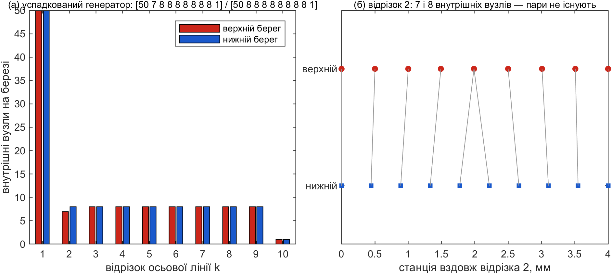
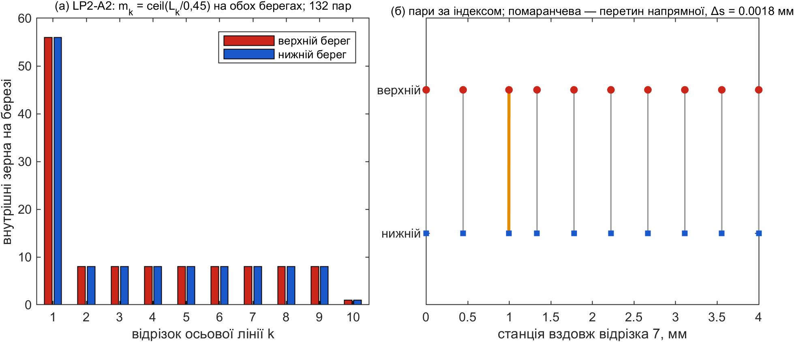
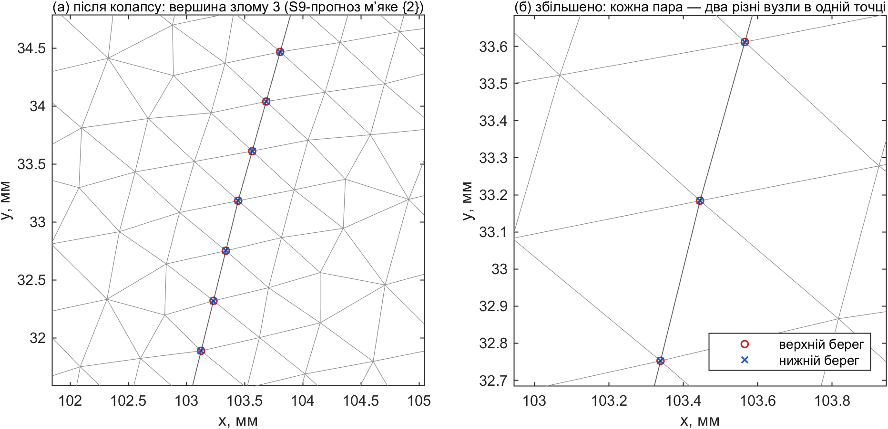
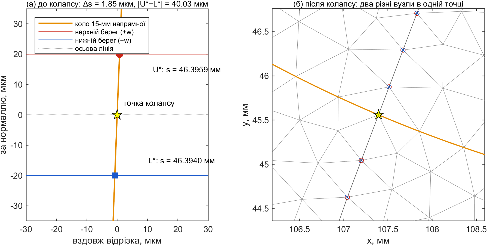
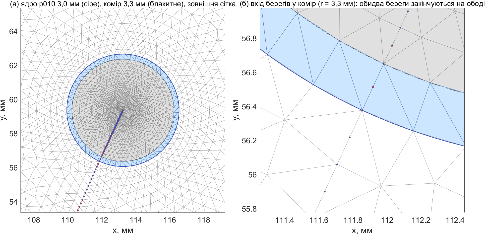
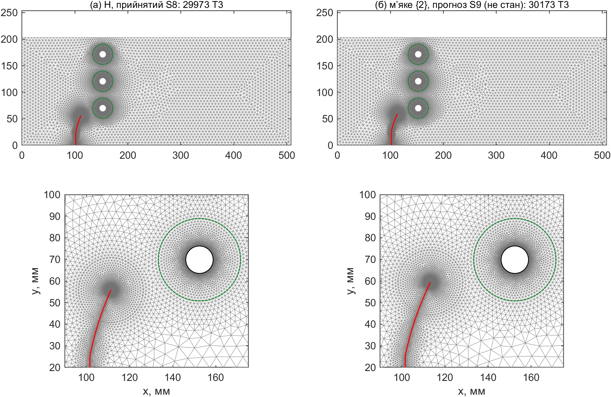
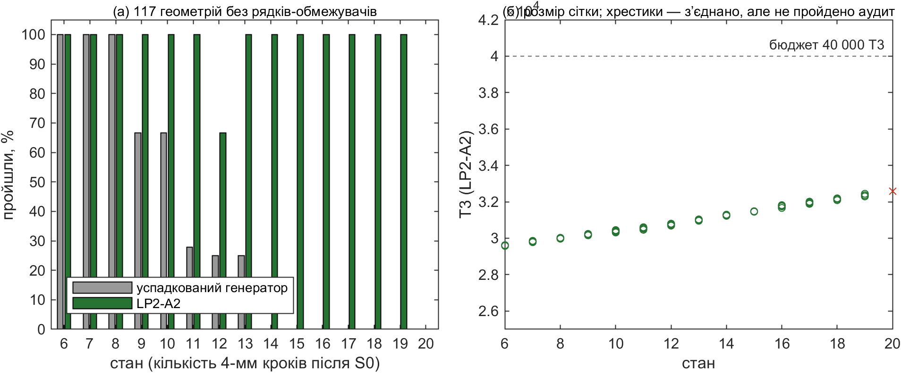
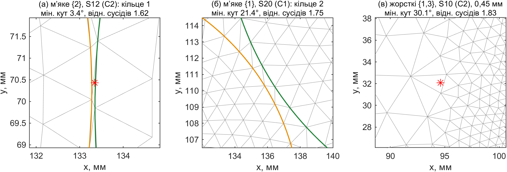

# Детерміноване парування вузлів берегів тріщини та кваліфікація сіток для продовження траєкторій у метакомпозиті

**G2-LP2-A2. Меморандум для незалежного наукового рецензування.** Гілка `research/g2-lp2a2-paired-banks-20261125`, чернетка PR поверх #70 (`ed5c6e6`).

**Висновок:** `LP2A2_MESH_QUALIFIED_RESTRICTED` прийнято незалежною рецензією ([6058599118](https://github.com/mfs9697/NewMetacomp/pull/71#pullrequestreview-6058599118), голова `05bc5f1`).

**Поточна точка зупинки:** `REVIEW_STOP_LP2A2_EQ_READY` — закриття перед авторизацією, § 14.

| | |
|---|---|
| Фізичних розв’язків МСЕ | **0** |
| Прийнятих станів | **0** |
| Живий GO | **немає** (файлу GO не існує) |
| Захищені записи LP1/A0/A1/M5-X6/LP2-A1 | **не змінено**; спільний відбиток `7e568370…` і відбиток LP2 `357dfdcd…` незмінні |

## 0. Головне

1. **Причину відмови встановлено.**
   - Успадкований генератор передає кожен відсунутий відрізок берега одним CAD-ребром. PDE Toolbox ділить два береги **незалежно**.
   - У всіх 59 відмовах берегів у тестовому наборі верхній берег отримує на одному 4-мм відрізку на один вузол менше (7 замість 8). Це відбувається за 32–72 мм позаду вершини і ніколи на відрізку, який перетинає 15-мм напрямна.
   - Відмову відтворено й на справжньому прогнозі: S9 м’якого {2}.
2. **Реалізація.** Явне парне засівання:
   - спільні параметричні станції ξ = j/m_k на кожному відрізку обох берегів, m_k = ⌈L_k/h⌉;
   - аналітичні перетини кола напрямної — вимушені пари;
   - кожен вузол берега мусить збігатися з єдиним зерном, кожне зерно — нести рівно один вузол;
   - пари визначаються за індексом зерна.

   Жоден поріг не послаблено.
3. **Парування пройшло на всіх згенерованих і перевірених з’єднаних сітках.** Це 113 сіток спроби 2 і 8 незалежних (§ 14), і на кожній незалежний аудит P1–P10 пройдено:
   - вузлів на тріщині без пари — 0;
   - регулярні пари мають розбіжність станцій 0;
   - для вимушених пар розбіжність станцій до колапсу ≤ 2,28 мкм, а координатний залишок після колапсу дорівнює 0.

   Універсальної гарантії для майбутніх поліліній немає: кожна сітка перевіряється окремо, а порушення дає HOLD. Геометричний аудит не означає фізичної придатності (§ 14).
4. **Спроба 1** (крок 0,45 мм) — HOLD для продовження: 10 відмов, серед них 2 регресії відносно старого генератора.
5. **Спроба 2** (наперед зафіксована драбина кроків 0,45 → 0,40 → 0,50 → 0,35 мм) пройшла 112 зі 117 геометрій; регресій немає. П’ять залишкових відмов — це геометрія наявної 15-мм напрямної біля кола кільця:
   - зазор між колами напрямної та кільця ≤ 0,49 мм;
   - чотири голкоподібні трикутники (той самий елемент на всіх чотирьох кроках);
   - одна відмова верифікатора фаз.
6. **Дозволений режим** (§ 10):
   - стани S9–S11;
   - зазор між колом напрямної та колом кожного кільця ≥ 1,0 мм;
   - сітка кожного стану проходить усі перевірки.

   На тестовому наборі в цьому режимі пройшли 76 із 76 геометрій; з них 74 на щаблі 1, а 2 — на запасному щаблі 2. Це регресійна, а не незалежна перевірка, і це **не** 76/76 для щабля 1. Незалежні 8 геометрій пройшли 8/8 на щаблі 1 (§ 14).
7. **Кампанію еквівалентності КІН підготовлено, але не виконано.**
   - Чотири розв’язки на S8 зі щаблем 1 (0,45 мм), допуски зафіксовано наперед.
   - Контрактні тести без МСЕ: v1 — 24/24; v2 після закриття — § 14.
   - Еквівалентність стосуватиметься лише кроку 0,45 мм.
   - Розрахунки на запасних кроках до WP5 не входять (§ 8.3).

## 1. Обсяг і заборони

Усі розрахунки — лише геометрія: сітки в пам’яті, без розв’язків, без станів і без змін історичних записів.

Не виконувалося:
- зменшення напрямної;
- перетин пасивного кільця;
- інтерфейс або CZM;
- M5;
- адаптивний крок;
- LP2-B.

Рядки «MESH_ONLY_SYNTHETIC» — синтетичні полілінії, а не траєкторії. S9 — лише геометричний прогноз (`GEOMETRY_ONLY_FORECAST`), а не прийнятий стан.

## 2. WP1. Діагностика відмови успадкованого генератора

**Механізм (спостереження).**
- `g2_kinked_exterior_mesh` будує мітрований канал півширини w = 0,02 мм. Кожен відсунутий відрізок верхнього й нижнього берега — окреме CAD-ребро з Hedge 0,45 мм.
- `generateMesh` ділить ребра кожного берега окремо. Перевірка `HOLD_LIP_STATIONS` вимагає однакових кількостей внутрішніх вузлів на відрізку.
- Відмова — коли кількості різні, наприклад [50 7 8 8 …] проти [50 8 8 8 …].
- Типовий старий поділ: стартовий відрізок 25,4 мм — 51 частина (0,498 мм); 4-мм відрізок — 9 частин; останній відрізок до входу в комір (0,7 мм) — 2 частини.

**Кількісні факти** (тестовий набір, 117 геометрій без рядків-обмежувачів):

| Показник | Значення |
|---|---|
| Відмов старого генератора | 60: 59 `HOLD_LIP_STATIONS` + 1 мін. кут (`C2_soft1_frozen_S12`) |
| Берег із меншою кількістю | верхній у 59/59 |
| Перший невдалий відрізок (k) | 2 — 29; 3 — 12; 4 — 6; 5 — 8; 6 — 4 |
| Усі невдалі відрізки | k = 2…12; від 1 до 6 на геометрію |
| Відстань від кінця невдалого відрізка до вершини | 32–72 мм |
| Невдалий відрізок містить перетин 15-мм напрямної | 0 випадків |
| Стартовий або останній відрізок | 0 випадків |
| Різниця довжин мітрованих відрізків (верх − низ) на невдалих відрізках | 0…+0,005 мм (на всіх: −0,0013…+0,005) — не розрізняє |
| Кути зламу на кінцях невдалих відрізків | 0–13,3° (медіана 1,8°); є невдалі відрізки без зламу — залежності від кута не встановлено |
| Частка проходжень за кількістю вершин (старий генератор) | N ≤ 10: 100 %; 11: 8/12; 12: 12/18; 13: 5/18; 14: 3/12; 15: 1/4; N ≥ 16: 0 |
| Відтворення сканування LP2 | 82/82 результатів і повідомлень ідентичні |
| Відтворення прийнятих S8 | повторний запуск старого генератора дає побітово ті самі X3/T3 (4/4) |

**Що спостережено, а що лише гіпотеза.**

*Спостереження:*
- поділ двох берегів незалежний;
- розбіжність виникає завжди на верхньому березі і далеко від вершини;
- частка відмов зростає з кількістю вершин;
- перетин напрямної до відмови не причетний;
- відмова детермінована.

*Гіпотеза:* PDE Toolbox трактує Hedge як ціль, а не як жорстку межу, і порядок поділу ребер залежить від глобального фронту генерації сітки. Старий генератор фактично дав крок 0,498 мм > Hedge 0,45 мм. Механізм усередині PDE Toolbox не спостережено.

**Рис. LP2A2-1.** 
(а) Внутрішні вузли на відрізках верхнього й нижнього берега, успадкований генератор, прогноз S9 м’якого {2}. (б) Відрізок 2: 7 і 8 внутрішніх вузлів; пар не існує.

## 3. WP2. Детерміноване парне засівання

**Конструкція** — модуль `g2_lp2a2_exterior_mesh`, копія успадкованого. Єдина алгоритмічна зміна — засівання:
- для кожного відрізка осьової лінії k (гирло, злами, вхід у комір) задається m_k = ⌈L_k/h⌉ частин; h = 0,45 мм (= Hedge) на щаблі 1;
- обидва мітровані береги діляться в однакових параметричних точках ξ_j = j/m_k, і ці точки стають вершинами CAD-полігону;
- перетини кіл напрямних (15-мм напрямна вершини, напрямні отворів) з берегами обчислюються аналітично, парують за колом і порядком і замінюють найближче регулярне зерно відрізка — це вимушені пари;
- після генерації: кожен вузол берега лежить на зерні (≤ 10⁻⁷ мм, успадкований допуск обода), кожне зерно несе рівно один вузол, інакше `HOLD_LIP_SEED_NOT_HONOURED`;
- пари визначаються **за індексом зерна** — не за найближчою відстанню і не за рівністю кількостей.

Успадковані перевірки станцій, колапс, обід, отвори, напрямні, Hgrad, Hmin, Hmax і всі HOLD — незмінні.

**Незалежний аудит парування** `g2_lp2a2_pairing_audit` (P1–P10, лише за збереженими масивами):
- однакові кількості, у тому числі вершинних і серединних вузлів;
- строгий порядок станцій;
- збіг координат і станцій після колапсу (≤ 10⁻¹² мм);
- різні ідентифікатори (спільна лише фізична вершина);
- той самий відрізок;
- той самий клас вузла; серединний вузол — у середині ребра;
- жодного вузла на тріщині поза берегами;
- ребра берегів мають одного власника з правильного боку;
- гирло, злами й вершина на своїх місцях;
- зв’язність сітки і додатні площі.

**Рис. LP2A2-2.** 
(а) Однакова кількість зерен на обох берегах. (б) Пари за індексом зерна; помаранчевим — вимушена пара перетину напрямної.

**Рис. LP2A2-3.** 
Сітка після колапсу біля зламу 3: кожна пара — два різні вузли в одній точці.

## 4. Вимушена пара перетину 15-мм напрямної (п. 1 додаткових вимог)

**Геометричне походження.** Коло напрямної радіуса R = 15 мм із центром у вершині перетинає два паралельні відсунуті береги (η = ±w) відрізка k у точках з поздовжніми координатами x_± = a − √(R² − (η − b)²). Тут b — нормальне зміщення вершини від прямої відрізка k: після подальших зламів вершина не лежить на продовженні відрізка.

Звідси:
- **колова частина:** Δx = x_U − x_L ≈ −2wb/√(R² − b²);
- **частина параметризації:** станції берегів відображаються на осьову лінію лінійно за параметром мітрованого відрізка, а довжини верхнього й нижнього мітрованих відрізків трохи різні;
- **разом:** Δs = Δx + частина параметризації.

**Чому вимушена пара відрізняється від регулярної.** Регулярні зерна задаються спільним ξ і тому мають ідентичні станції. Перетин кола є вершиною CAD, яку `decsg` створює неминуче, доки існує ця грань напрямної. Обидва перетини доводиться брати як зерна; їхні станції різні з геометричних причин. Додати на кожен берег ще й станцію іншого берега означало б ребра завдовжки ~2 мкм, тому це не робиться.

**Результати** (113 прийнятих сіток спроби 2, по одній вимушеній парі на кожній):

| Величина | Максимум (або мінімум) |
|---|---|
| Розбіжність станцій до колапсу, \|Δs\| | 0,00228 мм (`C1_soft1_frozenMTS_S6`) |
| Колова частина \|Δx\| | 0,00195 мм |
| \|\|Δx\| − 2w\|b\|/√(R²−b²)\| | 1,7·10⁻⁹ мм (поле `predictedDx_mm` у `LP2A2_SUPPLEMENT.json` має протилежний знак — див. ерату `supplement/ERRATUM_FORCED_PAIR_SIGNED_TERM.md`; правильна реалізація з `52d94ef`) |
| Частина параметризації | 0,00077 мм |
| Δs − (Δx + параметризація) | 0 |
| \|b\| | ≤ 0,73 мм (для прямих продовжень із S4 \|Δs\| ≤ 0,0013 мм) |
| Відстань між U* і L* до колапсу | 0,04005 мм (≈ 2w) |
| Координатний залишок після колапсу | **0** |
| Залишок сусідніх серединних пар T6 | **0** |
| Вузлів у точці колапсу | рівно 2, по одному в списку кожного берега |
| Ідентифікатори і СС (2i−1, 2i) | різні 113/113 |
| Однаковий індекс у списках берегів | 113/113 |
| Усередині того самого відрізка | 113/113 |
| Мін. кут суміжних T3 | ≥ 21,8° (поріг 20°), площі > 0 (мін. 0,050 мм²) |
| Відстань до вершини | 15,000 мм — поза коміром 3,3 мм |
| Переміщення вузла під час колапсу | ≤ 0,0200 мм |

Відповідно, аудит ядра й коміра (34 перевірки) пройдено на всіх 113 сітках.

**Різниця між станцією і координатою.** До колапсу вузли U* і L* лежать на різних берегах; їхні станції різні на ≤ 2,28 мкм, координати — на ≈ 40 мкм (ширина каналу). Під час колапсу обидва вузли переносяться в одну точку осьової лінії на середній станції. Після колапсу координатний залишок пари — 0, а вузли й ступені вільності лишаються незалежними.

**Порівняння з успадкованим сімейством.** Прийняті сітки S8 LP2-A1 уже колапсували всі пари на середній станції, але з розбіжністю 0,0134–0,0169 мм; на прогнозах S9 вона сягала 0,0349 мм. Нове сімейство має 0 для регулярних пар і ≤ 0,0023 мм для єдиної вимушеної пари.

**Рис. LP2A2-7.** 
(а) Перетин кола 15-мм напрямної з берегами ±w у локальних координатах (мкм); U* і L* — вимушені зерна, зірка — точка колапсу. (б) Після колапсу: два різні вузли в одній точці на межі напрямної.

## 5. WP3. Збережені інваріанти

- **Біля вершини без змін:** ядро p010 3,0 мм, комір 3,3 мм, 64 сектори, 65 ідентичностей обода, q-області, COD/EDI, відображення фаз, критерії прийняття, 15-мм напрямна, крок 4 мм, бюджет 40 000 T3.
- **Окреме дерево джерел** `matlab/g2/lp2a2/` (14 файлів):
  - спільний відбиток `7e568370…` і відбиток LP2 `357dfdcd…` незмінні;
  - відбиток LP2-A2 після виправлення шляху — `f9c15e01…`, його закріплено в політиці.
- **Позиції вилучення КІН.** COD бере вікно r ∈ [0,1; 1,5] мм, EDI — кільця ≤ 2,6 мм; обидва лежать усередині ідентичного ядра.

## 6. WP4. Кваліфікація

### 6.1 Наперед оголошений набір

`LP2A2_TEST_SET.json` (`7d2b6d35…`) зафіксовано комітом `9a2442b` до будь-якої оцінки:

| Група | Рядків | Правило |
|---|---:|---|
| A | 4 | прийняті S8, SHA STATE перевірено за маніфестом LP2-A1 |
| B | 4 | прогнози S9, побітово рівні кандидатам TERMINAL |
| C1 | 82 | усі рядки сканування LP2 (найраніші відмови S9, найдовші S20) |
| C2 | 29 | пряме продовження й повторюваний крок МКН від кожного прогнозу S9; 8 рядків-обмежувачів |
| C3 | 8 | прогноз H із чергуванням зламів ±2° і ±5°; 2 рядки-обмежувачі |

Рядки-обмежувачі (10) — перша полілінія, що не проходить допустимість K1–K10. Обидва генератори зупиняються на ній на `HOLD_KINK_ADMISSIBILITY` (10/10).

Прогнози S9 (лише геометрія):

| Випадок | Вершина S9, мм | До кола кільця 1, мм |
|---|---|---:|
| H | (113,0090; 59,4552) | 21,6894 |
| жорсткі {1,3} | (113,2510; 59,3870) | 21,4730 |
| м’яке {2} | (113,2393; 59,3732) | 21,4879 |
| м’яке {1} | (112,5349; 59,5939) | 22,1132 |

### 6.2 Групи A і B (спроба 2)

| Геометрія | Щабель | T3 нове / старе | Вузли берега T6 нове / старе | Мін. кут, ° | Макс. відн. сусідів нове / старе | Розбіжність пари нове (вимушена) / старе | Аудит |
|---|---:|---|---|---|---|---|---|
| A H S8 | 1 | 29 973 / 29 873 | 301 / 289 | 30,13 | 1,592 / 1,593 | 0,0019 / 0,0137 | 34/34, фази 4/4, P 10/10 |
| A жорсткі {1,3} S8 | 1 | 29 981 / 29 871 | 301 / 289 | 30,13 | 1,592 / 1,592 | 0,0017 / 0,0134 | так само |
| A м’яке {2} S8 | 1 | 30 001 / 29 879 | 301 / 289 | 30,13 | 1,592 / 1,745 | 0,0020 / 0,0134 | так само |
| A м’яке {1} S8 | 1 | 30 021 / 29 875 | 301 / 289 | 30,13 | 1,592 / 1,592 | 0,0022 / 0,0169 | так само |
| B H S9 | 1 | 30 169 / 30 043 | 319 / 307 | 30,13 | 1,592 / 1,701 | 0,0018 / 0,0183 | так само |
| B жорсткі {1,3} S9 | 1 | 30 179 / 30 031 | 319 / 307 | 30,13 | 1,790 / 1,637 | 0,0015 / 0,0169 | так само |
| B м’яке {2} S9 | 1 | 30 173 / — | 319 / — | 30,13 | 1,602 / — | 0,0018 / **старий: `HOLD_LIP_STATIONS`** | так само |
| B м’яке {1} S9 | 1 | 30 187 / 30 055 | 319 / 307 | 30,13 | 1,592 / 1,654 | 0,0021 / 0,0349 | так само |

**Різниця сімейств.**
- Стартовий відрізок: 57 частин по 0,4456 мм замість 51 по 0,498 мм, звідси +12 вузлів берега T6.
- Зовнішня сітка регенерується: T3 у середньому +120.
- Ядро, комір і q-поле ідентичні.

### 6.3 Узагальнені метрики нових сіток (спроба 2, 113 з’єднаних)

| Величина | Діапазон |
|---|---|
| T3 | 29 579–32 591 (бюджет 40 000) |
| Вузлів T6 | 60 149–66 425 |
| Мін. кут | 21,4–30,1° |
| Макс. відношення сусідів | 1,59–1,79 |
| Мін. довжина ребра (усі / береги) | 0,0417 / 0,0417 мм (ядро p010) |
| Пар T6 / T3 | 265–517 / 133–259 |
| Відхилення вузла від зерна | ≤ 1,6·10⁻¹⁴ мм |
| Мін. відстань між зернами | 0,200 мм (≥ Hmin 0,12) |
| Час з’єднання / аудиту | 2,0–8,1 с / 2,9–4,9 с |
| Пам’ять MATLAB | 1,95–2,01 ГіБ |
| Детермінізм | повторна генерація 117/117: той самий щабель і T3 |

**Рис. LP2A2-4.** 
(а) Ядро p010 3,0 мм, комір 3,3 мм і зовнішня сітка біля вершини прогнозу S9 м’якого {2}. (б) Вхід берегів у комір на ободі r = 3,3 мм.

**Рис. LP2A2-5.** 
Повні сітки LP2-A2: (а) прийнятий H S8; (б) прогноз S9 м’якого {2} (не стан). Унизу — збільшення біля кілець; пунктир — коло 15-мм напрямної.

**Рис. LP2A2-6.** 
(а) Частка проходжень за станом: старий генератор і LP2-A2 (спроба 2). (б) Розмір сіток LP2-A2.

## 7. Повне узгодження статистики (п. 3)

### 7.1 Сукупності

| Сукупність | Обсяг | Приєднано | Аудит парування | Повний аудит | Пройшло | HOLD |
|---|---:|---:|---:|---:|---:|---:|
| Унікальні геометрії тестового набору | 127 (117 + 10 обмежувачів) | | | | | |
| Старий генератор (двічі, у спробах 1 і 2; результати ідентичні) | 117 | — | — | — | 57 | 60 |
| Новий генератор, спроба 1 (крок 0,45) | 117 | 108 | 108 | 107 | 107 | 10 |
| Дослідження кроку (поза тестовим набором) | 46 геометрій × 4 кроки = 184 сітки | | | | 39 / 37 / 39 / 39 для 0,45 / 0,40 / 0,50 / 0,35 | |
| Новий генератор, спроба 2 (драбина) | 117; 135 спроб щаблів | 113 | 113 | 112 | 112 | 5 |
| Додаткова діагностика | 117 повторних генерацій + 5 × 4 щаблі + 5 старих | | | | | |

### 7.2 Узгодження названих величин

| Величина | Сукупність | Пояснення |
|---|---|---|
| 108 приєднаних / 108 аудитів парування | спроба 1, 117 рядків | 117 − 9 відмов якості з’єднання = 108; усі 108 пройшли P1–P10 |
| 107 | спроба 1 | 108 мінус S20 (відмова верифікатора фаз) |
| 59 відмов берегів старого генератора | 117 рядків | B 1 + C1 46 + C2 9 + C3 3; плюс 1 відмова мін. кута — разом 60 |
| 77/82 і 36/82 | лише C1 (сканування LP2) | новий (спроба 1) і старий генератор |
| 5 біля кілець | спроба 1 | 4 мін. кут (зазор 0,075–0,239 мм) + S20, фази (0,492 мм) |
| 5 далекого поля | спроба 1 | відношення сусідів 1,83–1,94 за 7–9 мм від тріщини, зазор ≥ 1,9 мм |
| 10 = 5 + 5 | спроба 1 | категорії не перетинаються: жоден рядок не має обох відмов |
| 112 і 5 | спроба 2 | усі 5 відмов далекого поля зняті щаблем 2 (4) або 3 (1); лишилися 5 біля кілець |

### 7.3 Парні таблиці, сканування C1 (82 рядки)

**Спроба 1:**

| Старий генератор | Новий пройшов | Новий не пройшов |
|---|---:|---:|
| Пройшов | 36 | 0 |
| Не пройшов | 41 | 5 |

**Спроба 2:**

| Старий генератор | Новий пройшов | Новий не пройшов |
|---|---:|---:|
| Пройшов | 36 | 0 |
| Не пройшов | 44 | 2 |

**Усі 117 рядків:**
- спроба 1: 55 / 2 / 52 / 8;
- спроба 2: 57 / 0 / 55 / 5 (порядок: пройшли обидва / регресія / виправлено / не пройшли обидва).

**Регресії.**
- Спроба 1: `C2_stiff13_straight_S10`, `C2_stiff13_straight_S11` (відношення сусідів).
- Спроба 2: немає.

**Виправлені відмови старого генератора** (спроба 2, 55 рядків): усі 59 відмов `HOLD_LIP_STATIONS`, крім чотирьох, де на тій самій геометрії лишається відмова біля кільця. Перелік — у `LP2A2_RECONCILIATION.json`.

Частки проходжень — це опис цього набору, а не ймовірність успіху на довільній майбутній траєкторії.

## 8. Драбина кроків (п. 2)

### 8.1 Підтвердження процедури

- Драбину 0,45 → 0,40 → 0,50 → 0,35 мм зафіксовано комітом `7a1ca24` до спроби 2. Обґрунтування — спроба 1 і дослідження на окремому наборі, де відмови відношення сусідів з’являються і зникають залежно від кроку, а голкоподібні елементи біля кілець — ні.
- Наступний щабель — лише при відмові глобальних порогів з’єднання `globalMinAngleAtLeast20` або `globalNeighborRatioAtMost1p8`. Будь-який інший HOLD (допустимість, CAD, зерна, бюджет, парування) зупиняє генерацію.
- Пороги без змін. Нових щаблів після спроби 2 не додано.
- Детермінізм: 117/117 повторних генерацій дали той самий щабель і T3.

### 8.2 Використання щаблів (спроба 2, 117 рядків)

| Перший прийнятий щабель | Рядків |
|---|---:|
| 1 (0,45 мм) | 108 (у тому числі S20, що далі не проходить аудит фаз) |
| 2 (0,40 мм) | 4: `C1_stiff13_straight_S13`, `C1_soft1_straight_S12`, `C2_stiff13_straight_S10`, `C2_stiff13_straight_S11` |
| 3 (0,50 мм) | 1: `C1_soft2_straight_S12` |
| немає (вичерпано) | 4: рядки з голкоподібними T3 біля кільця 1 |

Спроб щаблів усього: 135 = 117 + 9 + 5 + 4.

Відхилені щаблі:
- 0,45: 9 разів (5 — відношення сусідів, 4 — мін. кут);
- 0,40: 5 разів (1 — відношення, 4 — мін. кут, двічі разом із відношенням);
- 0,50: 4 рази (мін. кут; один рядок і з відношенням);
- 0,35: 4 рази (мін. кут).

Повні записи щаблів кожної геометрії — у `LP2A2_MESH_QUALIFICATION_ATTEMPT2.json` (`new.ladder`) і `LP2A2_RECONCILIATION.json`.

### 8.3 Наслідки для кампанії еквівалентності КІН

- **Щабель сіток EQ.** Усі чотири сітки S8 кампанії мають щабель 1 (0,45 мм); політика вимагає саме його.
- **Що доведе кампанія.** Фізичні дані еквівалентності стосуватимуться безпосередньо кроку 0,45 мм. Їх **не можна** автоматично поширити на запасні кроки.
- **Чи може запасний крок змінити КІН.** Вилучення КІН відбувається повністю в ідентичному ядрі: COD у вікні 0,1–1,5 мм, EDI — у кільцях ≤ 2,6 мм. Запасний крок змінює лише розбиття берегів поза коміром і регенеровану зовнішню сітку, тобто впливає на КІН тільки через глобальний розв’язок. Очікуваний вплив — того ж порядку, що й різниця сімейств 0,45 мм і LP2-A1. Проте величина цього впливу невідома; проходження тих самих геометричних аудитів її не обмежує.
- **Рішення рецензії:** до WP5 жодні розрахунки на запасних кроках не входять. Будь-яке дослідження чутливості до кроку — окрема робота, і випадок лише H не засвідчує неоднорідного контрасту. Фізичне використання спочатку обмежене щаблем 1. Нижче — історична пропозиція, не прийнята до WP5.
- **Найменший обґрунтований додатковий експеримент** (лише пропозиція, не входить у чотири розв’язки, потребує окремої авторизації):
  - два розв’язки H S8 з примусовими кроками 0,40 і 0,50 мм (`EQ-H-R2`, `EQ-H-R3`);
  - порівняння з EQ-H (0,45 мм) і з архівним S8 за тими самими C1–C11.

  Обґрунтування: використовувалися лише щаблі 2 і 3; матеріальний контраст на розбиття берегів поза ядром не впливає, тому достатньо одного випадку. Обидві сітки H S8 вже пройшли всі аудити (`LP2A2_HS8_RUNG_CHECK.json`: T3 29 975 і 29 943, 34/34, фази, P1–P10). Щабель 4 (0,35 мм) у спробі 2 жодного разу не прийнято, тому його можна додати лише тоді, коли він знадобиться.

## 9. Залишкові відмови та їх розмежування (п. 4)

| Геометрія | Випадок / стан | Кільце (стан) | Зазор напрямна–кільце, мм | Невдалий поріг | Найгірший елемент | Щаблі 0,45 / 0,40 / 0,50 / 0,35 | Старий генератор |
|---|---|---|---:|---|---|---|---|
| `C2_soft2_straight_S12` | м’яке {2}, S12 | 1 (пасивне) | 0,075 | мін. кут 3,45° | (133,35; 70,43): 0,013 мм від кола кільця, 0,07 мм поза колом напрямної | мін. кут на всіх; на 0,40 також відношення | `HOLD_LIP_STATIONS` |
| `C1_soft1_frozenMTS_S12` | м’яке {1}, S12 | 1 (активне) | 0,129 | мін. кут 9,41° | (133,33; 70,57): 0,036 / 0,111 мм | мін. кут на всіх | `HOLD_LIP_STATIONS` |
| `C2_soft1_frozen_S12` | м’яке {1}, S12 | 1 (активне) | 0,237 | мін. кут 9,58° | (133,29; 69,30): 0,068 / 0,203 мм | мін. кут на всіх | той самий мін. кут 9,58° у тій самій точці |
| `C2_stiff13_straight_S12` | жорсткі {1,3}, S12 | 1 (активне) | 0,239 | мін. кут 14,6° | (133,28; 69,18): 0,080 / 0,213 мм | мін. кут на всіх; на 0,40 і 0,50 також відношення | `HOLD_LIP_STATIONS` |
| `C1_soft1_straight_S20` | м’яке {1}, S20 (синтетика з S4) | 2 (пасивне) | 0,492 | верифікатор фаз `interfaceIdsOneToOne` (усі 4 маски) | хорди кільця 2: 1,5497–1,5999 мм проти 1,5497–1,5956 на інших кільцях; середнє координат вершин полігона кільця 2 (не центроїд площі) зміщено на 6,3·10⁻⁶ мм (допуск 10⁻⁶) | 0,45 і 0,35 — з’єднано, фази не пройдено; 0,40 і 0,50 — відношення 2,11 і 1,86 | `HOLD_LIP_STATIONS` |

**Висновки, що випливають безпосередньо з даних:**

1. **Парування берегів (категорія 1): відмов немає.** Усі сітки, що дійшли до з’єднання, пройшли P1–P10, а координати й залишки вимушених пар бездоганні.
2. **Якість зовнішньої сітки (категорія 2).** П’ять відмов відношення сусідів у далекому полі спроби 1 мали зазор ≥ 1,9 мм. Драбина зняла їх усі, отже вони не систематичні.
3. **Відображення фаз (категорія 3).** Одна відмова (S20): верифікатор вимагає, щоб середнє арифметичне координат вершин кожного полігона кільця (не центроїд площі) збігалося з центром у межах 10⁻⁶ мм. Біля кола напрямної (зазор 0,49 мм) хорди кільця 2 нерівномірні, і це середнє зміщується на 6,3·10⁻⁶ мм. Сам картограф фаз (`PHASE_MAP_TOPOLOGICAL_OK`) і перевірки ідентичності власників проходять.
4. **Геометрія наявної напрямної (категорія 4).**
   - Усі чотири відмови мін. кута спричинені тим самим голкоподібним елементом на кожному з чотирьох кроків. Він лежить у вузькій смузі між колом 15-мм напрямної і колом кільця 1 (зазор 0,075–0,239 мм) і не залежить від зерен берега.
   - Найменший зазор серед успішних сіток — 0,403 мм (`C2_H_straight_S12`). Усі відмови мають зазор ≤ 0,492 мм.
   - Чи можна цю геометрію в принципі розбити якісно, ці дані не встановлюють. Встановлено лише, що з наявними контролерами генератора і без зміни напрямної чи кілець цього не вдалося.

Активність кільця на геометрію сітки не впливає: усі відмови однакові для активних і пасивних кілець, а аудит фаз перевіряє всі чотири маски.

**Рис. LP2A2-8.** 
(а) Голкоподібний T3 (зірка) між колом 15-мм напрямної (помаранчеве) і колом кільця 1 (зелене), м’яке {2}, S12. (б) Нерівномірні хорди кільця 2 біля кола напрямної, м’яке {1}, S20. (в) Відмова відношення сусідів далекого поля на щаблі 1, жорсткі {1,3}, S10; щабель 2 її знімає.

Близькість напрямної до кільця належить LP2-B, бо в обмежений режим LP2-A2 (§ 10) вона не потрапляє.

## 10. WP6. Стеля продовження і дозволений режим

**Дані продовжень від прогнозів S9** (C2/C3, 15-мм напрямна, крок 4 мм):

| Продовження | Допустимі стани | Пройшли сітки (спроба 2) | Обмежувач | Зазор напрямна–кільце 1 на останньому допустимому, мм |
|---|---|---|---|---|
| H пряме | S10–S12 | 3/3 | S13, K9 | 0,403 |
| H МКН | S10–S11 | 2/2 | S12, K9 | 1,948 |
| жорсткі {1,3} пряме | S10–S12 | S10, S11 (щабель 2); S12 — ні | S13, K9 | 0,239 |
| жорсткі {1,3} МКН | S10–S11 | 2/2 | S12, K9 | 1,830 |
| м’яке {2} пряме | S10–S12 | S10, S11; S12 — ні | S13, K9 | 0,075 |
| м’яке {2} МКН | S10–S11 | 2/2 | S12, K9 | 1,662 |
| м’яке {1} пряме | S10–S12 | 3/3 | S13, K9 | 0,868 |
| м’яке {1} МКН | S10–S12 | S10, S11; S12 — ні | S13, K9 | 0,237 |
| H злами ±2° / ±5° | S10–S12 | 3/3 і 3/3 | S13, K9 | 0,662 / 1,056 |

**Розмежування обмежень:**

| Обмеження | Що показують дані |
|---|---|
| Відмова генерації сітки (парування) | не спостерігалась |
| Наближення до активного інтерфейсу | кільце 1 активне для жорстких {1,3} і м’якого {1}; K9 (вершина ≥ 15 мм від кола кільця) обриває всі продовження на S12–S13 |
| Пасивне кільце як перешкода | для H і м’якого {2} — та сама геометрична межа K9; перетин пасивного кільця не дозволено |
| Отвір або зовнішній край | далеко: кільце 2 ≥ 37,9 мм, кільце 3 ≥ 83,7 мм, нижній край ≈ 56 мм |
| Стеля сітки біля межі K9 | при зазорі ≤ 0,49 мм можливі голкоподібні T3 або відмова верифікатора фаз (S12 трьох продовжень) |
| Стеля кампанії | наступні стани потребують окремої політики й GO |

**Дозволений режим `LP2A2_MESH_QUALIFIED_RESTRICTED`:**

1. **Стани.** S9, S10 і S11 кожного випадку (не більше трьох 4-мм кроків після S8, дуга ≤ 69,4 мм).
2. **Допустимість полілінії** — K1–K10 з незмінною 15-мм напрямною.
3. **Зазор** між колом 15-мм напрямної і колом **кожного** кільця ≥ 1,0 мм, тобто вершина ≥ 16,0 мм від кола кільця.
   - Межу вибрано за даними: найбільший зазор серед відмов — 0,492 мм, тож 1,0 мм дає запас понад удвічі.
   - Усі продовження C2/C3 у S11 мають 1,66–2,63 мм.
   - Це емпірична межа, а не доведена.
4. **Сітка кожного стану** будується `g2_lp2a2_mesh` і проходить усі пороги з’єднання, аудит 34 перевірок, аудит фаз чотирьох масок, переприсвоєння фаз і P1–P10. Будь-яка відмова — HOLD цього стану без повтору.
5. **Щабель > 1 записується.** На стан із таким щаблем дані еквівалентності 0,45 мм не поширюються. За рецензією, фізичне використання спочатку дозволене лише на щаблі 1; запасні щаблі фізично не використовуються.
6. **Фізичне продовження S9–S11 лишається HOLD**, доки еквівалентність не пройдено й не надано окремої авторизації.

Усі геометрії тестового набору, що задовольняють умови 1–3, пройшли всі аудити: **76/76**. З них 74 на щаблі 1, а 2 (`C2_stiff13_straight_S10/S11`) — на щаблі 2. Із будь-яким станом за умови 3: 109/109. Незалежна перевірка: 8/8 на щаблі 1 (§ 14).

S12 і далі, а також зазори менше 1,0 мм — область LP2-B.

**Незалежна перевірка.** Запропоновано у версії `05bc5f1`; виконано після рецензії — § 14.

## 11. WP5. Підготовлена кампанія еквівалентності КІН

**Чотири розв’язки.** Кожен — фіксована геометрія, один раз, без повтору:

| ID | Геометрія | Матеріал |
|---|---|---|
| EQ-H | H S8 | H |
| EQ-stiff13 | жорсткі {1,3} S8 | жорсткі {1,3} |
| EQ-soft2 | м’яке {2} S8 | м’яке {2} |
| EQ-soft1 | м’яке {1} S8 | м’яке {1} |

Кожен розв’язок порівнюється з архівним розв’язком LP2-A1 S8 тієї самої геометрії.

**Політика** `G2_LP2A2_EQ_POLICY_v1.json`, статус `PREREGISTERED_NOT_AUTHORIZED`. Закріплені значення:
- політики LP1 і LP2;
- відбитки 7e568370… / 357dfdcd… / f9c15e01…;
- тестовий набір;
- 20 архівних файлів S8/TERMINAL.

**Допуски** (обґрунтування — у політиці):

| Критерій | Допуск |
|---|---|
| C1 K_I | \|ΔK_I\|/K_eq ≤ 5·10⁻⁴ |
| C2 K_II | \|ΔK_II\|/K_eq ≤ 5·10⁻⁵ |
| C3 K_II/K_I | ≤ 10⁻⁴ |
| C4 G, J | ≤ 10⁻³; нове \|J/G−1\| ≤ 10⁻⁴ |
| C5 МКН | \|Δθ\| ≤ 0,006° |
| C6 COD–EDI | нове ≤ 3 %, \|Δ\| ≤ 10⁻³ |
| C7 розкид EDI, квадратура 4×4 | ≤ max(10⁻⁵; 5 × архівне) |
| C8 розкриття | біля вершини ≤ 10⁻³, уздовж тріщини ≤ 2·10⁻³ максимуму |
| C9 фази | ворота розв’язувача, ті самі 76 хорд, активна площа ≤ 10⁻⁹ |
| C10 прогноз S9 | зміщення вершини ≤ 5·10⁻⁴ мм |
| C11 податливість | ≤ 10⁻³ |
| Контраст архітектур | \|ΔF_G\| ≤ 2·10⁻⁴, ті самі знаки й порядок; \|Δ(θ_X−θ_H)\| ≤ 0,01° |

**Як тлумачити результат.**
- Повне проходження — **чисельна еквівалентність на чотирьох геометріях**, а не сертифікована межа похибки дискретизації.
- Будь-яка відмова — HOLD; без повтору і без зміни допусків.

**Контрактні тести без МСЕ, v1** (`eq/LP2A2_EQ_TESTS.json`, коміт `1200dde`): **24/24**. Збережено як історію; актуальна версія v2 — § 14.
- E1 — закріплені значення й токен.
- E2 — тотожність чотирьох архівних розв’язків, прогноз S9 побітово дорівнює TERMINAL.
- E3 — 10 негативних збурень для C1, C2, C4, C6, C7, C8, C9 (два), C10, C11. Поправка рецензії: C3 і C5 окремо не перевірялися. За прийнятих допусків їх неможливо порушити без C2; прямі тести додано у v2.

C8 порівнює модуль вектора стрибка |u_U − u_L|, а не знакове нормальне розкриття. Це передбачене порівняння лишається; знакове розкриття й ворота розв’язувача v2 повідомляє окремо як метрики.
- E4 — 4 тести контрасту.
- E5 — відмова `Run=true` без GO; тека не створюється.
- E6 — чотири сухі виклики `READY_NOT_SOLVED`: щабель 1; T3 29 973–30 021; 301 пара; 76 хорд на кільце в обох сімействах.

Перша спроба цих тестів (`7e2b858`) зупинилась після E1 через відсутній у шляху `g2_lp2_forecast`. Друга (`7481509`) зупинилась на незмінному запобіжнику 5 ГіБ (4,86 ГіБ). Обидві збережено.

Шаблон рішення — `G2_LP2A2_EQ_GO_DECISION_TEMPLATE.md`; GO не створено.

## 12. Розділ, готовий для Word

> **Парування вузлів берегів у продовженнях LP2-A2.** Успадкований генератор ділив два береги тріщини незалежно. На довших полілініях це давало різну кількість вузлів на одному 4-мм відрізку (завжди менше на верхньому березі, за 32–72 мм позаду вершини), і сітку відхиляла перевірка парування. Для довжин понад вісім кроків частка придатних сіток падала до нуля.
>
> У LP2-A2 обидва береги засіваються в однакових параметричних точках кожного відрізка (не довше 0,45 мм). Пари задаються індексом зерна; генератор зобов’язаний поставити рівно один вузол на кожне зерно. Єдина пара, станції якої розходяться (до 2,3 мкм), — перетин 15-мм напрямної з берегами; після колапсу її залишок дорівнює нулю. Якщо глобальні пороги якості не виконуються, генератор переходить до наперед визначених кроків 0,40, 0,50 і 0,35 мм.
>
> На 117 перевірених геометріях парування пройшло в усіх 113 з’єднаних сітках, а повний аудит — у 112. Залишкові п’ять відмов пов’язані з майже дотичними колами 15-мм напрямної та кільця (зазор ≤ 0,49 мм). Продовження дозволено для станів S9–S11 за зазору не менше 1,0 мм. Чисельна еквівалентність КІН нового сімейства сіток ще має бути підтверджена чотирма розв’язками на S8.

## 13. Обмеження

- Спроба 2 — регресійна кваліфікація на геометріях з відомими результатами, а не незалежна перевірка.
- Межа зазору 1,0 мм — емпірична.
- Еквівалентність КІН не встановлено: кампанію не виконано, і вона стосуватиметься лише кроку 0,45 мм.
- Механізм усередині PDE Toolbox не спостережено.
- Розбіжність вимушеної пари визначена геометрією 15-мм напрямної.
- Похибку дискретизації не сертифіковано.

## Джерела та відтворення

Докази — `docs/research/G2_LP2A2_evidence/` (опис — `README.md`):
- **набір і кваліфікація:** `LP2A2_TEST_SET.json`, `attempt1/`, `attempt2/` (спроба 2 і дослідження кроку);
- **діагностика:** `supplement/` (детермінізм, вимушені пари, залишкові відмови, узгодження);
- **еквівалентність:** `eq/` (контрактні тести, перевірка щаблів H S8);
- **рисунки:** `figures/`.

Скрипти — `scripts/g2/lp2a2/`:
- `lp2a2_analyze.py`, `lp2a2_reconcile.py`;
- `lp2a2_figures.m`;
- `lp2a2_make_eq_policy.py`, `lp2a2_go_template.py`.

Джерела — `matlab/g2/lp2a2/`.
