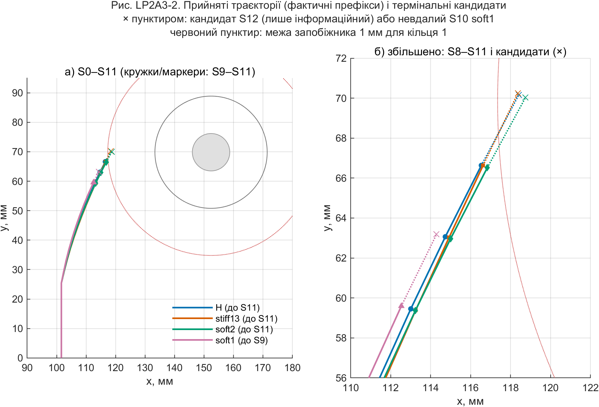
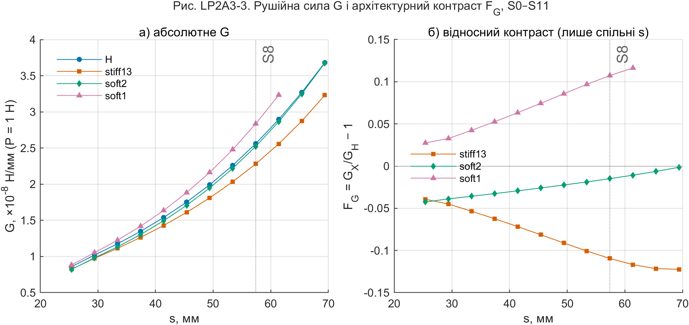
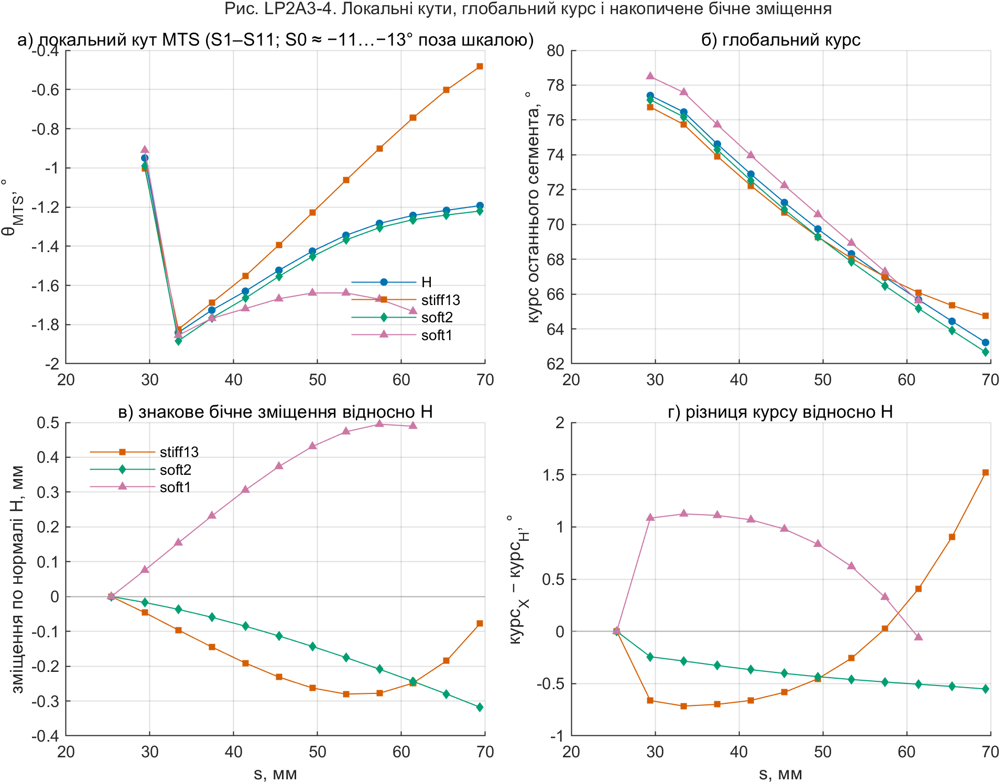
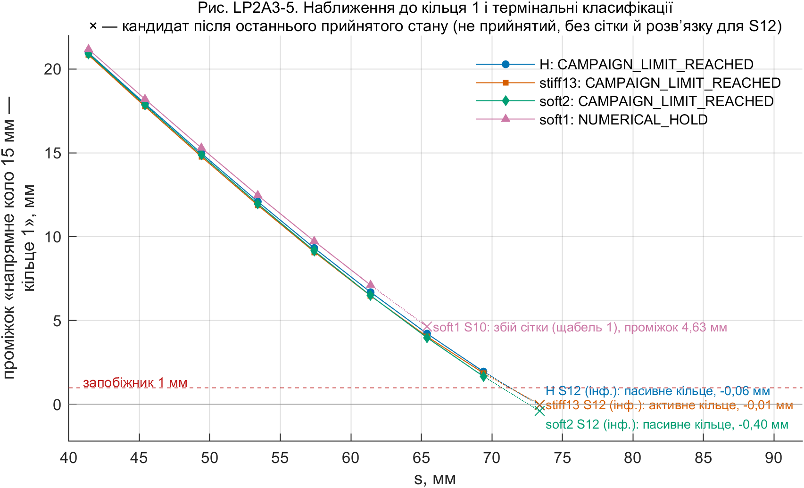

# G2-LP2-A3. Обмежене продовження S9–S11: демонстрація (кампанія G2-LP2A3-001)

**Підстави:**
- Авторизація дослідника: https://github.com/mfs9697/NewMetacomp/pull/75#issuecomment-7175877170.
- Рецензія готовності: https://github.com/mfs9697/NewMetacomp/pull/75#pullrequestreview-6065556000.
- Схвалена голова: `2348ba11b9ebe1e33a723b11055a3603b846383e`.

**Коміти:**
- GO — `3097929`: лише файл GO, безпосередньо на схваленій голові.
- Відкликання — `db9d230`: дерево `487886ba…` = дерево схваленої голови.

Модель — умовна LEFM/MTS з одиничним навантаженням. Ні фізичного росту, ні зупинки тріщини, ні зустрічі з інтерфейсом не стверджується.

## 0. Головне

**Виконання:**
- Точку входу `g2_lp2a3_external_run` викликано 1 раз; він виконав 4 виклики випадків у порядку H, stiff13, soft2, soft1, за 114,7 с.
- Результат контролера — `CAMPAIGN_CLOSED_VERIFIED`.
- Незалежний аудит — 0 проблем:
  - 11 допусків;
  - 10 виконаних фізичних розв’язків, усі прийняті;
  - 10 прийнятих станів;
  - 83 файли запуску і 26 файлів реєстру, без зайвих і відсутніх.

**Результати за випадками:**

| Випадок | Прийнятий префікс | Термінал |
|---|---|---|
| H | S9–S11 | `CAMPAIGN_LIMIT_REACHED` |
| stiff13 | S9–S11 | `CAMPAIGN_LIMIT_REACHED` |
| soft2 | S9–S11 | `CAMPAIGN_LIMIT_REACHED` |
| soft1 | S9 | `NUMERICAL_HOLD` на S10 |

Причина зупинки soft1: сітка типового щаблю 0,45 мм не пройшла глобальний шлюз відношення сусідніх елементів (`globalNeighborRatioAtMost1p8`). Розв’язку не було. Запасного щаблю немає за політикою, повтору теж. Кандидат S10 був MATRIX_ADVANCE із проміжком до кільця 1 = 4,633 мм. Отже, ця зупинка числова, а не наближення до кільця.

**Контраст архітектур на S11** (лише спільні s):
- stiff13: F_G = −0,12236. Посилення екранування триває, але приріст за крок зменшується (−0,0073; −0,0047; −0,0008).
- soft2: F_G = −0,00142. Послаблення екранування триває (+0,0041; +0,0045; +0,0049 за крок). До S11 зміни знака немає; нуль не екстраполюємо.
- soft1: F_G = +0,11630 на S9; підсилення триває (+0,0090 за крок).

**Абсолютне G** зростає в усіх випадках: H від 2,5604·10⁻⁸ (S8) до 3,6804·10⁻⁸ Н/мм (S11).
- Відносне екранування stiff13 посилюється, хоча абсолютне G stiff13 також зростає. Це **не** зменшення рушійної сили.

**Наближення до кільця 1.**
- Проміжок «напрямне коло 15 мм — кільце 1» на S11: H 1,957 мм, stiff13 1,867 мм, soft2 1,671 мм (поріг 1 мм).
- Кандидати S12 лише для інформації; їх не допущено і для них немає ні сітки, ні МСЕ:
  - H: −0,062 мм, пасивне кільце;
  - stiff13: −0,012 мм, активне кільце (інтерфейс);
  - soft2: −0,396 мм, пасивне кільце.
- Ці кандидати не проходять ні успадкований запобіжник напрямного кола, ні запобіжник 1 мм.
- Це числова класифікація кандидата поза кампанією, а не зупинка тріщини чи зустріч з інтерфейсом.

**Закриття:**
- GO відкликано окремим комітом; після відкликання правильний токен відхилено 4/4 (`G2LP2A3:HOLD_UNAUTHORIZED`), жодного запису не змінено.
- 723 захищені записи без змін, маніфест `44c54678…`.
- Архів `NewMetacomp_G2_LP2A3_Records_20261126.zip` (`e089d749…`, 135 членів) перевірено на двох фізичних пристроях.

## 1. Хронологія (2026-11-26)

| Крок | Результат |
|---|---|
| Перевірки Python на `2348ba1` | Перевірку хешів пройдено 18/18. Токен = авторизація байт у байт. Докази `2aa6a904…`. 723 файли, маніфест `44c54678…`. GO, тек запуску й реєстру та підсумку кампанії немає |
| Перевірка перед стартом (структурний результат, без пошуку тексту) | Перша спроба — відмова: знімного диска не було (`backupRemovable=false`); MATLAB не запускали. Після підключення D: — пройдено (8,615 ГіБ) |
| Перевірки MATLAB без GO | R2023a, PDE 3.10, один процес. Після контексту 7,835 ГіБ. Правильний токен → `G2LP2A3:HOLD_UNAUTHORIZED`, без записів |
| Активація `3097929` | Лише GO. HEAD~1 = `2348ba1` (перевірено через git, `cmd.exe` і cat-file). Зафіксовані байти = робочі байти `76cd0290…` |
| Кампанія | Перевірка перед стартом — 8,666 ГіБ. Один виклик точки входу, 00:18:03–00:19:58 |
| Відкликання `db9d230` | Видалено лише GO |
| Закриття (лише читання) | Після відкликання 4/4 відмови. Верифікатор контролера: pass, CLOSED, 11 допусків, 0 HOLD у реєстрі. Повний дамп записів, незалежний аудит, 723 захищені файли, архів |

## 2. Таблиці

### Таблиця 1. Прийняті стани S9–S11 (повна точність)

K — МПа·√мм, G і J — Н/мм (P = 1 Н), кути — градуси, відстані — мм. Проміжок = ‖вершина − c_i‖ − 19,05 − 15.

| Випадок | S | вершина x | вершина y | K_I | K_II | K_II/K_I | G | J | θ_MTS | курс | проміжок до кільця 1 / 2 / 3 |
|---|---|---|---|---|---|---|---|---|---|---|---|
| H | S9 | 113.0090467767817 | 59.45519081915546 | 0.009728330891580945 | 0.0001055407774512671 | 0.010848806298581372 | 2.8962126728035312e-08 | 2.896303004107645e-08 | -1.2428403936273038 | 65.68124225708142 | 6.6894066444265015 / 38.726726132148514 / 84.6701940669217 |
| H | S10 | 114.73497161080275 | 63.06367851725136 | 0.010336206195789625 | 0.00010980867509538642 | 0.010623692389197513 | 3.269444816568758e-08 | 3.269562397114348e-08 | -1.217065037212334 | 64.43840186345419 | 4.221510589814077 / 34.760164841202894 / 80.69427675540412 |
| H | S11 | 116.53715206030587 | 66.63469316681929 | 0.010966585950524308 | 0.00011415365460466159 | 0.010409224449583962 | 3.680379621497308e-08 | 3.680534965571676e-08 | -1.1925078331893164 | 63.221336826241775 | 1.9566946605367015 / 30.786696666535093 / 76.7308305117787 |
| stiff13 | S9 | 113.2510381957138 | 59.386960904158364 | 0.009142874427504435 | 5.9435267419040683e-05 | 0.006500720084292315 | 2.5579174951960913e-08 | 2.557977713305889e-08 | -0.7448542090953163 | 66.08758452132616 | 6.473035393151019 / 38.65351552443721 / 84.65453210282068 |
| stiff13 | S10 | 114.91979582056622 | 63.02223915891369 | 0.009688135688190462 | 5.096771173378269e-05 | 0.005260837933546984 | 2.8720706223749492e-08 | 2.8721332584758578e-08 | -0.6028086944219392 | 65.3427303122309 | 4.047034312858489 / 34.69390536541758 / 80.67290541275466 |
| stiff13 | S11 | 116.62670713185807 | 66.63975954937231 | 0.010274212920575938 | 4.328921132790837e-05 | 0.004213384680904756 | 3.230037042550429e-08 | 3.230099185757814e-08 | -0.4827983212474627 | 64.7399216178089 | 1.8670450674982568 / 30.732980451384563 / 76.69707664741424 |
| soft2 | S9 | 113.23932135822288 | 59.373237169992024 | 0.009675881386141056 | 0.000106791789827546 | 0.011036905638436812 | 2.865079260829118e-08 | 2.8651636222973172e-08 | -1.2643769379876781 | 65.17508131114458 | 6.487899687585884 / 38.671388976074894 / 84.67135241033263 |
| soft2 | S10 | 114.99840690534252 | 62.9656761796225 | 0.010303644638529596 | 0.00011159249429785022 | 0.010830390431028614 | 3.248892579419125e-08 | 3.2490036607956713e-08 | -1.2407318248477945 | 63.910704373156875 | 3.9798971926318423 / 34.69853002524856 / 80.70071973971602 |
| soft2 | S11 | 116.83486768985694 | 66.51918314977758 | 0.010958772455045965 | 0.00011674977976309677 | 0.01065354538950568 | 3.675155991528723e-08 | 3.67530463371258e-08 | -1.2204832310417044 | 62.66997254830904 | 1.67076394938535 / 30.719004694454796 / 76.74420093620832 |
| soft1 | S9 | 112.53494070252768 | 59.5938528405785 | 0.010277889641379047 | 0.00015550195627223593 | 0.015129755397078897 | 3.2330317733241096e-08 | 3.233159025689768e-08 | -1.7328171539890624 | 65.62083047314584 | 7.113230040251874 / 38.868283432510395 / 84.69771833656907 |

### Таблиця 2. Шлюзи й діагностика кожного прийнятого стану

| Випадок | S | T3 | аудит / парування | 16 шлюзів КІН | COD−EDI (відн.) | розкид EDI | J/G − 1 | MTS: стаціонарність | пам’ять перед розв’язком, ГіБ | розв’язок, с |
|---|---|---|---|---|---|---|---|---|---|---|
| H | S9 | 30169 | 34/34, 10/10 | так | 0.008772257298146026 | 1.64449705417144e-06 | 3.1189458205904685e-05 | 0 | 7.664 | 2.162 |
| H | S10 | 30379 | 34/34, 10/10 | так | 0.008765816232767306 | 1.6445823138610736e-06 | 3.596345929879341e-05 | 0 | 7.642 | 1.904 |
| H | S11 | 30559 | 34/34, 10/10 | так | 0.008758413665327376 | 1.644696322896191e-06 | 4.220870952020839e-05 | 2.4714698002588822e-18 | 7.611 | 1.920 |
| stiff13 | S9 | 30179 | 34/34, 10/10 | так | 0.008799477594590573 | 1.6444849690196834e-06 | 2.3541849927033454e-05 | 1.482273535749601e-18 | 7.617 | 1.909 |
| stiff13 | S10 | 30375 | 34/34, 10/10 | так | 0.008803836423427216 | 1.6444748664180467e-06 | 2.1808691061053764e-05 | 1.3988593939485565e-18 | 7.571 | 1.876 |
| stiff13 | S11 | 30509 | 34/34, 10/10 | так | 0.008808220387964335 | 1.644446072466293e-06 | 1.9239162451167857e-05 | 1.3190700802162294e-18 | 7.566 | 1.844 |
| soft2 | S9 | 30173 | 34/34, 10/10 | так | 0.008772570764916566 | 1.6444574213431192e-06 | 2.944472404409204e-05 | 5.60226040470064e-18 | 7.594 | 1.830 |
| soft2 | S10 | 30357 | 34/34, 10/10 | так | 0.008765891407968414 | 1.6445415503092977e-06 | 3.419053533826322e-05 | 0 | 7.594 | 1.812 |
| soft2 | S11 | 30551 | 34/34, 10/10 | так | 0.008758038383581655 | 1.6446529284154392e-06 | 4.044513598877586e-05 | 2.4732255705752887e-18 | 7.600 | 1.833 |
| soft1 | S9 | 30187 | 34/34, 10/10 | так | 0.008743474627729194 | 1.644492979406005e-06 | 3.936007270577413e-05 | 0 | 7.591 | 1.862 |

### Таблиця 3. Архітектурний контраст і бічне зміщення відносно H (лише спільні прийняті s)

| Випадок | S | s, мм | F_G = G_X/G_H − 1 | ΔF_G за крок | F_J | зміщення по нормалі H, мм | курс_X − курс_H | θ_X − θ_H |
|---|---|---|---|---|---|---|---|---|
| stiff13 | S0 | 25.4 | -0.039312131376338266 | — | — | 0.0 | 0.0 | -0.6626849801698338 |
| stiff13 | S1 | 29.4 | -0.044972131080844746 | -0.00565999970450648 | — | -0.04626310775344624 | -0.6626849801698285 | -0.052451388251342324 |
| stiff13 | S2 | 33.4 | -0.05347845313462685 | -0.0085063220537821 | — | -0.09618582722299482 | -0.7151363684212555 | 0.016456153105192328 |
| stiff13 | S3 | 37.4 | -0.062411167596481465 | -0.008932714461854618 | — | -0.14490603607474364 | -0.6986802153160738 | 0.03759392883480239 |
| stiff13 | S4 | 41.4 | -0.07173169597893636 | -0.009320528382454896 | — | -0.1909019814362965 | -0.6610862864811509 | 0.07780387963237256 |
| stiff13 | S5 | 45.4 | -0.08135956088567498 | -0.009627864906738615 | -0.08135704519784281 | -0.23134353422655451 | -0.5832824068488236 | 0.12943535794627747 |
| stiff13 | S6 | 49.4 | -0.09111180146017828 | -0.009752240574503301 | -0.09111030875872594 | -0.26261913063074527 | -0.4538470489024746 | 0.1964198498869394 |
| stiff13 | S7 | 53.4 | -0.10066332983470483 | -0.009551528374526552 | -0.10066350780329358 | -0.2800539851742582 | -0.2574271990155381 | 0.280887205178709 |
| stiff13 | S8 | 57.4 | -0.10948893228343659 | -0.008825602448731762 | -0.1094917340382664 | -0.27775718123220333 | 0.023460006163006142 | 0.38288225808168097 |
| stiff13 | S9 | 61.4 | -0.11680605529564592 | -0.007317123012209326 | -0.11681280940631233 | -0.24861710500340545 | 0.40634226424474207 | 0.4979861845319875 |
| stiff13 | S10 | 65.4 | -0.12154179577523738 | -0.004735740479591466 | -0.12155422970035801 | -0.1846142762256705 | 0.9043284487767096 | 0.6142563427903948 |
| stiff13 | S11 | 69.4 | -0.12236307806846947 | -0.000821282293232084 | -0.12238323614021096 | -0.0776679842173091 | 1.5185847915671289 | 0.7097095119418537 |
| soft2 | S0 | 25.4 | -0.04258951952890033 | — | — | 0.0 | 0.0 | -0.243277903949366 |
| soft2 | S1 | 29.4 | -0.03881374646885294 | 0.0037757730600473938 | — | -0.016983950652370388 | -0.24327790394924875 | -0.04075896974597826 |
| soft2 | S2 | 33.4 | -0.035768158657430216 | 0.003045587811422723 | — | -0.036811648334565975 | -0.28403687369535646 | -0.042962347260169675 |
| soft2 | S3 | 37.4 | -0.03259547403597396 | 0.0031726846214562565 | — | -0.05961507598668511 | -0.32699922095562783 | -0.039900697430233834 |
| soft2 | S4 | 41.4 | -0.029318154347938497 | 0.0032773196880354627 | — | -0.08516271076796854 | -0.366899918385613 | -0.03564388526328832 |
| soft2 | S5 | 45.4 | -0.025933194830278783 | 0.0033849595176597136 | -0.02593479606475335 | -0.11314479437690869 | -0.40254380364908116 | -0.031175295122534585 |
| soft2 | S6 | 49.4 | -0.022422503836180496 | 0.0035106909940982867 | -0.02242412094690127 | -0.14324166615035389 | -0.4337190987714479 | -0.027033091690319422 |
| soft2 | S7 | 53.4 | -0.018754623438246965 | 0.0036678803979335317 | -0.018756266636117847 | -0.1751585932446064 | -0.4607521904619034 | -0.023707687429724178 |
| soft2 | S8 | 57.4 | -0.014883513662928172 | 0.003871109775318793 | -0.014885194844999616 | -0.20865784048818467 | -0.4844598778916662 | -0.02170106804530625 |
| soft2 | S9 | 61.4 | -0.01074969813742177 | 0.004133815525506401 | -0.010751424062387382 | -0.24359152826357103 | -0.5061609459368412 | -0.021536544360374332 |
| soft2 | S10 | 65.4 | -0.006286155082195988 | 0.004463543055225783 | -0.006287916797924287 | -0.27993692197420433 | -0.5276974902973137 | -0.023666787635460595 |
| soft2 | S11 | 69.4 | -0.0014193182513221325 | 0.004866836830873855 | -0.0014210792474520506 | -0.3178291922416341 | -0.5513642779327341 | -0.027975397852388006 |
| soft1 | S0 | 25.4 | 0.02745821892637479 | — | — | 0.0 | 0.0 | 1.0842061496976516 |
| soft1 | S1 | 29.4 | 0.0327435824560931 | 0.005285363529718312 | — | 0.0756873511371644 | 1.0842061496976498 | 0.03984309222091964 |
| soft1 | S2 | 33.4 | 0.04239471266845096 | 0.009651130212357861 | — | 0.1541334896519974 | 1.124049241918442 | -0.01395852682957388 |
| soft1 | S3 | 37.4 | 0.05258473303853295 | 0.010190020370081987 | — | 0.23146003863992418 | 1.1100907150888162 | -0.04188129037174648 |
| soft1 | S4 | 41.4 | 0.06328936089276849 | 0.010704627854235538 | — | 0.3056714291336001 | 1.0682094247174092 | -0.08881881454586193 |
| soft1 | S5 | 45.4 | 0.07440871537679805 | 0.011119354484029564 | 0.07440588850207153 | 0.37346074293171744 | 0.979390610171393 | -0.14521320425532291 |
| soft1 | S6 | 49.4 | 0.08572566543829652 | 0.011316950061498465 | 0.08572425469698963 | 0.43088883992739513 | 0.8341774059162645 | -0.21343398054207174 |
| soft1 | S7 | 53.4 | 0.09687929255834704 | 0.011153627120050524 | 0.09688011583509737 | 0.47320222031322623 | 0.6207434253740445 | -0.29415411833725713 |
| soft1 | S8 | 57.4 | 0.10732482855393055 | 0.01044553599558351 | 0.10732902966372748 | 0.4947773926894554 | 0.32658930703674116 | -0.3870010909723556 |
| soft1 | S9 | 61.4 | 0.11629639759656807 | 0.008971569042637517 | 0.11630551813963552 | 0.4891407168360923 | -0.060411783935578 | -0.48997676036175863 |

### Таблиця 4. Термінали

| Випадок | Термінал | Останній прийнятий | Кандидат після нього | Обмеження (об’єкт, тип, запобіжник, запас мм) | Проміжок кандидата до кільця 1, мм | Причина |
|---|---|---|---|---|---|---|
| H | CAMPAIGN_LIMIT_REACHED | S11 | S12 (лише інформаційний) PASSIVE_CONTOUR_APPROACH | ring1, NUMERICAL_RING, tipGuideRadius, -0.06177869703875061; ring1, NUMERICAL_RING, guideRingGap1mm, -1.0617786970387506 | -0.06177869703875061 | межа кампанії S11 |
| stiff13 | CAMPAIGN_LIMIT_REACHED | S11 | S12 (лише інформаційний) INTERFACE_APPROACH | ring1, PHYSICAL_INTERFACE, tipGuideRadius, -0.011774069123074327; ring1, PHYSICAL_INTERFACE, guideRingGap1mm, -1.0117740691230743 | -0.011774069123074327 | межа кампанії S11 |
| soft2 | CAMPAIGN_LIMIT_REACHED | S11 | S12 (лише інформаційний) PASSIVE_CONTOUR_APPROACH | ring1, NUMERICAL_RING, tipGuideRadius, -0.3961046801657666; ring1, NUMERICAL_RING, guideRingGap1mm, -1.3961046801657666 | -0.3961046801657737 | межа кампанії S11 |
| soft1 | NUMERICAL_HOLD | S9 | S10 MATRIX_ADVANCE | — | 4.632956381638341 | G2LP2A3:HOLD_MESH_QUALITY: Default rung (0.45 mm) failed: HOLD_KINKED_PROTECTED_MESH_JOIN globalNeighborRatioAtMost1p8 |

### Таблиця 5. Лічильники, відновлені з незмінних записів (незалежний аудит)

| Величина | Значення |
|---|---|
| виклики точки входу / виклики випадків | 1 / 4 |
| допуски (ADMIT у реєстрі = теки станів) | 11: H_S9, H_S10, H_S11, stiff13_S9, stiff13_S10, stiff13_S11, soft2_S9, soft2_S10, soft2_S11, soft1_S9, soft1_S10 |
| фізичні розв’язки виконано (усі завершені й прийняті) | 10 |
| спроби розв’язку без прийняття | 0 (soft1 S10 зупинився на сітці до розв’язку) |
| прийняті стани | 10 |
| файли запуску / реєстру | 83 / 26 (без зайвих і відсутніх) |
| проблеми незалежного аудиту | 0 |

## 3. Рисунки

## 4. Науковий аналіз (лише фактичні прийняті стани; порівняння лише на спільних s = 25,4 + 4k)

**1. stiff13: посилення екранування.**
- F_G спадає монотонно від −0,03931 (S0) до −0,12236 (S11).
- Абсолютний приріст за крок зменшується: на S6–S8 приблизно −0,0098…−0,0088, далі −0,0073 (S9), −0,0047 (S10), −0,0008 (S11).
- Попередньо зареєстроване питання «чи триває посилення, поки F_G < 0» — **так, до S11**, зі сповільненням.
- Зміни знака немає. Плато чи розворот не екстраполюємо.

**2. soft2: послаблення екранування.**
- F_G зростає монотонно від −0,04259 (S0) до −0,00142 (S11); приріст за крок навіть трохи збільшується.
- Зміни знака в межах S11 **не спостерігається**: усі значення від’ємні.
- Нуль не екстраполюємо.
- Консервативний статус INCONCLUSIVE (A1, відношення 0,863) не змінено. Цей тренд сам по собі його не підвищує.

**3. soft1: підсилення.**
- F_G зростає від +0,02746 (S0) до +0,11630 (S9); приріст за крок дещо зменшується (+0,0113 на S6 → +0,0090 на S9).
- Префікс soft1 коротший: S10 — числова зупинка сітки, а не фізичний результат.
- Тому soft1 порівнюється з H лише до S9.

**4. Абсолютне G і J.**
- G і J зростають в усіх випадках разом із довжиною тріщини.
- Абсолютні значення на S11: H 3,6804·10⁻⁸, soft2 3,6752·10⁻⁸, stiff13 3,2300·10⁻⁸ Н/мм; soft1 на S9 — 3,2330·10⁻⁸.
- Відносне екранування (F_G < 0) не означає спадання абсолютної рушійної сили.
- F_J збігається з F_G до ~2·10⁻⁵ (таблиця 3).

**5. Локальні кути MTS і глобальний курс.**
- Локальний кут малий і від’ємний в усіх випадках (−0,5…−1,8°).
- За модулем він спадає для H (−1,283 → −1,193°), stiff13 (−0,901 → −0,483°) і soft2 (−1,305 → −1,220°). Для soft1 на S9 він зростає (−1,670 → −1,733°).
- Глобальний курс останнього сегмента щокроку повертає на кут MTS батька: 0,6–1,7° за крок (H 66,965° (S8) → 63,221° (S11); stiff13 лише 66,988° → 64,740°).
- Малий локальний кут **накопичується** в помітну зміну курсу. Компенсацію напрямку з малого локального MTS не виводимо.

**6. Бічне зміщення відносно H** (знакова проєкція на нормаль H):
- stiff13: −0,2778 мм (S8) → −0,0777 мм (S11). Траєкторія повертається до H; різниця курсу зростає до +1,519°. Це наслідок меншого за модулем локального кута stiff13 (відносно H на +0,71° на S11).
- soft2: −0,2087 → −0,3178 мм; різниця курсу −0,48…−0,55°.
- soft1: +0,4948 (S8) → +0,4891 мм (S9); різниця курсу змінює знак (+0,327 → −0,060°).
- Перетини локального й глобального кутів:
  - для soft1 різниця курсу перетинає нуль між S8 і S9;
  - для stiff13 — між S7 і S8 (з даних LP2-A1).
  - Нулі між станами не інтерполюємо.

**7. Наближення до кілець, залежне від архітектури.**
- На S11 найменший проміжок до кільця 1 має soft2 (1,671 мм; пасивне кільце), далі stiff13 (1,867 мм; активне), потім H (1,957 мм; пасивне).
- Кільця 2 і 3 далеко (≥ 26,7 мм).
- Наступний крок S12 у всіх трьох випадках дав би кандидата з від’ємним проміжком: для stiff13 до **активного** інтерфейсу, для H і soft2 до **пасивного** числового контуру.
- Ці кандидати лише інформаційні. Класифікації умовні й числові, не фізичні.

**8. Чого ми не стверджуємо:**
- розкладу на внесок матеріалу і траєкторії з контрастів на власних траєкторіях (M5-X6 лише на S4);
- фізичного росту, зупинки чи зустрічі з інтерфейсом;
- оцінок в’язкості руйнування, Gc чи R-кривої.

## 5. Числові шлюзи і якість

- **Шлюзи кожного прийнятого стану:**
  - 34/34 шлюзи аудиту сітки, парування 10/10, фазовий аудит, 76/76/76 хорд;
  - щабель 1 (0,45 мм), T3 30169–30559 (≤ 40000);
  - 16 шлюзів КІН;
  - корінь MTS OK, стаціонарність ≤ 5,6·10⁻¹⁸;
  - K_I > 0;
  - фактичний кліренс MATRIX_ADVANCE;
  - запас запобіжника 1 мм ≥ 0,671 мм.
- **Діагностика:**
  - COD−EDI становить 0,874–0,881 %, розкид EDI — 1,644·10⁻⁶; обидва стабільні.
  - J/G − 1 зростає з довжиною тріщини до 4,22·10⁻⁵ (H S11); для stiff13 воно спадає до 1,92·10⁻⁵.
- **Пам’ять:**
  - на шлюзі перед кожним розв’язком — 7,566–7,664 ГіБ (≥ 7);
  - на шлюзі перед кожним допуском — ≥ 7 ГіБ;
  - успадкований запобіжник 5 ГіБ — без змін.
- **Час розв’язку:** 1,81–2,16 с на стан.

## 6. Незалежна перевірка (не лише лічильники контролера)

`scripts/g2/lp2a3/lp2a3_audit.py` → `campaign/verify/LP2A3_INDEPENDENT_AUDIT.json`.

**Що перевірено:**
- точний набір файлів (без зайвих і відсутніх), кожен маніфест;
- усі зв’язки SHA, ланцюг батьків від закріплених S8;
- тотожність, токен, дайджести, схвалена голова в SOLUTION, шлюз пам’яті;
- щабель, T3, аудит 34/34, парування 10/10, фази;
- усі шлюзи КІН, корінь MTS, G = (K_I² + K_II²)/E;
- **незалежна рекурентність** (крок 4 мм за знаковим MTS) до 10⁻⁹ мм;
- запас 1 мм;
- термінали: префікси, причини, прапорці зупинки і зустрічі = false;
- реєстр: RECEIPT, порядок ADMIT за часом, CLOSED прив’язаний до TERMINAL; ліміти 3/12.

**Лічильники контролера:** `computed` для soft1 = 1 (S9). Невдалий допуск S10 відновлено з реєстру й тек.

**Перший запуск аудиту** повідомив 35 проблем через дві помилки самого скрипта аудиту:
- MATLAB `dir` упорядковує теки як S10, S11, S9;
- хеші записів у дампі не приведено до нижнього регістру.

Записи не змінювали. Скрипт виправлено, і повторний запуск дав 0 проблем. Перший вивід не збережено окремо: файл перезаписано.

## 7. Обмеження

- Лише щабель 1. Збій сітки soft1 на S10 — відомий хаотичний відгук зовнішньої сітки на глобальне відношення сусідніх елементів. За політикою запасного щаблю немає, тому префікс soft1 коротший.
- Результати S9–S11 — умовна LEFM/MTS з одиничним навантаженням на чотирьох архітектурах і лише до S11.
- Продовження за S11, перетин пасивного контуру, фізика інтерфейсу і LP2-B не авторизовані. Наступне питання LP2-B (поведінка біля активного інтерфейсу stiff13 і пасивного контуру H/soft2 на відстані ~1–2 мм) пропонується лише як питання, а не як висновок.
- Запобіжник одного запуску — локальний реєстр і теки. Їх збережено й заархівовано.

## Відтворення

1. `python -I scripts/g2/lp2a3/lp2a3_audit.py <exec> <RECORD_DUMP.json> 2348ba1… <out>`
2. `python -I scripts/g2/lp2a3/lp2a3_analyze.py <RECORD_DUMP.json> <policy> <out>`
3. `python -I scripts/g2/lp2a3/lp2a3_tables.py <dump> <analysis> <audit> <out.md>`
4. MATLAB: `lp2a3_campaign_figures(analysisJson,outDir)`

Скрипти запуску й закриття та логи — `docs/research/G2_LP2A3_evidence/campaign/`.
