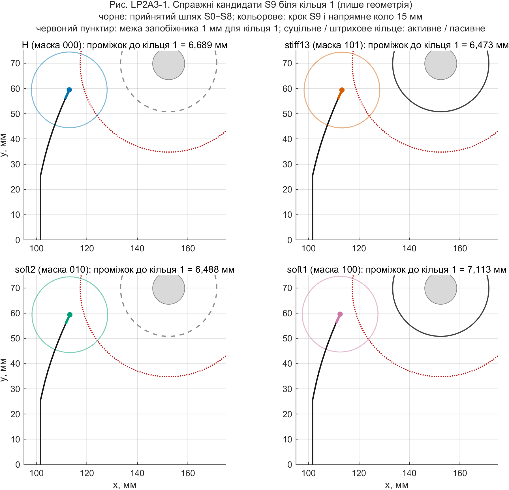

# G2-LP2-A3. Обмежене продовження тріщини в матриці S9–S11: меморандум готовності

Завдання: https://github.com/mfs9697/NewMetacomp/issues/74.

Гілка `research/g2-lp2a3-restricted-20261125` (чорновий PR, складений на #71). Початкова голова — `666c3a7842299ec8f95f8a325df01f5c24dde588`.

**Лише підготовка.**
- Фізичних розв’язків МСЕ: 0.
- Нових прийнятих станів: 0.
- Живого GO немає; GO-файлу, теки запуску і реєстру кампанії не існує.
- Злиттів немає.
- Зупинка: `REVIEW_STOP_LP2A3_READY`.

## 0. Головне

- **Мета.** Підготувати продовження чотирьох прийнятих траєкторій LP2-A1 від S8 щонайбільше до S11.
  - Сітка — лише сімейство LP2-A2 з парними вузлами берегів, з типовим кроком вузлів 0,45 мм (щабель 1).
  - Методологія — успадкована: крок 4 мм, знаковий критерій MTS, незмінні BVP, 16 шлюзів КІН і запобіжники.
- **Батьки.** Авторитетні батьки — **оригінальні стани S8 LP2-A1**: повноточні ламана, дотична і знакові K_I/K_II. Записи WP5 — лише докази придатності нового сімейства сіток; батьками вони не є.
- **Чотири справжні кандидати S9** (розділ 3):
  - кожен відтворює архівного кандидата TERMINAL **побітово**;
  - класифікація — MATRIX_ADVANCE;
  - найменший проміжок «напрямне коло — кільце» — 6,47–7,11 мм (поріг 1 мм);
  - сітка на щаблі 1 проходить 34/34 шлюзи, парування 10/10, фазовий аудит, 76/76/76 хорд;
  - кліренс за фактичними полігонами нової сітки — MATRIX_ADVANCE.
- **Контрактні тести:** 78/78 (`2775d8b`, зокрема 6 реальних тестів git через Windows `system()` і регресія відтворення WP5 `VERIFIED_V2`). **Незмінні набори:** контракт LP2-A1 101/101; набір LP2-A2 v3 72/80 — 8 невиконаних (E9_preflight_bypass_refused, E11_replay_no_records, E5_refusal_without_GO, E6_dry_EQ-H, E6_dry_EQ-stiff13, E6_dry_EQ-soft2, E6_dry_EQ-soft1, E12_no_production_go_or_output) стверджують відсутність кореня виходу WP5 `outputs/g2_lp2a2_eq_v1`, який після активації A2 містить 24 захищені записи; це очікуваний стан після кампанії, а не регресія.
- **Незалежні перевірки.** Перевірка закріплень Python — 18/18 (токен Python = токен MATLAB); 723 захищені записи без змін.

## 1. Обсяг кампанії і межі (заморожено в політиці)

| Параметр | Значення |
|---|---|
| Кампанія / область / запуск | `G2-LP2A3-001` / `LP2A3_S9_S11_MAX12` / `run_lp2a3_s9_s11_v1` |
| Корінь запуску / реєстр (нові, ніколи не історичні) | `outputs/g2_lp2a3_paths_v1/run_lp2a3_s9_s11_v1` / `outputs/g2_lp2a3_campaign_ledger/G2-LP2A3-001` |
| Випадки (порядок фіксований) | H (маска 000, відношення 1), stiff13 (101, 2), soft2 (010, 0,5), soft1 (100, 0,5) |
| Стани і довжина дуги | S9 61,4 мм, S10 65,4 мм, S11 69,4 мм; крок 4 мм, без адаптації |
| Обмеження допусків | ≤ 3 на випадок, ≤ 12 загалом; без повторів і відновлень; не всі 12 мусять бути придатними |
| Поза кампанією | прогноз S12 — лише геометричний, для інформації; без допуску, сітки й МСЕ |
| Сітка | `g2_lp2a3_mesh` = щабель 1 `g2_lp2a2_mesh` (`g2_lp2a2_join`, SeedSpacing 0,45 мм, потім аудит парування). Запасних щаблів немає; провал щаблю 1 зупиняє випадок |

## 2. WP0. Неперервність батьків

**Закріплення батьків.** Закріплено 20 файлів (S8 STATE, MESH, PHASE, SOLUTION і TERMINAL для кожного випадку). Вони збігаються з маніфестом реєстру LP2-A1 і з закріпленнями політики LP2-A2. Перевіряють їх `g2_lp2a3_context`, `g2_lp2a3_parent` і, незалежно, Python.

**Що перевіряє `g2_lp2a3_parent`:**
- маніфести записів;
- тотожність: S8, випадок, маска, відношення;
- зв’язки STATE з MESH, PHASE і SOLUTION;
- побітову рівність K_I і K_II у STATE та SOLUTION;
- 10 вершин ламаної;
- що TERMINAL прив’язаний саме до цього S8 (CAMPAIGN_LIMIT_REACHED).

**Кандидат S9.** Прогноз `g2_lp2_forecast` за політикою LP2-A3 має **побітово** дорівнювати `TERMINAL.candidate.polyline_mm`. Для всіх чотирьох випадків це виконано; найбільша різниця — 0.

**Перехід між сімействами сіток.**
- S8 розв’язано сітковиком LP1 (`g2_kinked_join`).
- S9–S11 буде розв’язано сімейством LP2-A2.
- Придатність нового сімейства спирається лише на рівноцінність WP5 на фіксованих S8 (`EQUIVALENT`, повторне відтворення `VERIFIED_V2`; рецензії 6063867614 і 6064434652).
- Закріплено 24 записи WP5, 8 файлів доказів і SHA архіву `96ed7a36…` — як окремі докази кваліфікації.
- Діагностично: у WP5 зсув предиктора S9, обчисленого з K нового сімейства на S8, становив ≤ 4,194·10⁻⁷ мм. Це лише числове порівняння. Новий кандидат S9 будується з оригінальних K архівного S8.
- Фізичних розв’язків S8 немає. Другого S8 не створено.

**S10 і S11** будуть прогнозовані лише після майбутньої авторизації — з K свого безпосереднього прийнятого батька. Синтетичні геометрії ніколи не стають станами.

## 3. WP2. Чотири справжні кандидати S9 (лише геометрія; без розв’язку)

| Величина | H | stiff13 | soft2 | soft1 |
|---|---|---|---|---|
| маска (кільця 1,2,3) | 000 | 101 | 010 | 100 |
| S9 = кандидат TERMINAL побітово | так | так | так | так |
| вершина S9, мм | (113,0090; 59,4552) | (113,2510; 59,3870) | (113,2393; 59,3732) | (112,5349; 59,5939) |
| курс S9, ° | 65,6812 | 66,0876 | 65,1751 | 65,6208 |
| MTS батька S8, ° | -1,28350 | -0,90061 | -1,30520 | -1,67050 |
| проміжок до кільця 1 / 2 / 3, мм (поріг 1) | 6,6894 / 38,7267 / 84,6702 | 6,4730 / 38,6535 / 84,6545 | 6,4879 / 38,6714 / 84,6714 | 7,1132 / 38,8683 / 84,6977 |
| вершина — коло кільця 1, мм | 21,6894 | 21,4730 | 21,4879 | 22,1132 |
| класифікація (номінальна) | MATRIX_ADVANCE | MATRIX_ADVANCE | MATRIX_ADVANCE | MATRIX_ADVANCE |
| сітка, щабель 1 (0,45 мм) | пройдено | пройдено | пройдено | пройдено |
| T3 | 30169 | 30179 | 30173 | 30187 |
| шлюзи аудиту / парування | 34/34 / 10/10 | 34/34 / 10/10 | 34/34 / 10/10 | 34/34 / 10/10 |
| хорди на коло | 76/76/76 | 76/76/76 | 76/76/76 | 76/76/76 |
| фазовий аудит / карта фаз | так / так | так / так | так / так | так / так |
| кліренс фактичних полігонів нової сітки | MATRIX_ADVANCE | MATRIX_ADVANCE | MATRIX_ADVANCE | MATRIX_ADVANCE |

Результат для кожного випадку окремо: усі чотири кандидати S9 пройшли всі перевірки до МСЕ на типовому щаблі; жодного розв’язку не виконано, нічого не записано.

**Чим ці результати відрізняються від попередніх.**
- Це **справжні** кандидати з архівних батьків.
- Попередні результати — інша річ:
  - вісім синтетичних геометрій S11 (±1°/крок, кліренс 1,716–2,818 мм, 8/8 на щаблі 1);
  - регресія 74/76 на щаблі 1;
  - 8/8 незалежних.
- Широку регресію не повторювали, і політику під результати не налаштовували.
- Майбутні геометрії S10/S11 невідомі до отримання реальних K.

## 4. WP1. Мінімальна проспективна реалізація

Простір імен — `matlab/g2/lp2a3/`, 13 файлів `.m`, власний дайджест. Історичні джерела не змінено.

| Файл | Роль | Звідки |
|---|---|---|
| `g2_lp2a3_context` | Закріплення, дайджести g2/lp2/lp2a2/lp2a3, 20 батьків, кваліфікація WP5, токен | Новий, за зразком `g2_lp2_context` |
| `g2_lp2a3_parent` | Оригінальний S8 як батько; побітовий кандидат TERMINAL | Новий |
| `g2_lp2a3_guard`, `g2_lp2a3_classify` | Запобіжник 1 мм до кожного кільця; `g2_lp2_classify` без змін + PASSIVE_CONTOUR_APPROACH | Новий / обгортка |
| `g2_lp2a3_mesh` | Лише щабель 1 (0,45 мм); `SeedSpacing` передати не можна | Перша послідовність викликів `g2_lp2a2_mesh` |
| `g2_lp2a3_chain`, `g2_lp2a3_verify` | Ланцюг і перевірка | Копії прийнятих `g2_lp2_chain`/`g2_lp2_verify`: схеми LP2-A3, текст S11/S12, перевірка щаблю |
| `g2_lp2a3_admit_hook`, `g2_lp2a3_failure_class` | S9–S11; 3 на випадок, 12 загалом; порядок; локальні ідентифікатори LP2-A3 | Копії з розширенням |
| `g2_lp2a3_go_validate`, `g2_lp2a3_run`, `g2_lp2a3_external_run` | GO з прив’язкою git (`g2_lp2a2_git`: HEAD~1, код завершення, 40-hex); драйвер; єдина точка входу | За зразком WP5/LP2-A1 |
| `g2_lp2a3_tests` | Контрактні тести без МСЕ | Новий |

**Перевірка успадкованих припущень:**
- `g2_lp2_chain` жорстко задавав текст S8/S9 → параметризовано (S11/S12 лише для інформації).
- `g2_lp2_verify` очікував схему LP2A, джерело lp2 і батька S4 → схеми LP2-A3, дайджести lp2a2/lp2a3, батьки S8, обов’язкові поля щаблю 1.
- `g2_lp2_admit_hook` мав межі S5–S8 і 16 допусків → S9–S11, 3 на випадок, 12 загалом, заборона пропуску й дублювання.
- `g2_lp2_classify` позначав пасивне кільце як NUMERICAL_HOLD → тепер PASSIVE_CONTOUR_APPROACH (саму успадковану функцію не змінено).
- `g2_lp2_failure_class` не знав ідентифікаторів LP2-A2/A3 → обгортка з локальними ідентифікаторами LP2-A3.
- Драйвер сітки LP2-A1 використовував `g2_kinked_join`, а LP2-A2 — драбину щаблів → `g2_lp2a3_mesh` бере лише щабель 1.

**Незмінні складові:**
- `g2_lp2_forecast` (знаковий MTS, 4 мм, стаціонарність ≤ 1e-12, K_I > 0);
- `g2_lp0_clearance`, `g2_lp1_audit`;
- `g2_lp1_admit_state` (запобіжник 5 ГіБ), `g2_lp1_campaign_validate` і реєстр;
- `g2_m4b_ring_activation`, `g2_m4b_sif_partial`;
- BVP (плоский напружений стан, E = 3268,115 МПа, ν = 0,35, товщина 12,7 мм, точкова сила 1 Н), контрасти, COD/EDI, J/G, MTS.

Критерії C1–C11 з WP5 не є порогами приймання нових станів. Архівних S9–S11 для порівняння не існує.

## 5. Ресурси, запобіжники і правила зупинки

| Що | Значення | Наслідок |
|---|---|---|
| До запуску MATLAB | ≥ 8,2 ГіБ доступної пам’яті, 0 процесів MATLAB, знімний диск (`lp2a2_eq_prestart_check.ps1`, типовий поріг) | Без запуску |
| Попередня перевірка в MATLAB | R2023a + PDE, один процес, чисте дерево, ≥ 5 ГіБ (без змін) | `G2LP2A3:Preflight` |
| Перед кожним допуском | `g2_lp2a2_eq_memgate` ≥ 7 ГіБ, потім `g2_lp1_admit_state` (≥ 5 ГіБ) | Глобальний HOLD до створення теки стану |
| Перед кожним розв’язком | ≥ 7 ГіБ і ≥ 5 ГіБ | Глобальний HOLD після допуску; без автоматичного повтору |
| Кандидат: успадковані запобіжники кліренсу, перегину, q, кола 15 мм, коміра 3,3 мм | Без змін | Термінальна класифікація; без сітки й розв’язку |
| Кандидат: проміжок до кожного кільця | min_i(‖tip−c_i‖ − 19,05 − 15) ≥ 1 мм; рівно 1 мм проходить | Активне кільце → INTERFACE_APPROACH; пасивне → PASSIVE_CONTOUR_APPROACH; не є зустріччю чи зупинкою |
| Сітка, щабель 1 | 34 шлюзи, P1–P10, фази/власники, 76 хорд, T3 ≤ 40000, кут ≥ 20°, відношення ≤ 1,8 | NUMERICAL_HOLD (FAILED_MESH збережено); іншого кроку немає |
| Розв’язок | 16 шлюзів КІН, MTS OK, стаціонарність ≤ 1e-12, K_I > 0 | NUMERICAL_HOLD |
| Глобальні причини | Джерело, політика, авторизація, пам’ять, цілісність записів чи реєстру, неочікувана помилка | Глобальний HOLD, кампанію зупинено, часткові записи збережено, без відновлення |
| Прийнято S11 | Межа | CAMPAIGN_LIMIT_REACHED; кандидат S12 позначено як інформаційний |

## 6. Шаблон GO і токен

**Шаблон:** `docs/research/G2_LP2A3_GO_DECISION_TEMPLATE.md`. Токен прив’язує:
- політику;
- джерела g2, lp2, lp2a2 і lp2a3;
- маніфест 20 батьків і маніфест кваліфікації (24 записи, 8 файлів доказів, архів);
- випадки, стани, ліміти й крок 0,45 мм;
- назви кампанії та запуску.

**Що перевіряє GO** (`GO_LP2A3_PHYSICAL`):
- URL рішення в цьому репозиторії;
- 40-hex голову;
- поля кампанії, порядок випадків, ліміти;
- хеш контрактних доказів;
- прив’язку активації: HEAD~1 дорівнює схваленій голові, і змінено лише файл GO.

**Хто вирішує.** Авторизувати може лише окремий коментар дослідника.

**Після будь-якого результату** кампанії:
- незалежна перевірка лише на читання: повний прийнятий префікс, термінали, реєстр;
- архів на двох фізичних пристроях;
- відкликання GO окремим комітом і перевірка відмови.

## 7. WP3. Попередня реєстрація наукового аналізу (нових даних ще немає)

**Що зберегти.** Зберегти всі криві S0–S8 і стани-батьки для кожної архітектури.

**Що звітувати для майбутніх прийнятих станів S9–S11:**
- G і J;
- знакові K_I і K_II, змішаність K_II/K_I;
- локальний кут MTS і глобальний курс;
- повне знакове бічне зміщення вершини відносно H;
- відстані до всіх кілець: вершина — коло кільця, проміжок «напрямне коло — кільце», кліренс сегмента;
- фактичну активність фаз;
- діагностику сітки й розв’язувача;
- причину термінала і останній прийнятий стан.

**Правила порівняння:**
- лише спільні прийняті довжини дуги s = 25,4 + 4k;
- без інтерполяції чи екстраполяції відсутніх траєкторій.

**Що обчислювати:**
- F_G = G_X/G_H − 1;
- абсолютні G і J;
- попарні контрасти;
- прирости, нахили й можливі зміни знака.

Нулі не екстраполювати.

**Попередньо зареєстровані питання:**
1. stiff13: чи триває посилення, поки F_G < 0?
2. soft2: чи триває послаблення, поки F_G < 0? Консервативний статус INCONCLUSIVE (A1, відношення 0,863) лишається, доки його окремо не обґрунтовано; тренд сам по собі його не підвищує.
3. soft1: чи триває тренд підсилення?
4. Чи перетинаються локальний і глобальний кути?
5. Який знак і величина бічного зміщення?

**Заборонені висновки:**
- Розклад на внесок матеріалу і траєкторії з контрастів на власних траєкторіях не робимо. M5-X6 — лише на S4.
- Компенсацію напрямку з малого локального MTS не виводимо.
- Відносне екранування треба відрізняти від спадання абсолютного G.

**Класифікації наближення і термінали** — числові та умовні. Це не фактична зустріч з інтерфейсом і не зупинка тріщини; кільце 1 для H і soft2 пасивне.

**Межі моделі.** Модель — умовна LEFM/MTS з одиничним навантаженням. Без Gc, в’язкості руйнування, R-кривої чи доведення фізичного росту.

**Наступне питання LP2-B** пропонуватимемо лише з фактичних даних про наближення, після окремо авторизованої кампанії.

## 8. Обмеження

- Кваліфікація охоплює лише S9: справжні кандидати. Геометрії S10/S11 невідомі.
- Наближення до кільця 1 є основним ризиком продовження. На S9 проміжок становить 6,47–7,11 мм. За гіпотетичного кроку 2–3 мм на стан частина випадків може зупинитися запобіжником 1 мм до S11. Це не прогноз.
- Запобіжник одного запуску — локальний реєстр і теки станів. Їх видалення або незалежний клон обійшли б його; протокол це забороняє.
- Попередня перевірка пам’яті жорстка (5 ГіБ). На цій машині з 15 ГіБ пам’яті запуски залежать від вільної пам’яті. Її не знижено.
- Перевірка перед стартом (`lp2a2_eq_prestart_check.ps1`) повторно використана без змін; її запис має мітку `A2`.

## Відтворення

Команди:
- `python -I scripts/g2/lp2a3/lp2a3_make_policy.py <exec> <out> <lp2a3digest>`
- `python -I scripts/g2/lp2a3/lp2a3_hashcheck.py <exec> <tests.json> <out>`
- `python -I scripts/g2/lp2a3/lp2a3_protected.py <exec> <tree.json> <ledger.json> <archiveRecord.json> <out> <manifest>`
- `python -I scripts/g2/lp2a3/lp2a3_go_template.py <repo> <tests.json> <commit>`

MATLAB: `g2_lp2a3_tests()`, `g2_lp2a3_run('Case',id,'Mesh',true,'Preflight',false)`.

Докази — `docs/research/G2_LP2A3_evidence/` (README).
