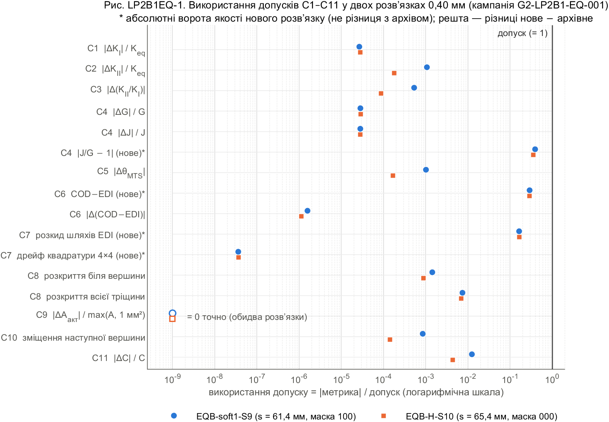

# G2-LP2-B1-EQ — демонстрація фізичної еквівалентності двох фіксованих геометрій на сітці 0,40 мм

**Науковий меморандум (кампанія G2-LP2B1-EQ-001)**

**Статус: `REVIEW_STOP_LP2B1_EQ_DEMONSTRATION`.** Обидва авторизовані розрахунки виконано та завершено. Контролер видав `EQUIVALENT_AT_0p40`, read-only верифікатор — `VERIFIED_EQUIVALENT`. Незалежний аудит пройдено: 59 із 59 перевірок.

GO відкликано окремим комітом, і після відкликання обидва виклики з правильним токеном відмовлено. Новий STATE не створено. Цільовий розрахунок soft1 S10 не виконувався. LP2-B2 не розпочато. Злиття не було.

## 1. Підстави та обсяг

| Пункт | Значення |
|---|---|
| Завдання | https://github.com/mfs9697/NewMetacomp/issues/78 |
| Незалежний висновок про готовність | https://github.com/mfs9697/NewMetacomp/pull/79#pullrequestreview-6084428945. Корекцію перевірки координати вершини явно прийнято |
| Авторизація дослідника `GO_LP2B1_EQ` | https://github.com/mfs9697/NewMetacomp/pull/79#issuecomment-7211904299 (автор mfs9697, 2026-11-27T06:51:00Z) |
| Затверджена голова | `7d0df53f35b30c4e33734c40fdda33e987ea96ee` |
| Комміт активації (лише GO-файл) | `3269d125825dcc403ea9ab975fb5ab55d9a003e8`. Батько — затверджена голова; єдиний змінений шлях — `matlab/g2/lp2b1eq/G2_LP2B1EQ_GO.json`; SHA-256 GO `6abdc02b7ba3d088b9d8b4edced1e7003b4c142f02c21610dcd9ced7567aac2c` |
| Комміт відкликання | `d8906ce669fe6d7e52f6fd773c4fbdbf65fa7447`. Видаляє лише GO-файл; дерево тотожне затвердженій голові |
| Розрахунки | EQB-soft1-S9 (s = 61,4 мм, маска 100, відношення модулів 0,5), потім EQB-H-S10 (s = 65,4 мм, маска 000, відношення 1) |

Обидва розрахунки:
- мали щонайбільше по одній спробі;
- виконані на кваліфікованій сітці 0,40 мм;
- використали незмінні геометрію, матеріали, крайову задачу, розв’язувач, 16 воріт, C1–C11 і всі допуски.

Еталонами є оригінальні прийняті записи LP2-A3 на сітці 0,45 мм.

## 2. Перевірки перед активацією (GO відсутній)

1. Чистий виконавчий клон перебував на затвердженій голові: `git status` порожній, а шляхи GO, кореня прогону, кореня квитанції та підсумку кампанії були відсутні.
2. Незалежний Python-hashcheck дав 12/12. Його виконано щодо закоміченого санітизованого контрактного доказу `35d89119…`, а не сирого архівного файлу.
3. Перевірка захищених записів:
   - 891 унікальний файл без змін (832 відомі файли `e756d64a…`, 43 виходи LP2-B1, 61 файл, закріплений політикою);
   - об’єднаний маніфест `e351f5ac…` дорівнює рецензованому;
   - обидві копії архівів LP2-A3, LP2-B1 і архіву готовності збігаються на C: і на знімному D:.
4. Перевірки в MATLAB (реальний preflight, захисне правило 5 ГіБ без змін):
   - драйвер із правильним токеном відмовив для обох розрахунків з `G2LP2B1EQ:HOLD_UNAUTHORIZED`;
   - обидва записи виходів (2 875 елементів) і git-статус не змінилися;
   - зовнішню точку входу не викликано.
5. Перевірки перед стартом MATLAB (не менше 8,2 ГіБ, жодного процесу MATLAB, знімний D:):
   - `PRESTART_01` відмовила: 5,62 ГіБ;
   - `PRESTART_02` відмовила: D: від’єднано;
   - після очікування й повторного під’єднання D: усі подальші перевірки пройдено.

   Пороги не знижувалися.
6. Перша спроба скрипта перевірок (`b1eq_preact_attempt1`) зупинилася на першому рядку. Причина — дефект мого скрипта: шлях `lp2a2` не було додано до шляху MATLAB, тож `g2_lp2a2_git` був невизначений. Контекст, проби й записи не виконувалися.

   Друга спроба відтворює набір шляхів контексту дослівно і перевіряє розв’язання залежностей. Той самий дефект усунено в скрипті кампанії до її запуску. Інакше він зупинив би перевірку батьківського комміту ще до будь-якого розрахунку.

## 3. Виконання

`g2_lp2b1eq_external_run(approvedHead, tok, outDir)` викликано рівно один раз: 2026-11-27, 10:22:57–10:23:49 за місцевим часом. Квитанцію відкрито о 08:23:04.250Z.

| Величина | Значення |
|---|---|
| Виклики точки входу | 1 |
| Виклики розрахунків (case calls) | 2 |
| Фізичних розрахунків: спроб / завершених | 2 / 2 |
| Допуск геометрії 0,40 мм (19/19 перевірок B1) | 2 / 2; T3 30 183 і 30 349; мінімальний кут 22,387808° і 22,782266°; максимальне відношення сусідів 1,591829 |
| Тривалість розв’язання | 2,17 с (soft1 S9) і 1,86 с (H S10); загальний час 51,3 с |
| Вільна пам’ять перед розв’язанням | 7,93 і 7,87 ГіБ (гейт не менше 7 ГіБ) |
| Вільна пам’ять у попередній перевірці | 8,13 ГіБ |
| Порядок | квитанція → порівняння soft1 S9 (+23,5 с) → геометрія H S10 (+35,0 с) → порівняння H S10 (+43,2 с) → підсумок (+45,0 с) |

Другий розрахунок виконано лише після повного `EQUIVALENT_CASE` першого.

Набори записів точні:
- 10 файлів на розрахунок: MESH, PHASE, SOLUTION і COMPARISON (.mat разом із маніфестами), COMPARISON.json, а також ATTEMPT.json і ATTEMPT_ARRAYS.mat геометричного допуску;
- 2 файли квитанції;
- жодного HOLD.json.

## 4. Результати C1–C11

Таблиці подано з повною точністю. Значення обчислено незалежним аудитом і збігаються із записаними контролером:
- до 1,8·10⁻¹⁶ масштабу операндів;
- для Δθ_MTS різниця з контролером становить 2,2·10⁻¹⁶ ° (класична форма кореня без раціоналізації дала до 1,4·10⁻¹³ ° в аудиті v2, див. §6).

Одиниці вимірювання:
- K — МПа·мм^0,5 при P = 1 Н;
- G і J — Н/мм.

Ворота з поміткою «нове» — абсолютні ворота якості нового розв’язку, а не різниця з архівом.

### EQB-soft1-S9

| Крит. | Величина | Архівне (0,45 мм) | Нове (0,40 мм) | Знакова метрика | Правило | Використання |
|---|---|---|---|---|---|---|
| C1 | K_I, МПа·мм^0,5 (P = 1 Н) | 0.010277889641379047 | 0.01027788950386973 | -1.3377608180104412e-08 | \|ΔK_I\|/K_eq ≤ 5e-4 | 2.676e-05 |
| C2 | K_II, МПа·мм^0,5 | 0.00015550195627223593 | 0.00015550140570708742 | -5.356178785145471e-08 | \|ΔK_II\|/K_eq ≤ 5e-5 | 1.071e-03 |
| C3 | K_II/K_I | — | — | -5.33654955121865e-08 | \|Δ(K_II/K_I)\| ≤ 1e-4 | 5.337e-04 |
| C4 | G = (K_I²+K_II²)/E, Н/мм | 3.2330317733241096e-08 | 3.2330316815942054e-08 | -2.8372719618197095e-08 | \|G_н/G_а − 1\| ≤ 1e-3 | 2.837e-05 |
| C4 | J, Н/мм | 3.233159025689768e-08 | 3.2331589343798755e-08 | -2.824169542670063e-08 | \|J_н/J_а − 1\| ≤ 1e-3 | 2.824e-05 |
| C4 | J/G − 1 (нове) | — | — | 3.9360203735183674e-05 | \|J_н/G_н − 1\| ≤ 1e-4 | 3.936e-01 |
| C5 | θ_MTS, ° | -1.7328171539890624 | -1.7328110485362325 | 6.105452829974212e-06 | \|Δθ\| ≤ 0,006°; корінь допустимий | 1.018e-03 |
| C6 | COD−EDI (відносне) | 0.008743474627729194 | 0.008743473046875786 | -1.5808534082478731e-09 | нове ≤ 0,03; \|Δ\| ≤ 1e-3 | 1.581e-06 |
| C7 | розкид шляхів EDI | 1.644492979406005e-06 | 1.644494493585566e-06 | — | нове ≤ max(1e-5, 5×архівне) | 1.644e-01 |
| C7 | дрейф квадратури 4×4 | 3.608147683702242e-13 | 3.611522990019584e-13 | — | нове ≤ max(1e-5, 5×архівне) | 3.612e-08 |
| C8 | стрибок \|u_U−u_L\| біля вершини (≤ 3,3 мм) | — | — | 1.4368654607795249e-06 | ≤ 1e-3 | 1.437e-03 |
| C8 | стрибок \|u_U−u_L\| по всій тріщині | — | — | 1.4906312656478323e-05 | ≤ 2e-3 | 7.453e-03 |
| C9 | активна площа, мм² | 1012.152528598162 | 1012.152528598162 | 0.0 | \|ΔA\|/max(A,1) ≤ 1e-9; 16 воріт; 76 хорд | 0.000e+00 |
| C10 | наступна вершина, мм | — | — | 4.2624101465153124e-07 | ≤ 5e-4 мм | 8.525e-04 |
| C11 | піддатливість, мм/Н | 0.0002375687468303487 | 0.00023756578234956544 | -1.2478412345084955e-05 | \|C_н/C_а − 1\| ≤ 1e-3 | 1.248e-02 |
| C10 | координати наступної вершини (x, y), мм | (114.29544883822506, 63.18559491151613) | (114.2954484554881, 63.1855950991163) | Δ = (-3.827369567943606e-07, 1.8760017184149547e-07) | — | — |

Прапорці C1–C11 (незалежний аудит = записані): C1 ✓, C2 ✓, C3 ✓, C4 ✓, C5 ✓, C6 ✓, C7 ✓, C8 ✓, C9 ✓, C10 ✓, C11 ✓

Діагностика розкриття (лише звітується):

- біля вершини: вузлів 57 (архів 57), max |Δj| = 2.646028554481616e-11 мм, max |Δg| (знакове нормальне) = 2.6308393208081607e-11 мм; max j_нове = 1.841528401027956e-05 мм;
- вся тріщина: станцій 349 (архів 319), max |Δj| = 1.382100571827255e-09 мм на s = 56.600 мм; max j_нове = 9.271914548408392e-05 мм;
- знакове нормальне розкриття, вся тріщина: відносна різниця 0.0030811065276042738; максимум |Δg| = 2.791276737398548e-07 мм на s = 25.600 мм (0.200 мм за зламом s = 25,4 мм); біля вершини 1.4286386405837456e-06; мінімум g: нове 0.0, архів 0.0 мм.

### EQB-H-S10

| Крит. | Величина | Архівне (0,45 мм) | Нове (0,40 мм) | Знакова метрика | Правило | Використання |
|---|---|---|---|---|---|---|
| C1 | K_I, МПа·мм^0,5 (P = 1 Н) | 0.010336206195789625 | 0.010336206049051612 | -1.4195704850799865e-08 | \|ΔK_I\|/K_eq ≤ 5e-4 | 2.839e-05 |
| C2 | K_II, МПа·мм^0,5 | 0.00010980867509538642 | 0.00010980858206191415 | -9.000228995153775e-09 | \|ΔK_II\|/K_eq ≤ 5e-5 | 1.800e-04 |
| C3 | K_II/K_I | — | — | -8.849917691039488e-09 | \|Δ(K_II/K_I)\| ≤ 1e-4 | 8.850e-05 |
| C4 | G = (K_I²+K_II²)/E, Н/мм | 3.269444816568757e-08 | 3.2694447231246634e-08 | -2.8581027988749952e-08 | \|G_н/G_а − 1\| ≤ 1e-3 | 2.858e-05 |
| C4 | J, Н/мм | 3.269562397114348e-08 | 3.269562304005951e-08 | -2.8477326941001024e-08 | \|J_н/J_а − 1\| ≤ 1e-3 | 2.848e-05 |
| C4 | J/G − 1 (нове) | — | — | 3.596356300383796e-05 | \|J_н/G_н − 1\| ≤ 1e-4 | 3.596e-01 |
| C5 | θ_MTS, ° | -1.217065037212334 | -1.2170640238870094 | 1.0133253245392382e-06 | \|Δθ\| ≤ 0,006°; корінь допустимий | 1.689e-04 |
| C6 | COD−EDI (відносне) | 0.008765816232767306 | 0.00876581511470412 | -1.1180631871721136e-09 | нове ≤ 0,03; \|Δ\| ≤ 1e-3 | 1.118e-06 |
| C7 | розкид шляхів EDI | 1.6445823138610736e-06 | 1.6445814344895828e-06 | — | нове ≤ max(1e-5, 5×архівне) | 1.645e-01 |
| C7 | дрейф квадратури 4×4 | 3.646735889949859e-13 | 3.6299539082759067e-13 | — | нове ≤ max(1e-5, 5×архівне) | 3.630e-08 |
| C8 | стрибок \|u_U−u_L\| біля вершини (≤ 3,3 мм) | — | — | 8.916365842485338e-07 | ≤ 1e-3 | 8.916e-04 |
| C8 | стрибок \|u_U−u_L\| по всій тріщині | — | — | 1.3956277737331265e-05 | ≤ 2e-3 | 6.978e-03 |
| C9 | активна площа, мм² | 0.0 | 0.0 | 0.0 | \|ΔA\|/max(A,1) ≤ 1e-9; 16 воріт; 76 хорд | 0.000e+00 |
| C10 | наступна вершина, мм | — | — | 7.074345218137021e-08 | ≤ 5e-4 мм | 1.415e-04 |
| C11 | піддатливість, мм/Н | 0.0002386204261080145 | 0.0002386193882912188 | -4.349237039846798e-06 | \|C_н/C_а − 1\| ≤ 1e-3 | 4.349e-03 |
| C10 | координати наступної вершини (x, y), мм | (116.53715206030587, 66.63469316681929) | (116.5371519971494, 66.6346931986924) | Δ = (-6.315647738119878e-08, 3.187311392593983e-08) | — | — |

Прапорці C1–C11 (незалежний аудит = записані): C1 ✓, C2 ✓, C3 ✓, C4 ✓, C5 ✓, C6 ✓, C7 ✓, C8 ✓, C9 ✓, C10 ✓, C11 ✓

Діагностика розкриття (лише звітується):

- біля вершини: вузлів 57 (архів 57), max |Δj| = 1.6503095846267732e-11 мм, max |Δg| (знакове нормальне) = 1.6513444528899052e-11 мм; max j_нове = 1.8508769310061953e-05 мм;
- вся тріщина: станцій 369 (архів 337), max |Δj| = 1.3781410696980096e-09 мм на s = 60.600 мм; max j_нове = 9.87470366838328e-05 мм;
- знакове нормальне розкриття, вся тріщина: відносна різниця 0.0037506919681238467; максимум |Δg| = 3.5977263683736383e-07 мм на s = 25.600 мм (0.200 мм за зламом s = 25,4 мм); біля вершини 8.922027101732063e-07; мінімум g: нове 0.0, архів 0.0 мм.

**Рис. LP2B1EQ-1.** Використання допусків (|метрика| / допуск, логарифмічна шкала) для обох розв’язків. Також є векторний [PDF](G2_LP2B1EQ_evidence/campaign/figures/LP2B1EQ_1_vykorystannia_dopuskiv.pdf).

## 5. Наукова інтерпретація

1. **Порівняльні метрики** (різниця нове − архівне) використовують допуск щонайбільше на 1,25 %. Найбільшою є піддатливість: ΔC/C = −1,248·10⁻⁵ для soft1 S9 і −4,35·10⁻⁶ для H S10. Решта:
   - C8, розкриття по всій тріщині: 0,75 % і 0,70 %;
   - C8, розкриття біля вершини: 0,14 % і 0,09 %;
   - C2: 0,11 % і 0,018 %;
   - C5: 0,10 % і 0,017 %;
   - C10: 0,085 % і 0,014 %.

   Відносні зміни K_I, G і J мають порядок 10⁻⁸.
2. **Механізм.** Захищене ядро біля вершини в обох сітках побітово тотожне: 5 953 вузли та 2 916 елементів у колі 3,3 мм. Носій q-функції EDI/J (2 443 елементи, радіус 2,77 мм) лежить усередині цього ядра. Тому зміна зовнішньої сітки 0,45 → 0,40 мм впливає на K лише через далеке поле, і цей вплив має порядок 10⁻⁸.

   Глобальна піддатливість — інтеграл по всьому тілу. Вона реагує на зовнішню сітку сильніше (10⁻⁶–10⁻⁵), але на 2–3 порядки нижче за допуск 10⁻³.
3. **Абсолютні ворота якості** мають помітне використання:
   - J/G − 1: 39 % і 36 %;
   - COD−EDI: 29 %;
   - розкид шляхів EDI: 16 %.

   Вони збігаються з архівними значеннями до 2·10⁻⁹ в абсолютних одиницях відповідних величин. Отже, це властивості методу видобування K на цій геометрії, а не наслідок зміни сітки.
4. **H S10 — точний нуль активної площі.** Маска 000 у новій сітці не дає жодного елемента з міткою 2. Активна площа дорівнює 0 точно, як і в архіві. Сильніший підгейт C9 виконано.

   Розподіл власників кілець (30 349 = 18 087 + 4 088 + 4 080 + 4 094) змінився разом із сіткою, але мітки фаз повністю визначаються маскою.
5. **soft1 S9 — активне кільце 1.** Активна площа становить 1012,152528598162 мм² і побітово дорівнює архівній, бо контур кільця — той самий 76-хордовий багатокутник. Незалежне підсумовування площ трикутників дає 1012,1525285981616 мм², тобто відрізняється на 4·10⁻¹³ мм² через порядок підсумовування.

   Кількість елементів кільця 1 змінилася: 4 076 → 4 090.
6. **Наступна вершина.** Рекурентність g2_lp2_forecast незалежно відтворює архівні вершини S10 і S11 з нульовою похибкою. Зі новими K вершина зміщується на 4,26·10⁻⁷ мм (soft1 → S10) і 7,07·10⁻⁸ мм (H → S11). Межа становить 5·10⁻⁴ мм, тож прогноз траєкторії нечутливий до цієї зміни сітки.
7. **Знакове нормальне розкриття** (лише звітується). По всій тріщині відносна різниця становить 3,08·10⁻³ і 3,75·10⁻³. Для модуля стрибка ці показники — 1,5·10⁻⁵ і 1,4·10⁻⁵.

   Максимум |Δg| в обох випадках лежить на станції s = 25,6 мм, тобто за 0,2 мм після найбільшого зламу полілінії: 11,5° на s = 25,4 мм між вихідним надрізом і першим приростом. Знакове розкриття g = (u_U − u_L)·n використовує нормаль сегмента, яка на зламі стрибає. Тому лінійна інтерполяція архівних станцій через злам дає артефакт, а модуль стрибка, неперервний на зламі, його не має.

   Біля вершини знакова й модульна різниці однакові: 1,4·10⁻⁶ і 8,9·10⁻⁷. Мінімум g дорівнює 0, і досягається він у вершині, де стрибок нульовий.
8. **Вершина H** знаходиться на відстані одного ULP (1,42·10⁻¹⁴ мм) від кінця полілінії, однаково в архівній і новій сітці. Це збігається з прийнятою на рецензії діагностикою. Для soft1 відстань дорівнює 0.

## 6. Незалежний аудит (поза верифікатором)

Аудит — це скрипт `scripts/g2/lp2b1eq/lp2b1eq_audit.py` (Python + numpy, жодна функція MATLAB не використовується повторно). Він працює з байтами записів, git-об’єктами та сирими float64-експортами (66 масивів). Результат `LP2B1EQ_AUDIT_v3.json`: PASS, 59/59.

Перевірено незалежно:
- **Набори та зв’язки:**
  - точні набори прогону й квитанції без зайвих файлів;
  - маніфести відповідають SHA-256 файлів;
  - копія підсумку кампанії тотожна;
  - зв’язки SOLUTION/PHASE/COMPARISON ↔ MESH ↔ архівний SOLUTION.
- **Активація:**
  - GO дорівнює активаційному запису авторизації поле в поле, із фактичним URL коментаря;
  - перевірено батьківський комміт, єдиний змінений шлях і байти GO, а також відкликання з деревом, тотожним затвердженій голові;
  - токен у квитанції, PHASE, SOLUTION і COMPARISON;
  - SHA політики й джерел перераховано.
- **Еталони:** архівні піни STATE, SOLUTION, PHASE, ADMIT і MESH та масиви кваліфікації перехешовано з диска.
- **Геометрія:**
  - канонічні дайджести `7535d71a…` і `45298fae…` перераховано із сирих масивів;
  - 9 масивів побітово дорівнюють кваліфікації;
  - полілінія тотожна архівному STATE;
  - усі площі T3 додатні.
- **Береги тріщини й топологія:**
  - пари берегів збігаються (нев’язка 0);
  - станції унікальні;
  - є рівно один спільний вузол — фізична вершина 1114;
  - захищений диск 3,3 мм збігається як множина елементів (2 916) і множина координат вузлів (5 953) побітово.
- **Фази:**
  - мітки повністю визначаються власниками й маскою;
  - кількості міток дорівнюють K.phaseCounts;
  - активну площу перераховано з трикутників;
  - для H активна площа дорівнює нулю точно.
- **Розв’язувач:** 16 воріт (нові й архівні); довжина u = 2·N_T6; вузол навантаження (254; 203,2); C = |u_y|.
- **Метрики та прапорці:**
  - корінь MTS обчислено в іншій алгебраїчній формі;
  - рекурентність наступної вершини — окрема реалізація;
  - C8 реалізовано повністю окремо (станції, стрибки, ідентичність 57 вузлів біля вершини, відсутність екстраполяції, інтерполяція);
  - усі метрики й прапорці C1–C11 перераховано за порогами політики;
  - COMPARISON.json і COMPARISON.mat порівняно поле в поле;
  - перевірено вектори.
- **Ресурси й облік:** гейти пам’яті, порядок за часом файлів; 1 виклик точки входу, 2 рядки розв’язувача, 2 допуски геометрії, 2 записи SOLUTION.

**Невдалі спроби аудиту (збережено):**
- **v1** аварійно завершився на розборі дампа: масив структур кодується як список. Жодної перевірки не виконано.
- **v2** — HOLD, 55/59. Обидві причини — дефекти аудиту:
  - (а) порівняння хешів чутливе до регістру, а MATLAB-читач записів повертає частину дайджестів у верхньому регістрі; усі хеші збігаються без урахування регістру;
  - (б) правило збігу метрик «10⁻¹² відносно самої різниці» некоректно поставлене для різниць майже рівних величин.

  Залишкові розбіжності v2 такі:
  - Δθ_MTS — 3·10⁻¹⁴ °. Класична форма 2·atan((K_I − √(K_I² + 8K_II²))/(4K_II)) має скорочення порядку ε/(4(K_II/K_I)²) ≈ 2,4·10⁻¹³;
  - зміщення вершини — 1,3·10⁻¹⁴ мм, тобто 1 ULP координати близько 114 мм;
  - розкриття по всій тріщині — 3,4·10⁻¹⁷, через округлення інтерполяції.
- **v3:**
  - хеші порівнюються без урахування регістру;
  - основною є раціоналізована форма MTS без скорочення; класичну форму збережено й звітовано з її межею;
  - збіг вимагається до 10⁻¹² масштабу операндів (1 для нормованих відношень, |θ| для кутів, модуль координат для вершин, саме значення для абсолютних величин); лічильники — точно.

  Найгірший збіг: 1,5·10⁻¹⁶ (soft1 S9) і 1,8·10⁻¹⁶ (H S10) масштабу операндів. Прапорці C1–C11 не залежать від цієї зміни правила і збігаються із записаними у v2 і v3.

## 7. Закриття

1. **Відкликання.** Комміт `d8906ce` видаляє лише GO-файл; дерево тотожне `7d0df53`.
2. **Відмови після відкликання** (реальний preflight, правильний токен), `LP2B1EQ_POST_REVOCATION.json`:
   - обидва розрахунки — `G2LP2B1EQ:HOLD_UNAUTHORIZED`;
   - файли прогону (20), квитанції (2), підсумок і перелік виходів не змінилися;
   - git чистий;
   - 0 розрахунків, зовнішню точку входу не викликано.
3. **Верифікатор після відкликання:** `VERIFIED_EQUIVALENT`, дерево без змін.
4. **Захищені записи після кампанії** (`LP2B1EQ_PROTECTED_POSTCAMPAIGN.json`):
   - 832 відомі файли, 43 виходи B1 і 61 закріплений файл без змін;
   - об’єднаний маніфест `e351f5ac…` дорівнює попередньому;
   - копії архівів LP2-A3 і LP2-B1 збігаються на обох пристроях.

   Загальний прапорець скрипта — FAIL лише через компонент готовності «корені відсутні»: кампанія очікувано створила корені прогону й квитанції та підсумок, а GO-файл відсутній. Перша спроба цієї перевірки (`…_attempt1_D_detached`) виконувалася при від’єднаному D:. Її збережено, повторено після під’єднання.
5. **Архів:** `NewMetacomp_G2_LP2B1EQ_Campaign_20261127.zip`, SHA-256 `1d739f80fe77597e3749de7e939abf8f572bc48f27bb703c28d02f94634d6e8a`, 136 членів (23 файли виходів і журнали та докази).

   Копії перевірено член за членом на C: (`<backup>`) і на знімному D:. Попередні архіви не змінено.

## 8. Інциденти та відхилення

- Дві відмови перевірки перед стартом: нестача пам’яті та від’єднаний D:. Обидві до активації; пороги не знижувалися.
- D: від’єднувався ще раз після закриття. Перевірку захищених записів і архівування виконано після повторного під’єднання.
- Дефект шляху MATLAB у скрипті попередніх перевірок (див. §2.6).
- Дві невдалі спроби аудиту (див. §6).
- Перша версія рисунка мала накладання позначок на підпис C9; її збережено в журналах.
- Скрипт архівування кампанії `lp2b1eq_campaign_archive.py` — мінімальний варіант рецензованого `lp2b1eq_archive.py`. Він приймає кілька шляхів; решту коду не змінено (diff у журналі).
- Рецензовані скрипти готовності (`lp2b1eq_hashcheck.py`, `lp2b1eq_protected.py`) містять локальний шлях резервної теки. Вони не змінювалися.

## 9. Межі тверджень

Доведено лише числову еквівалентність (C1–C11 з початковими допусками) двох фіксованих геометрій між прийнятою сіткою 0,45 мм і кваліфікованою сіткою 0,40 мм. Це:
- не оцінка похибки дискретизації;
- не твердження про збіжність;
- не контраст архітектур;
- не загальна межа для інших станів, геометрій чи кроків сітки.

Новий STATE, поширення тріщини, перетин інтерфейсу чи зупинку не стверджуються і не створювалися.

## 10. Наступні кроки

1. Незалежна наукова рецензія демонстрації.
2. Розрахунок soft1 S10 потребує окремої пізнішої авторизації. Цей GO її не надає і вже відкликаний.
