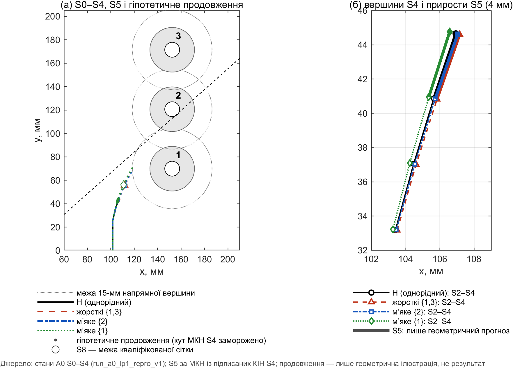
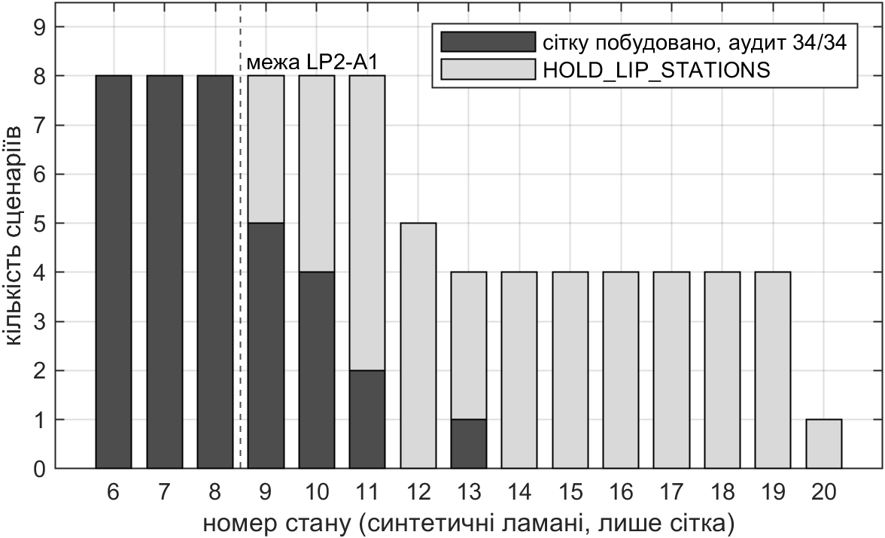

# Поширення тріщини в матриці метакомпозита: постановка задачі, числові обмеження та кваліфікація продовження траєкторій

**Статус:** `REVIEW_STOP_LP2A_CORRECTIONS`. Наукову постановку LP2-A1 прийнято в огляді [6055250219](https://github.com/mfs9697/NewMetacomp/pull/70#pullrequestreview-6055250219). Виправлення C1–C4 внесено, і повторна кваліфікація без МСЕ дала `LP2A_PREFLIGHT_PASS_SCIENTIFIC_HOLD`, 107/107 перевірок (див. редакційну примітку наприкінці). Кампанія **не дозволена**: файлу `GO_LP2A` немає, нових фізичних розв’язків немає.

**Основа:** PR #69 на голові `d5f4681`, огляд [6054335912](https://github.com/mfs9697/NewMetacomp/pull/69#pullrequestreview-6054335912). Цей огляд дозволу на LP2 не дає.

## 0. Головне

1. **Стартові стани.** Прийняті стани S4 узято з відтворення A0 (`run_a0_lp1_repro_v1`). Вони побітово збігаються з первинним LP1 S4. Формула продовження, застосована до батьківських станів A0, побітово відтворює S1–S4 усіх чотирьох траєкторій.
2. **Звідки брати КІН для продовження.** Батьківські КІН беруться з A0 S4 — того сімейства сіток, на якому перевірено алгоритм поширення. Уточнення A1 B9 змінює кут МКН лише на 1,2–1,8·10⁻⁴°, а вершину S5 — на 0,8–1,2·10⁻⁵ мм, тож сімейство сіток під час продовження не змінюється.
3. **Чотири прогнози S5** (лише геометрія): усі `MATRIX_ADVANCE`, проходять K1–K10. Сітки для них побудовано незміненим генератором LP1, і вони проходять аудит 34/34.
4. **Головне чинне обмеження — генератор сітки, а не напрямна вершини.** Незмінений генератор LP1 стабільний лише до 10 вершин ламаної (S8): синтетичні ламані S6–S8 пройшли 24/24. Від S9 частина спроб зупиняється з `HOLD_LIP_STATIONS` (S9 — 5/8, S10 — 4/8), а після S12 зупиняються майже всі. Причина — неоднакова кількість вузлів на двох берегах тріщини.
5. **LP2-A1 готова до окремого рішення.** Це продовження S5–S8 для всіх чотирьох траєкторій, не більше 16 розв’язків, з незміненою чисельною схемою. Наприкінці гіпотетичного продовження вершина лишалася б на відстані 24–26 мм від кола кільця 1, тобто напрямна ще не обмежує.
6. **Далі S8 потрібні нові кваліфікації.**
   - LP2-A2: стійке парування вузлів берегів у генераторі сітки.
   - LP2-B: підхід до кілець. За гіпотетичним продовженням 15-мм напрямна зупиняє траєкторію за 15–17 мм від кола кільця 1 (S11–S12). Ближче можна підійти лише з меншою напрямною, змінним кроком і новою топологією біля пасивних контурів.
7. **Межі тлумачення.** Пасивний контур кільця (усі кільця в H, неактивні кільця в архітектурах) не є матеріальним інтерфейсом. Його перешкода — числова, і класифікується як `NUMERICAL_HOLD`. Фізична зупинка тріщини ніколи не виводиться.

## 1. Наукова мета і що саме розрізняється

Мета — повні траєкторії тріщини в матриці для H, жорстких {1,3}, м’якого {2} і м’якого {1} до першої кваліфікованої зустрічі з активним інтерфейсом, краєм зразка або числового HOLD. Розрізняються шість речей:

1. екранування або підсилення рушійної сили (F_G);
2. зміна локального напрямку (кут МКН);
3. накопичена різниця траєкторій (бічне зміщення, курс);
4. наближення до **активного** інтерфейсу;
5. наближення до отвору або зовнішнього краю;
6. **числове** припинення.

Остання категорія ніколи не тлумачиться як фізична зупинка.

## 2. Прийняті стартові стани S4

**Таблиця 1.** Стани A0 S4: P = 1 Н, K у МПа·√мм, G у Н/мм; курс відраховується від осі x.

| Випадок | s, мм | вершина S4, мм | курс, ° | K_I | K_II | G | θ_МКН, ° |
|---|---|---|---|---|---|---|---|
| H | 41,4 | (105,6475; 40,8720) | 72,887 | 7,091176·10⁻³ | +1,009033·10⁻⁴ | 1,538959·10⁻⁸ | −1,6298 |
| жорсткі {1,3} | 41,4 | (105,8320; 40,8226) | 72,226 | 6,832177·10⁻³ | +9,257277·10⁻⁵ | 1,428567·10⁻⁸ | −1,5520 |
| м’яке {2} | 41,4 | (105,7297; 40,8499) | 72,520 | 6,986421·10⁻³ | +1,015889·10⁻⁴ | 1,493840·10⁻⁸ | −1,6654 |
| м’яке {1} | 41,4 | (105,3506; 40,9466) | 73,956 | 7,312049·10⁻³ | +1,097221·10⁻⁴ | 1,636359·10⁻⁸ | −1,7186 |

Перевірено:

- маніфести записів;
- SHA-256 файлів STATE, MESH і SOLUTION — вони збігаються із закоміченим `A0_RUN_RECORDS_SHA256.json` і закріплені в політиці LP2;
- зв’язки STATE → MESH/SOLUTION;
- побітову рівність A0 S4 і LP1 S4.

## 3. Методика продовження за критерієм МКН

Для кожного прийнятого стану n використовуються знакові КІН цього самого стану:

- θ_n = θ_МКН(K_I,n, K_II,n) — неперервний розтяжний корінь `g2_mts_direction`, статус OK, нев’язка стаціонарності ≤ 10⁻¹²;
- t_(n+1) = cos θ_n · t_n + sin θ_n · n_n, де n_n = R(+90°) t_n;
- x_(n+1) = x_n + Δa · t_(n+1), Δa = 4 мм.

Курс α_(n+1) = α_n + θ_n збігається з поворотом дотичної. θ < 0 повертає дотичну до −n, тобто праворуч, до колони кілець. Траєкторія не задається геометрично: кожен крок спирається лише на розв’язок попереднього прийнятого стану.

`g2_lp2_forecast` повторює `g2_lp1_forecast` рядок у рядок; змінено лише межі станів. Вона побітово відтворює прийняті S1–S4 з їхніх батьківських станів A0.

## 4. Видобування КІН і перевірки

Без змін залишаються:

- плоский напружений стан, T6, ідеальне зчеплення фаз, шарнір, каток і сила 1 Н;
- сліпий COD за парами вузлів берегів;
- знаковий EDI на п’яти кільцях (основне 0,4–2,6 мм) і правило 4×4;
- 16 критеріїв `g2_m4b_sif_partial`: рівновага, COD–EDI ≤ 3 % K, розкид контурів ≤ 0,5 %, J–G ≤ 0,5 %, квадратура ≤ 0,1 %, q-область усередині ядра 3 мм, лише в матриці й поза кільцями, розкриття по всій тріщині, K_I > 0, енергетична тотожність, баланс на активних інтерфейсах;
- аудит сітки з урахуванням кінків (34 перевірки), бюджет 40 000 T3, фазова карта й незалежний оракул власника кілець.

Нове лише одне: кожен стан LP2 додатково записує відстані до всіх кілець і отворів, запаси напрямної, q-області та комірця, класифікацію й хеші батьківського стану й джерел.

## 5. Чотири геометричні прогнози S5

**Таблиця 2.** Кандидати S5 від батьківських станів A0 S4. Відстані взято до номінальних кіл кілець (19,05 мм); запас напрямної дорівнює відстані до кола мінус 15 мм.

| Випадок | вершина S5, мм | курс, ° | до кілець 1 / 2 / 3, мм | запас напрямної до кілець, мм | запас до країв плити (min), мм | K1–K10 | класифікація |
|---|---|---|---|---|---|---|---|
| H | (106,9327; 44,6599) | 71,257 | 32,93 / 69,50 / 115,65 | 17,93 / 54,50 / 100,65 | 29,66 | так | MATRIX_ADVANCE |
| жорсткі {1,3} | (107,1557; 44,5972) | 70,674 | 32,76 / 69,44 / 115,63 | 17,76 / 54,44 / 100,63 | 29,60 | так | MATRIX_ADVANCE |
| м’яке {2} | (107,0416; 44,6286) | 70,855 | 32,85 / 69,47 / 115,64 | 17,85 / 54,47 / 100,64 | 29,63 | так | MATRIX_ADVANCE |
| м’яке {1} | (106,5709; 44,7559) | 72,237 | 33,20 / 69,61 / 115,68 | 18,20 / 54,61 / 100,68 | 29,76 | так | MATRIX_ADVANCE |

Для всіх чотирьох кандидатів S5:

- сегменти мають довжину 4 мм, накопичена довжина 45,4 мм;
- найменша відстань між несуміжними сегментами 4,0 мм;
- самоперетинів немає;
- до кіл отворів понад 45 мм;
- до найближчого (нижнього) краю плити 44,6–44,8 мм, тобто запас напрямної 29,6–29,8 мм;
- сітки (7 вершин, 29 217–29 245 T3) пройшли аудит 34/34 і фазову перевірку.

**Таблиця 3.** Порівняння з уточненням B9 і гіпотетичне продовження. Продовження **не є прогнозом**: це повторення кроку з постійним кутом МКН S4 або прямий хід, лише щоб оцінити межі.

| Випадок | Δθ (B9 − A0), ° | зсув вершини S5, мм | заморожений кут: допустимих станів | обмеження | прямий хід: допустимих станів | обмеження |
|---|---|---|---|---|---|---|
| H | −1,55·10⁻⁴ | 1,08·10⁻⁵ | 7 (до S11) | NUMERICAL_HOLD, ring1 | 15 (до S19) | NUMERICAL_HOLD, ring2 |
| жорсткі {1,3} | −1,76·10⁻⁴ | 1,23·10⁻⁵ | 7 (до S11) | INTERFACE_APPROACH, ring1 | 15 (до S19) | NUMERICAL_HOLD, ring2 |
| м’яке {2} | −1,63·10⁻⁴ | 1,14·10⁻⁵ | 7 (до S11) | NUMERICAL_HOLD, ring1 | 15 (до S19) | INTERFACE_APPROACH, ring2 |
| м’яке {1} | −1,19·10⁻⁴ | 8,30·10⁻⁶ | 8 (до S12) | INTERFACE_APPROACH, ring1 | 16 (до S20) | NUMERICAL_HOLD, ring2 |

В обох сценаріях першою спрацьовує 15-мм напрямна вершини біля кільця 1 (за замороженого кута) або кільця 2 (за прямого ходу). Тип обмеження залежить від архітектури: біля активного кільця це наближення до інтерфейсу, біля пасивного — числова перешкода. За замороженого кута в останньому допустимому стані вершина лежала б за 15,1–16,7 мм від кола кільця 1.

**Рис. LP2-1.** (а) Прийняті траєкторії S0–S4, геометричні прирости S5 (товсті), гіпотетичне продовження із замороженим кутом МКН S4 (точки; не результат) і межа 15-мм напрямної вершини (34,05 мм від центрів кілець). Порожні маркери позначають S8, останній стан у межах кваліфікованої сітки. (б) Вершини S2–S4 і прирости S5. Джерело: стани A0, S5 за МКН із підписаних КІН S4.

## 6. Чинні числові обмеження

| Обмеження | Де діє | Роль | Природа | Наслідок для LP2 |
|---|---|---|---|---|
| Крок 4 мм | K1 (`g2_kink_admissibility`: усі сегменти після першого рівно ΔA), блок `g2_kinked_regular_block` (ΔA = 4), прогноз | ідентичність ламаної, побудова ядра на останньому сегменті | **запобіжник реалізації**: ядро потребує лише ≥ 3,3 мм останнього сегмента | змінний крок потребує змін у K1, блоці й зовнішній сітці, а не лише скаляра |
| Мінімальний останній сегмент 3,3 мм | K3 (вхід комірця на останньому сегменті), комірець 3,3 мм, ядро 3,0 мм | захищена вершина p010 | **фундаментальне для чинної топології** вершини | крок < 3,3 мм неможливий без нового ядра й комірця |
| Напрямна вершини 15 мм | K9 (вершина > 15 мм від країв і > 34,05 мм від центрів кілець), `g2_lp0_clearance`, зовнішня сітка (грань подрібнення 1,5 мм) | контроль розміру елементів біля вершини, не перетинає граней кілець | **консервативний запобіжник** | зупиняє траєкторії за 15–19 мм від кіл кілець; зменшення потребує кваліфікації нового сімейства сіток |
| Комірець 3,3 мм | блок, шви 64+64, аудит G7 | перехід від регулярного ядра до зовнішньої сітки | фундаментальне для чинної топології | — |
| q-область 2,6 мм + 1 мм | EDI, `qSupportRingOwnerFree`, `g2_lp0_clearance` | EDI для однорідного матеріалу в області інтегрування | **фундаментальне для чинного EDI** біля активних інтерфейсів; біля пасивних — перевірка власника (числова) | найближча допустима вершина ≈ 3,6 мм від активного інтерфейсу за будь-якої сітки |
| Лише матриця в q-області | `g2_m4b_sif_partial` | інтеграл взаємодії без доданків від неоднорідності | фундаментальне | зустріч з інтерфейсом цим методом обчислити не можна |
| Якість сітки (кут ≥ 20°, сусіди ≤ 1,8, 40 000 T3) | генератор, аудитор | точність T6 | запобіжники | у пробах ≤ 30 869 T3, запас достатній |
| Парування вузлів берегів | `g2_kinked_exterior_mesh` (однакова кількість вузлів на сегмент, Hedge 0,45 мм) | пари вузлів для COD і берегів | **обмеження реалізації**, виявлене тут | надійно лише до S8; далі HOLD_LIP_STATIONS |
| Відступ сегмента від кола кільця 1,52 мм, від отвору 3 мм, від граней 1,52 мм | K6/K7, `g2_lp0_clearance` | геометрія граней сітки | запобіжники | менш жорсткі за напрямну |

**Рис. LP2-2.** Кваліфікація незміненого генератора сітки на синтетичних ламаних (лише сітка, не траєкторії): гіпотетичні продовження для чотирьох випадків, із замороженим кутом і прямим ходом. Сірим — `HOLD_LIP_STATIONS`. Чотири справжні кандидати S5 (7 вершин) пройшли окремо, 4/4.

## 7. LP2-A1: пропозиція фізичної кампанії

- **Політика** `matlab/g2/lp2/G2_LP2A_POLICY_v1.json` (SHA `093a546b…` після виправлень), драйвер `g2_lp2_run.m`. Увесь код LP2 лежить у підкаталозі. Спільний відбиток `matlab/g2` (`7e568370…`) не змінився, тож закриті кампанії A1 і M5-X6 і далі відтворюються.
- **Межа:** для кожного випадку S5–S8, разом не більше 16 розв’язків (4×4).
  - *Обґрунтування — сітка:* S5 4/4, синтетичні S6–S8 24/24, S9 лише 5/8.
  - *Геометрія:* за гіпотетичним продовженням у S8 до кола кільця 1 ще 24–26 мм, запас напрямної 9–11 мм.
  - *Ресурси:* ≈ 5–12 с на сітку, ≈ 30 с на аудит і 2–3 с на розв’язання для кожного стану; менше 20 хв і менше 0,1 ГБ загалом.
- **Хід кожного випадку.** Прогноз, далі перевірка відступів і класифікація. Якщо результат не `MATRIX_ADVANCE`, записується TERMINAL без сітки й без розв’язання. Інакше: допуск (журнал VG2), сітка, аудит, розв’язання й записи. HOLD означає `NUMERICAL_HOLD` без повтору, а прийнятий S8 — `CAMPAIGN_LIMIT_REACHED`. Кандидат S9 класифікується лише для інформації. Кампанія закривається, коли всі чотири випадки завершено.
- **Закріплені значення:**
  - політика `093a546b9bae54d8fab0026420c8d85dced85f0e0e6ed212d597b3fd1aa6eec5`;
  - відбиток `matlab/g2` `7e568370…`;
  - відбиток LP2 `357dfdcdb576d2866b9d1b41a14265300a14c30700d6475f995881041ba822ca`;
  - маніфест батьківських станів `0dcc572f…`;
  - контрактні докази `docs/research/G2_LP2_evidence/qualification_v2/LP2A_CONTRACT.json`, SHA `34fedbdaa7c4ca681ec47cf95dc51209411902759a87177174cbb09c3ca421dc`;
  - токен — у `LP2A_QUALIFICATION.json`.
- **Кваліфікація без МСЕ після виправлень (107/107, коміт `8d49759`):**
  - 101 контрактна перевірка, з них 56 негативних. До 64 початкових додано:
    - 16 перевірок кампанії на синтетичних записах (C1);
    - 12 перевірок верифікатора, з них 11 негативних (C2);
    - нові правила аналізу (C3).
  - Повторно перевірено батьківські стани S4, і прогнози S5 збіглися з початковими.
  - Перевірено походження успадкованих доказів сітки.
  - 541 захищений файл не змінився.
- **Початкова кваліфікація** (70/70, `86a88fa`, політика `f9d0ce0c…`, LP2 `f114a619…`) збережена як історичний доказ у `qualification_v1_86a88fa/`. Її токен **недійсний** для GO.

## 8. LP2-B: підхід до інтерфейсів і країв

1. **Змінний крок (пропоноване детерміноване правило).** Узяти найбільше Δa з множини {4,0; 3,8; 3,6; 3,4} мм, за якого кандидат проходить усі перевірки. Якщо такого немає, стан завершальний.
   - Нижня межа 3,4 мм лишає запас над фундаментальними 3,3 мм.
   - Потрібно: K1 з довжинами сегментів, параметр ΔA у блоці й зовнішній сітці, прогноз зі змінним Δa, звірка станів за довжиною дуги, а не за номером.
   - Сам по собі змінний крок дає лише ≤ 0,6 мм на крок і **не розв’язує** головного обмеження — напрямної.
2. **Менша напрямна (15 → 5–6 мм).** Потрібні нове сімейство сіток (грань подрібнення біля граней кілець), аудит і перевірка рівності КІН на наявних станах (S4/S5) у межах допусків A1. Для цього треба МСЕ, отже окремий GO. Нижню фізичну межу задає q-область: ≈ 3,6 мм до активного інтерфейсу.
3. **Пасивні контури.** Для H і для неактивних кілець тріщина могла б перетнути контур без жодного фізичного ефекту. Проте сітка, фазова карта й перевірка власника цього не допускають. Потрібна або сітка без полігонів кілець для H (тоді вона відрізнятиметься від сімейства архітектур), або розщеплення полігона кільця тріщиною. Це числова переробка, і до її кваліфікації зупинка біля пасивного контуру класифікується як `NUMERICAL_HOLD` (тип `NUMERICAL_RING`).
4. **Парування берегів (LP2-A2).** Щоб пройти далі S8, треба зробити вузли берегів однаковими: Hedge, що точно ділить сегмент (наприклад 0,4 мм), або явні вузли на обох берегах. Кваліфікація — пробіг лише сіток до S12, а потім рівність КІН проти прийнятих S5–S8 у фізичній кампанії за окремим GO.
5. **Поза межами LP2:** проникнення в інтерфейс, поширення вздовж інтерфейсу, когезійні зони, відшарування, зупинка, розгалуження.

## 9. Завершальна класифікація

| Мітка | Коли |
|---|---|
| `MATRIX_ADVANCE` | кандидат проходить усі перевірки |
| `INTERFACE_APPROACH` | порушено перевірку, пов’язану з **активним** кільцем (напрямна, q-область або відступ сегмента) |
| `INTERFACE_ENCOUNTER` | у LP2-A **не призначається ніколи**: потребував би прийнятого стану, що реально досягає інтерфейсу. Екстрапольований перетин сегмента-кандидата — це наближення |
| `HOLE_BOUNDARY_APPROACH` | відступ сегмента від отвору; тут досяжне лише через область кільця |
| `EXTERNAL_BOUNDARY_APPROACH` | напрямна, q-область або канал біля краю плити |
| `NUMERICAL_HOLD` | пасивний контур кільця, самоперетин, сітка, аудит, КІН, МКН, записи, пам’ять або кампанія |
| `CAMPAIGN_LIMIT_REACHED` | прийнято S8 |

Пріоритет: `INTERFACE_APPROACH` > `HOLE_BOUNDARY_APPROACH` > `EXTERNAL_BOUNDARY_APPROACH` > `NUMERICAL_HOLD`. Кожне порушення записується окремо, з об’єктом, типом (фізичний інтерфейс, пасивний контур, отвір, край, інше числове) і запасом. Завершальний запис містить останній прийнятий стан і його відстані до кожного кільця й отвору. Кінцева точка не вигадується.

## 10. Преєстровані наукові порівняння

- **A. Екранування.** F_G(s) = G_X(s)/G_H(s) − 1 на однакових довжинах дуги. У LP2-A довжини s_k = 25,4 + 4k однакові. Якщо в майбутньому з’явиться змінний крок, — лінійна інтерполяція в s на спільному інтервалі, ніколи не за номером стану. Це контрасти на **власних** траєкторіях, а не прямий матеріальний внесок M5-X6.
- **B. Відхилення.** Бічне зміщення d(s) = (x_X − x_H)·n_H, різниця курсів, локальні кути МКН і їхня різниця, K_II/K_I, найменші відстані до кожного кільця, завершальні класи. Подібні локальні кути МКН не означають збіжності траєкторій.
- **C. Опір руйнуванню.** Траєкторії — умовні продовження ЛМР/МКН за P = 1 Н. Без G_c, в’язкості руйнування чи R-кривої фізичне поширення або зупинку не стверджуємо.
- **D. Гіпотези (відкриті питання, фіксовані правила):**
  - **H1/H2 — лише поки F_G < 0 у кожній точці S4…Sn.**
    - H1 (жорсткі {1,3}): підтверджено, якщо F_G строго спадає (стає від’ємнішим).
    - H2 (м’яке {2}): підтверджено, якщо F_G строго зростає до нуля.
    - Спростовано, якщо останнє значення зсунулося проти гіпотези відносно першого; інакше змішано.
    - Зміна знака — це `SIGN_TRANSITION` (з екранування в підсилення або навпаки), а не подальше посилення чи послаблення.
    - F_G > 0 усюди — `NO_SHIELDING`; менше двох точок — `INSUFFICIENT_EVIDENCE`.
  - **H3 — лише описовий замінник.** Δθ_МКН(s) = θ_X − θ_H наводиться разом із різницею курсів і бічним зміщенням. Висновку про компенсацію матеріалу й траєкторії немає.
  - **H4 — `NOT_TESTABLE_WITHIN_LP2_A1`.** Числове наближення — не зустріч, пасивний контур — не матеріальний розрив. Описово наводяться остання вершина, об’єкт, маска кілець, відстань, обмеження і чи обірвала траєкторію межа S8.
  - Довжини дуги порівнюються лише за збігом; входи з різними кроками відхиляються (`G2LP2:ANALYSIS_UNSUPPORTED`).

  Від’ємні результати зберігаються, чисельна схема не підлаштовується. Класифікація м’якого {2} лишається НЕРОЗРІЗНЕНОЮ.

## 11. Умови майбутнього GO для LP2-A1

Файл `matlab/g2/lp2/G2_LP2A_SCIENTIFIC_GO_v1.json` (зараз його немає) має містити:

- `decision = GO_LP2A_PHYSICAL`, `reviewStatus = REVIEWED_ACCEPTED`, рецензента й посилання на рішення в репозиторії;
- точні `approvedPolicySHA256`, `approvedG2SourceSHA256`, `approvedLP2SourceSHA256`, `approvedParentManifestSHA256`, `approvedToken`;
- `approvedCases = [H, stiff13, soft2, soft1]`, `maxStateIndex = 8`, `maxSolves = 16`, `revocationRequired = true`;
- контрактні докази `docs/research/G2_LP2_evidence/qualification_v2/LP2A_CONTRACT.json`, SHA `34fedbda…`, і токен з `qualification_v2/LP2A_QUALIFICATION.json`;
- `approvedRunName = run_lp2a_s5_s8_v1`, `campaignId = G2-LP2A-001`, `campaignScope = LP2A_S5_S8_MAX16`.

Порядок у сесії з GO:

1. Чистий клон виконання; незалежна перевірка закріплених значень.
2. Проба `Run=true` з правильним токеном до створення GO має бути відхилена.
3. R2023a з PDE Toolbox, один процес MATLAB, ≥ 7 ГіБ RAM усередині MATLAB під час запуску, окремий носій для резервної копії; без автоматичних повторів.
4. Коміт GO, далі чотири випадки послідовно.
5. VERIFY_ONLY, маніфести, незмінність захищених дерев, архів на двох носіях, `g2_lp2_analyze` і окремий коміт відкликання.

## 12. Обмеження та відкриті питання

- Гіпотетичне продовження й синтетичні ламані — не траєкторії. Справжні S6–S8 залежатимуть від розрахованих КІН, тож HOLD сітки на справжній ламаній S6–S8 не виключений: у пробах він не трапився.
- LP2-A1 не дійде до інтерфейсу. Отже, H4 і поведінка поблизу кілець (H3) потребують LP2-A2 і LP2-B.
- Похибку КІН у нових станах не сертифіковано. Як інформацію наводимо масштаб уточнення A1 при S4 (|ΔF_G| ≤ 5·10⁻⁶).

## Додаток. Розділ для майбутнього українського звіту Word

> **Продовження траєкторій у матриці (постановка).** Чотири прийняті траєкторії S0–S4 — однорідна H, жорсткі кільця {1,3}, м’яке кільце {2} і м’яке кільце {1} — продовжуються за критерієм максимального кільцевого напруження. Кут кожного кроку обчислюється зі знакових коефіцієнтів інтенсивності напружень попереднього прийнятого стану; крок 4 мм. Розв’язання, видобування КІН (сліпий COD, знаковий EDI) і числові перевірки не змінюються. Перші прирости S5 геометрично допустимі для всіх траєкторій. Чинний генератор сітки кваліфіковано до восьмого стану включно, тому перша фізична кампанія обмежена станами S5–S8. Наближення до кілець обмежує 15-мм зона захисту вершини. Зупинка біля пасивного контуру кільця є числовою, а не фізичною. Траєкторії є умовними продовженнями лінійної механіки руйнування за одиничного навантаження і не встановлюють фізичної зупинки тріщини.

Прийняті редакції Word не змінюються. Розділ буде внесено під час наступного контрольованого зведення звіту, разом із виправленням −1,83 % → −1,82 % для кільця 3 при S2.

## Джерела та відтворення

- **Код:**
  - `matlab/g2/lp2/` — політика, драйвер, контекст, гейт, валідатор, допуск, прогноз, класифікація, аналіз, геометрія S5, проби сітки, контракт, кваліфікація;
  - `scripts/g2/lp2/g2_lp2_figures.m`, `scripts/g2/lp2/lp2_memo_tables.py`.
- **Докази** (`docs/research/G2_LP2_evidence/`):
  - чинна кваліфікація — `qualification_v2/`;
  - початкова (історична) — `qualification_v1_86a88fa/`;
  - успадковані без змін — `LP2_S5_GEOMETRY.json`, `LP2_MESH_PROBE.json`, `LP2_MESH_SCAN.json` і рисунки.
- **Відтворення в чистому клоні виконання:** `addpath('<repo>/matlab/g2/lp2'); g2_lp2_qualify('<нова тека>')` (≈ 4 хв, 0 розрахунків).
- **Таблиці 1–3** генерує й звіряє `python -I scripts/g2/lp2/lp2_memo_tables.py <repo>`.

## Редакційна примітка: виправлення C1–C4 (огляд 6055250219)

**C1 — завершення випадку й закриття кампанії.**
- *Дефект.* Після локального HOLD допущеного стану гілка обробки винятків записувала TERMINAL і повертала керування, оминаючи спільне закриття. Якщо так завершувався четвертий випадок, усі чотири TERMINAL існували без CLOSED. Крім того, винятки прогнозу й класифікації не перехоплювалися.
- *Виправлення.*
  - Логіку одного випадку винесено в `g2_lp2_chain` (операції передаються ззовні), тож кожен завершальний шлях проходить спільну перевірку TERMINAL і закриття.
  - `g2_lp2_failure_class` розрізняє чотири класи:
    - LOCAL — сітка, геометрія кінків, аудит або фазова карта цієї сітки, розв’язувач, перевірки КІН, корінь МКН, відступи, класифікація. Завершує лише цей випадок записом TERMINAL(NUMERICAL_HOLD), зберігає префікс і докази збою, повторів немає;
    - PREADMISSION_MEMORY і GLOBAL — джерела, політика, авторизація, цілісність записів або журналу, пам’ять після допуску, будь-яка неочікувана помилка. Записують HOLD у журнал, що блокує кампанію; TERMINAL і CLOSED не створюються;
    - CAMPAIGN_REFUSAL — нічого не записується.
  - Прогноз і класифікація тепер у захищеному блоці.
- *Перевірки* (на синтетичних записах, без сітки й МСЕ):
  - усі чотири випадки завершено й закрито;
  - локальний HOLD у раніше обробленому випадку;
  - локальний HOLD в останньому випадку, і закриття відбувається в тому самому виклику;
  - HOLD пам’яті до допуску і глобальний HOLD після допуску (кампанію заблоковано, закриття немає);
  - TERMINAL кандидата без допуску;
  - локальний і неочікуваний винятки прогнозу;
  - відмова при повторному допуску;
  - VERIFY_ONLY без обчислень і без змін файлів;
  - префікс зберігається, невдалий стан не повторюється.
- *Обмеження.* Справжній шлях сітки й розв’язання виконується лише в сесії з GO; перевірки підставляють синтетичні записи з тими самими полями зв’язків.

**C2 — семантична перевірка.**
- *Дефект.* Повторне використання перевіряло лише STATE і батьківський SHA.
- *Виправлення.* `g2_lp2_verify` лише читає дані й перевіряє:
  - для кожного стану: ідентичність, токен, політику й джерела, батьківський SHA (для S5 — закріплений A0 S4), хеші MESH/PHASE/SOLUTION та їхні зв’язки, рівність знакових K_I/K_II у STATE і SOLUTION, рекурсію ламаної й дотичної;
  - неперервність тек станів;
  - TERMINAL: останній прийнятий стан, довжину префікса, батьківський SHA, мітку, узгодженість із невдалою текою і стелею S8;
  - журнал: квитанцію, рівність множини ADMIT множині тек станів, прив’язку CLOSED до поточних хешів TERMINAL.

  Перевірка виконується перед повторним використанням, перед закриттям і у VERIFY_ONLY. Будь-яка розбіжність дає HOLD цілісності, ніколи не перерахунок.
- *Перевірки:* 11 негативних випадків — змінений хеш MESH, підмінений STATE, хибний батьківський зв’язок, неузгоджений КІН, відсутні PHASE, SOLUTION і TERMINAL, хибний останній стан у TERMINAL, порушена прив’язка CLOSED, зайвий ADMIT, пропуск стану.
- *Обмеження.* Ізоляція журналу локальна (залишкова загроза VG2), тому відкликання GO обов’язкове.

**C3 — гіпотези.**
- *Дефект.* H4 могла вважатися підтвердженою лише через різні мітки; H1/H2 не вимагали F_G < 0; H3 читалася як розклад; дані з різними довжинами дуги інтерполювалися частково.
- *Виправлення.* Правила розд. 10 і `g2_lp2_analyze` v2; аналіз приймає лише однакові довжини дуги.
- *Перевірки:* регресія проти M5 (до 10⁻¹²); синтетичні ланцюги для `SUPPORTED`, `SIGN_TRANSITION`, `CONTRADICTED`, `MIXED`, `NO_SHIELDING`; відхилення різних кроків; `INSUFFICIENT_EVIDENCE` і `NOT_TESTABLE_WITHIN_LP2_A1` на S0–S4.
- *Обмеження.* Інтерполяцію для змінного кроку не реалізовано; вона належить до LP2-B.

**C4 — повторна кваліфікація.**
- 107/107, 0 фізичних розв’язків, 541 захищений файл не змінився.
- Спільний відбиток `7e568370…` і маніфест батьківських станів `0dcc572f…` не змінилися.
- Змінилися політика (`f9d0ce0c…` → `093a546b…`), відбиток LP2 (`f114a619…` → `357dfdcd…`), токен і контрактні докази (`ffcd126b…` → `34fedbda…`).
- Справжню пробу `Run=true` з правильним токеном без GO, як і раніше, треба виконати в сесії активації до коміту GO.

**Успадковане і нове.**
- *Успадковано без змін:*
  - `LP2_S5_GEOMETRY.json`, `LP2_MESH_PROBE.json` і `LP2_MESH_SCAN.json` (82 сітки) та рисунки.
  - П’ять файлів LP2, що їх створили, побайтово збігаються з переліченими в початковій кваліфікації. Спільний відбиток і батьківські стани також не змінилися, тож сітки не перебудовувалися.
- *Нове:*
  - `qualification_v2/` — контракт, кваліфікація, повторна перевірка S4/S5 і журнал;
  - код C1–C3 у `matlab/g2/lp2/`.
